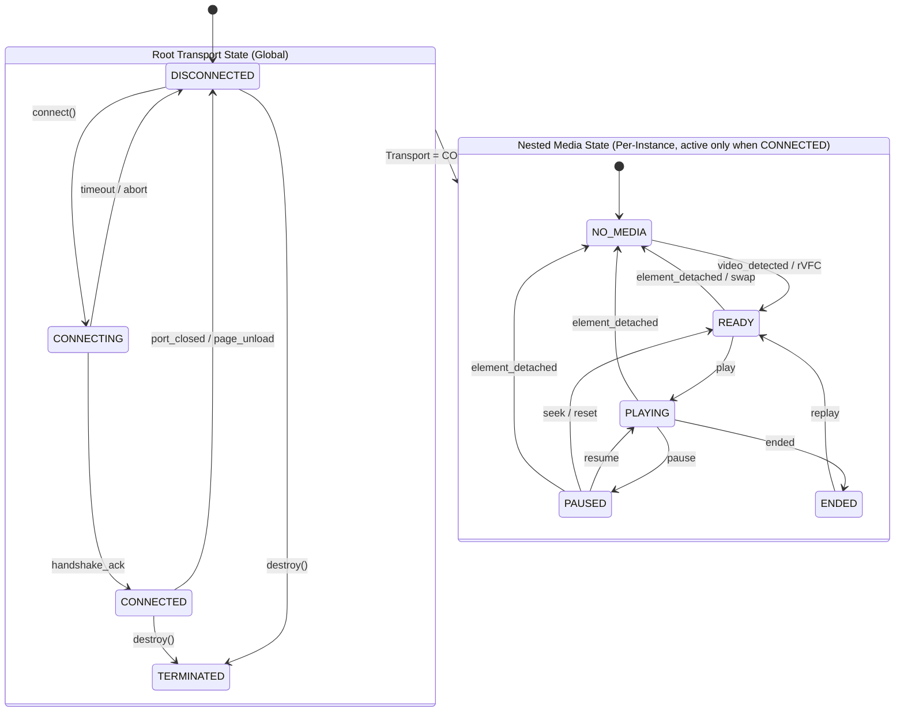
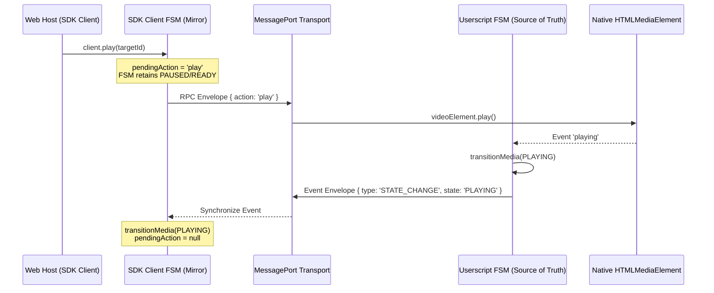

# Architecture Design Document: Zero-Dependency Hierarchical FSM Engine

> **Status:** Architecture Design Document (Approved)  
> **Applies to:** `@sremote/shared`, `@sremote/sdk`, `@sremote/userscript` (v4.0+)  
> **Objective:** Completely eliminate race conditions, ghost states, listener leaks, and timer polling loops during cross-origin media lifecycle management.

---

## 1. Background & Problem Statement

In SRemote versions prior to v4.0:
- **Heuristics & Flag-based State**: Connection and media states were tracked separately using scattered boolean flags (`isReady`, `connected`, `hasMedia`) and continuous `setInterval` polling loops.
- **Race Conditions on Media Swaps**: When an iframe changed video (e.g. Single Page App navigation on YouTube replacing video inside the same `<video>` element or re-mounting), `pause`, `play`, and `loadstart` events fired out of order. This left the client SDK stuck in stale states or conflated physical disconnection (`DISCONNECTED`) with temporary media detachment (`NO_MEDIA`).
- **Non-deterministic State Transitions**: Lack of formal transition rules allowed SDK commands like `play()` to fire before the physical `MessagePort` handshake completed.

---

## 2. Hierarchical State Architecture

The FSM engine is designed around a **Two-Level Hierarchy**:



### 2.1. Level 1: Root Transport State (Global)
Manages the physical transport channel (Window Events, MessagePort, Bridge).
- **`DISCONNECTED`**: No communication channel established.
- **`CONNECTING`**: Handshake negotiation in progress (awaiting announcement or challenge response).
- **`CONNECTED`**: Two-way transport verified and ready to transmit RPC protocol envelopes.
- **`TERMINATED`**: Transport permanently disposed (unmount, destroy).

### 2.2. Level 2: Nested Media State (Per-Instance)
Active only when Root Transport is `CONNECTED`. If Transport transitions to `DISCONNECTED`, Media State automatically resets to `NO_MEDIA`.
- **`NO_MEDIA`**: Transport is connected, but no `<video>`/`<audio>` element is mounted in the frame.
- **`READY`**: Media element is mounted, metadata loaded (`readyState >= 2`), ready to receive commands.
- **`PLAYING`**: Media is actively rendering video frames or audio.
- **`PAUSED`**: Media is currently paused.
- **`ENDED`**: Playback has reached the end of stream.

---

## 3. Synchronization & Topology



### 3.1. Userscript FSM (Single Source of Truth)
The Userscript Iframe Agent holds the definitive authoritative state. It observes the native DOM element via `MutationObserver` and `requestVideoFrameCallback` (rVFC), guaranteeing frame-accurate state transitions with zero polling.

### 3.2. SDK Client FSM (Passive Mirror)
The SDK Client runs a mirror FSM that transitions deterministically upon receiving event envelopes from the transport channel. While an action is in-flight, it sets `pendingAction = 'play'` without preemptively flipping state, preventing UI jitter.

### 3.3. Multi-Instance Topology
- **1 Global Transport FSM**: Governs top-window connectivity with the Userscript host bridge.
- **`Map<instanceId, InstanceMediaFSM>`**: Each iframe/player instance maintains an isolated Media Sub-FSM. Player A can be `PLAYING` while Player B is `PAUSED` or `NO_MEDIA`.

---

## 4. Technical Specification of the FSM Engine (`@sremote/shared`)

The FSM engine is ultra-compact (~80 LoC, zero external dependencies) with robust enterprise guarantees:

### 4.1. Transition Guards (`beforeTransition`)
Enables registration of transition interceptors:
```javascript
fsm.beforeTransition((from, to, context) => {
  // Example: Prevent transitioning to PLAYING if Autoplay Policy rejects gesture
  if (to === MediaState.PLAYING && !context.hasUserGesture && context.isAutoplayBlocked) {
    return false; // Abort transition
  }
  return true;
});
```

### 4.2. State Transition History Buffer & Triggers
Every state transition must provide an explicit trigger defined in `FSM_TRIGGERS`:

```javascript
export const FSM_TRIGGERS = Object.freeze({
  // Transport Triggers
  TRANSPORT_READY_CALL: 'transport:ready_call',
  TRANSPORT_DRIVER_READY: 'transport:driver_ready',
  TRANSPORT_HANDSHAKE_TIMEOUT: 'transport:handshake_timeout',
  TRANSPORT_DISCONNECT: 'transport:disconnect',
  TRANSPORT_TERMINATE: 'transport:terminate',

  // Media Triggers
  MEDIA_MOUNT: 'media:mount',
  MEDIA_UNMOUNT: 'media:unmount',
  MEDIA_PLAYING_EVENT: 'media:playing_event',
  MEDIA_PAUSE_EVENT: 'media:pause_event',
  MEDIA_ENDED_EVENT: 'media:ended_event',
  MEDIA_READY_EVENT: 'media:ready_event',
});
```

Transition signatures:
```javascript
fsm.transitionTransport(nextState, trigger, meta = {});
fsm.transitionMedia(nextState, trigger, meta = {});
```

A circular buffer retains the **10 most recent transitions**:
```javascript
history = [
  { from: 'DISCONNECTED', to: 'CONNECTING', trigger: FSM_TRIGGERS.TRANSPORT_READY_CALL, timestamp: 1726750000100 },
  { from: 'CONNECTING', to: 'CONNECTED', trigger: FSM_TRIGGERS.TRANSPORT_DRIVER_READY, timestamp: 1726750000150 },
  { from: 'NO_MEDIA', to: 'READY', trigger: FSM_TRIGGERS.MEDIA_MOUNT, timestamp: 1726750000200 },
  { from: 'READY', to: 'PLAYING', trigger: FSM_TRIGGERS.MEDIA_PLAYING_EVENT, timestamp: 1726750000500 }
];
```

---

## 5. Safe Action Dispatch Matrix (`canExecute(action)`)

| Current FSM State | Allowed Commands | Blocked / Buffered in Auto-Queue |
| :--- | :--- | :--- |
| **`DISCONNECTED` / `CONNECTING`** | `hello`, `scan`, `on`, `off` | Media commands: `play`, `pause`, `seek`, `volume`... *(Buffered up to 2s in Auto-Queue)* |
| **`CONNECTED` + `NO_MEDIA`** | `list`, `capabilities`, `assign`, `css`, `note` | Playback commands: `play`, `pause`, `seek`, `volume`, `speed`... *(Rejects or awaits media mount)* |
| **`CONNECTED` + `READY`** | All commands, `play`, `seek`, `volume`, `speed`... | None |
| **`CONNECTED` + `PLAYING`** | All commands, `pause`, `seek`, `volume`, `speed`... | None |
| **`CONNECTED` + `PAUSED`** | All commands, `play`, `seek`, `volume`, `speed`... | None |
| **`TERMINATED`** | No commands allowed | All (Throws `InstanceTerminatedError`) |
