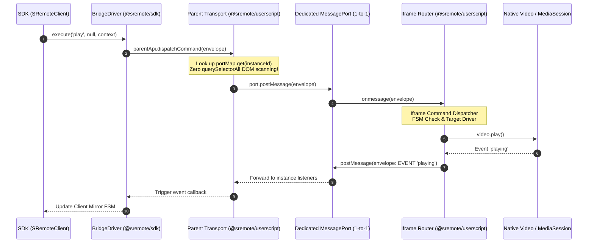

# Architecture Design Document: Micro-Kernel Protocol Envelope & BridgeDriver - Userscript Communication

> **Status:** Architecture Design Document (Approved)  
> **Applies to:** `@sremote/sdk` (BridgeDriver), `@sremote/shared` (Protocol Envelope), `@sremote/userscript` (Parent Transport & Iframe Controller)  
> **Objective:** Replace legacy string postMessages (`sremote:${action}`) with an immutable **Micro-Kernel Protocol Envelope** standard; eliminate recursive DOM scanning (`root.querySelectorAll('iframe')`); and unify two-way driver dispatch (Parent Host ⇄ Iframe Sandbox).

---

## 1. Problem Statement

Cross-context communication between **BridgeDriver** (SDK / Top Window), **Parent Userscript Transport**, and **Iframe Userscript Controller** historically exhibited three architectural bottlenecks:

1. **Ad-hoc String Messaging**:
   - Message packets relied on arbitrary string prefixes like `sremote:${action}` (e.g. `sremote:play`, `sremote:rpc_request`, `sremote:pong`).
   - Arguments and payloads were scattered inconsistently across `data.value`, `data.params`, or `data.payload`.
   - No standardized boundary separated handshakes, RPC requests, and natural media event streams.

2. **Recursive DOM Scanning Blocking Main Thread (`findIframeElementBySource`)**:
   - Upon receiving a window message from a source frame, Parent Transport recursively traversed `root.querySelectorAll('iframe')` to locate the source iframe DOM node.
   - On complex pages with dozens of tracking or ad iframes, continuous DOM traversal triggered layout thrashing, frame drops, and cross-origin security warnings when accessing `contentDocument`.

3. **Monolithic Iframe Command Dispatch**:
   - Inside the iframe's `mediaPort.onmessage`, monolithic nested `if-else` blocks handled `rpc_request`, `ping`, `resendBlobObject`, and `bridge_post` before calling `executeControl`.
   - Lacked FSM integration and the unified `driver.execute(action, payload, context)` contract shared by the SDK.

---

## 2. Communication Standard: Micro-Kernel Protocol Envelope

All packets transmitted across `MessagePort` or `window.postMessage` are packaged into an **Immutable Protocol Envelope** defined at `@sremote/shared`:

```typescript
export interface SRemoteEnvelope<T = any> {
  /** Unique Packet ID (UUID or NanoID) for request / response correlation */
  id: string;

  /** Packet classification */
  type: 'HANDSHAKE' | 'RPC_REQ' | 'RPC_RES' | 'EVENT' | 'HEARTBEAT';

  /** Target action name (e.g. 'play', 'seek', 'volume', 'setCSS') */
  action: string;

  /** Standardized payload */
  payload?: T;

  /** Contextual transmission metadata */
  meta: {
    instanceId?: string;
    source: 'sdk' | 'parent-userscript' | 'iframe';
    timestamp: number;
    passkey?: string | null;
    isProgrammatic?: boolean;
    error?: {
      code: string;
      message: string;
    } | null;
  };
}
```

### Envelope Types:

| Type | Purpose | Direction | Example Action |
| :--- | :--- | :--- | :--- |
| **`HANDSHAKE`** | 3-way handshake negotiation (SYN, SYN-ACK, ACK), `MessagePort` allocation | Iframe ⇄ Parent | `syn`, `syn_ack`, `ack` |
| **`RPC_REQ`** | Command execution request from Host to Iframe | SDK / Parent ➔ Iframe | `play`, `seek`, `volume`, `getMediaInfo` |
| **`RPC_RES`** | Execution result returned from Iframe to Parent/SDK | Iframe ➔ Parent / SDK | `play:res`, `getMediaInfo:res` |
| **`EVENT`** | Natural media events or FSM state change notifications | Iframe ➔ Parent / SDK | `playing`, `pause`, `timeupdate`, `state_change` |
| **`HEARTBEAT`** | Transport liveness probe | Bidirectional | `ping`, `pong` |

---

## 3. End-to-End Dataflow Architecture



---

## 4. Architectural Highlights & Refactoring

### 4.1. Standardized Envelope Module (`@sremote/shared/src/protocol/`)
- `createEnvelope({ type, action, payload, meta })` builds immutable message frames.
- `validateEnvelope(packet)` rejects malformed or unverified payloads.

### 4.2. Promise-Based BridgeDriver (`packages/sdk/src/drivers/bridge.js`)
- Unifies all host dispatch via protocol envelopes:
  ```javascript
  async execute(actionName, payload, context = {}) {
    const envelope = createEnvelope({
      type: 'RPC_REQ',
      action: actionName,
      payload,
      meta: {
        instanceId: context.targetId,
        passkey: context.passkey,
        source: 'sdk',
        timestamp: Date.now()
      }
    });
    return this.sendToHost(envelope);
  }
  ```
- Correlates asynchronous responses via `Map<packetId, { resolve, reject, timer }>`.

### 4.3. Port-to-Instance Direct Indexing (Zero DOM Scanning)
- Parent Transport maps instance IDs directly to source `MessagePort` channels upon `SYN` handshake.
- Command dispatch operates with **O(1)** complexity directly over dedicated channels with 0ms CPU latency.

### 4.4. Iframe Action Router
- Replaces monolithic branching with clean table dispatch:
  ```javascript
  const ACTION_HANDLERS = {
    RPC_REQ: handleRpcRequest,
    HEARTBEAT: handleHeartbeat,
    BRIDGE_POST: handleBridgePost,
  };
  ```
- Verifies FSM guard constraints (`fsm.canExecute(envelope.action)`) before invoking underlying drivers.
