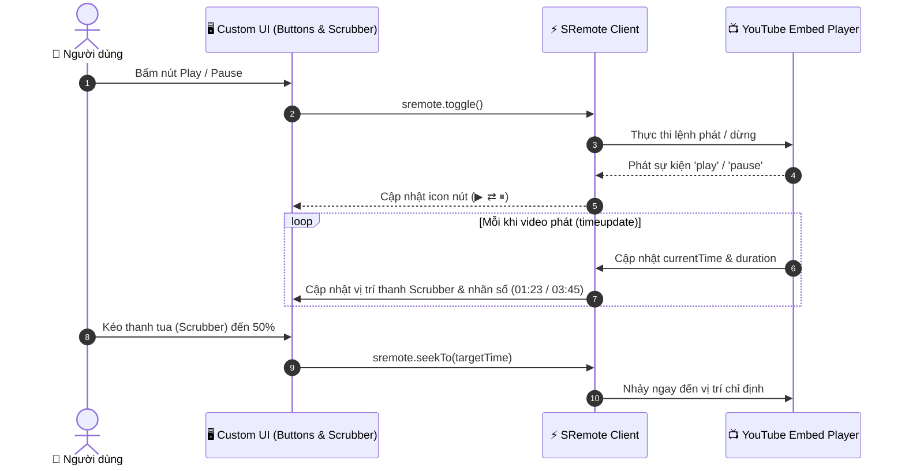

# Blueprint 01: Xây dựng Trình phát Video/Nhạc Tùy biến (Custom Controls)

Bài hướng dẫn này sẽ dẫn dắt bạn từng bước từ A đến Z để tự tay xây dựng một **Custom Video Player** hoàn chỉnh: thay thế toàn bộ giao diện mặc định của YouTube/Vimeo bằng bộ nút điều khiển do chính bạn thiết kế (Play/Pause, Scrubber tua mịn, hiển thị thời gian số, thanh chỉnh âm lượng và bật/tắt tiếng) thông qua **SRemote**.

---

## 1. Bài toán Thực tế & Mục tiêu

Trong các sản phẩm web cao cấp (như nền tảng xem phim trực tuyến, web portfolio nghệ thuật, hoặc trang giới thiệu sản phẩm SaaS), giao diện mặc định của YouTube hay Vimeo thường chứa nhiều logo, nút chia sẻ và thanh điều khiển không đồng bộ với thiết kế tổng thể (Brand Identity) của website.

Mục tiêu của chúng ta là:
- Nhúng video YouTube trong chế độ ẩn thanh điều khiển gốc (`controls: 0`).
- Tự vẽ toàn bộ thanh điều khiển bằng HTML/CSS Flat UI hiện đại.
- Dùng SRemote để đồng bộ trạng thái phát thời gian thực 2 chiều giữa player và giao diện.



---

## 2. Các Bước Triển Khai Step-by-Step

### Bước 1: Chuẩn bị Cấu trúc Giao diện (`index.html`)

Tạo vùng chứa video và thanh điều khiển bên dưới:

```html
<!DOCTYPE html>
<html lang="vi">
<head>
  <meta charset="UTF-8">
  <meta name="viewport" content="width=device-width, initial-scale=1.0">
  <title>Custom Media Player - SRemote Blueprint 01</title>
  <link rel="stylesheet" href="style.css">
</head>
<body>

  <div class="player-card">
    <!-- Khung chứa video YouTube -->
    <div id="video-wrapper" class="video-wrapper"></div>

    <!-- Thanh điều khiển tùy biến -->
    <div class="controls-bar">
      <button id="btn-play-pause" class="ctrl-btn" title="Phát / Dừng">▶</button>
      
      <span id="time-display" class="time-display">00:00 / 00:00</span>

      <!-- Scrubber thanh tiến trình -->
      <div class="slider-wrapper">
        <input type="range" id="seek-bar" class="slider" min="0" max="100" value="0" step="0.1">
      </div>

      <button id="btn-mute" class="ctrl-btn" title="Tắt / Bật tiếng">🔊</button>

      <!-- Thanh chỉnh âm lượng -->
      <input type="range" id="vol-bar" class="slider vol-slider" min="0" max="1" step="0.05" value="1">
    </div>
  </div>

  <script type="module" src="app.js"></script>
</body>
</html>
```

---

### Bước 2: Thiết kế Giao diện Dark Modern (`style.css`)

```css
* {
  box-sizing: border-box;
  margin: 0;
  padding: 0;
}

body {
  background: #0f172a;
  color: #f8fafc;
  font-family: -apple-system, BlinkMacSystemFont, "Segoe UI", Roboto, sans-serif;
  display: flex;
  justify-content: center;
  align-items: center;
  min-height: 100vh;
  padding: 20px;
}

.player-card {
  width: 100%;
  max-width: 760px;
  background: #1e293b;
  border-radius: 12px;
  overflow: hidden;
  box-shadow: 0 10px 25px -5px rgba(0, 0, 0, 0.5), 0 0 0 1px rgba(255, 255, 255, 0.08);
}

.video-wrapper {
  width: 100%;
  aspect-ratio: 16 / 9;
  background: #000;
}

.controls-bar {
  display: flex;
  align-items: center;
  gap: 12px;
  padding: 12px 18px;
  background: #111827;
}

.ctrl-btn {
  background: #334155;
  border: none;
  color: #f8fafc;
  width: 36px;
  height: 36px;
  border-radius: 50%;
  font-size: 14px;
  display: flex;
  align-items: center;
  justify-content: center;
  cursor: pointer;
  transition: all 0.2s;
}

.ctrl-btn:hover {
  background: #0284c7;
  transform: scale(1.05);
}

.time-display {
  font-size: 12px;
  font-variant-numeric: tabular-nums;
  color: #94a3b8;
  white-space: nowrap;
}

.slider-wrapper {
  flex: 1;
  display: flex;
  align-items: center;
}

.slider {
  width: 100%;
  height: 6px;
  border-radius: 3px;
  background: #334155;
  outline: none;
  cursor: pointer;
  accent-color: #38bdf8;
}

.vol-slider {
  width: 70px;
}
```

---

### Bước 3: Viết Logic Điều Khiển Thuần JS (`app.js`)

```javascript
import { sremote } from 'https://cdn.jsdelivr.net/npm/@sremote/sdk/+esm';
import { youtube } from 'https://cdn.jsdelivr.net/npm/@sremote/ready2use/+esm';

// Lấy các phần tử DOM
const btnPlayPause = document.getElementById('btn-play-pause');
const timeDisplay = document.getElementById('time-display');
const seekBar = document.getElementById('seek-bar');
const btnMute = document.getElementById('btn-mute');
const volBar = document.getElementById('vol-bar');

let isUserScrubbing = false;

// Hàm định dạng số giây thành chuỗi mm:ss
function formatTime(seconds) {
  const s = Math.floor(seconds || 0);
  const m = Math.floor(s / 60);
  const remSec = s % 60;
  return `${String(m).padStart(2, '0')}:${String(remSec).padStart(2, '0')}`;
}

// 1. Khởi tạo và gắn YouTube player vào container
await youtube.mount('#video-wrapper', {
  videoId: 'dQw4w9WgXcQ',
  playerVars: {
    controls: 0, // Ẩn giao diện điều khiển gốc của YouTube
    autoplay: 0,
    modestbranding: 1
  }
});

// 2. Lắng nghe sự kiện Play / Pause để đồng bộ Icon nút bấm
sremote.on('play', () => {
  btnPlayPause.textContent = '⏸';
  btnPlayPause.title = 'Tạm dừng';
});

sremote.on('pause', () => {
  btnPlayPause.textContent = '▶';
  btnPlayPause.title = 'Phát';
});

// 3. Cập nhật tiến trình thời gian thực
sremote.on('timeupdate', ({ state }) => {
  const current = state.currentTime || 0;
  const duration = state.duration || 1;

  timeDisplay.textContent = `${formatTime(current)} / ${formatTime(duration)}`;

  // Chỉ cập nhật thanh slider nếu người dùng không đang giữ chuột kéo (scrubbing)
  if (!isUserScrubbing) {
    seekBar.value = ((current / duration) * 100).toFixed(2);
  }
});

// 4. Xử lý sự kiện bấm nút Play / Pause
btnPlayPause.addEventListener('click', async () => {
  await sremote.toggle();
});

// 5. Xử lý thao tác tua trên thanh Scrubber
seekBar.addEventListener('mousedown', () => { isUserScrubbing = true; });
seekBar.addEventListener('touchstart', () => { isUserScrubbing = true; });

seekBar.addEventListener('input', async () => {
  const state = await sremote.getState();
  const duration = state.duration || 100;
  const targetTime = (parseFloat(seekBar.value) / 100) * duration;
  timeDisplay.textContent = `${formatTime(targetTime)} / ${formatTime(duration)}`;
});

seekBar.addEventListener('change', async () => {
  const state = await sremote.getState();
  const duration = state.duration || 100;
  const targetTime = (parseFloat(seekBar.value) / 100) * duration;
  await sremote.seekTo(targetTime);
  isUserScrubbing = false;
});

// 6. Xử lý âm lượng và tắt tiếng (Mute)
btnMute.addEventListener('click', async () => {
  await sremote.toggleMuted();
  const isMuted = (await sremote.getState()).muted;
  btnMute.textContent = isMuted ? '🔇' : '🔊';
});

volBar.addEventListener('input', async () => {
  const volume = parseFloat(volBar.value);
  await sremote.volume(volume);
  if (volume === 0) {
    btnMute.textContent = '🔇';
  } else {
    btnMute.textContent = '🔊';
  }
});
```

---

## 3. Deep Dive: Giải thích Kỹ thuật Cốt lõi

1. **Biến cờ `isUserScrubbing` (Chống giật thanh trượt)**:  
   Khi người dùng bấm giữ chuột để kéo thanh tua, nếu cứ nhận sự kiện `timeupdate` liên tục từ player thì giá trị của thanh trượt sẽ bị giật qua lại giữa vị trí video đang phát và vị trí tay người dùng. Biến cờ này chỉ cho phép cập nhật thanh trượt từ `timeupdate` khi người dùng đã nhả chuột (`change`).
2. **`formatTime` với `padStart`**:  
   Đảm bảo đồng hồ số luôn hiển thị đủ 2 chữ số (ví dụ `02:05` thay vì `2:5`), tránh làm xô lệch layout của thanh điều khiển khi độ rộng text thay đổi.
3. **`sremote.toggle()`**:  
   SRemote tự động kiểm tra trạng thái hiện tại (`paused` hay `playing`) để kích hoạt hành động ngược lại mà bạn không cần phải tự viết câu lệnh `if...else`.

---

## 4. Xử lý Tình huống Biên & Tối ưu UX (Edge Cases)

- **Trình duyệt chặn phát tự động (Autoplay Policy)**:  
  Nếu bạn bật `autoplay: 1`, các trình duyệt hiện đại như Chrome/Safari sẽ từ chối phát nếu video có bật tiếng. Giải pháp: hãy gọi `await sremote.mute()` trước khi gọi `play()`.
- **Khi video kết thúc (`ended`)**:  
  Bạn có thể lắng nghe `sremote.on('ended', () => { btnPlayPause.textContent = '▶'; })` để đưa nút về trạng thái sẵn sàng phát lại từ đầu.
- **Tối ưu chạm trên màn hình cảm ứng di động**:  
  Cần bắt cả sự kiện `touchstart` và `touchend` cho thanh slider như đoạn mã ở Bước 3 để người dùng điện thoại có thể vuốt tua mượt mà.
