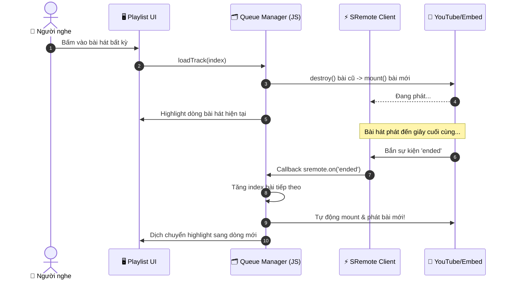

# Tutorial 02: Xây dựng Trình Phát Hàng Đợi Playlist & Podcast (Continuous Playback)

Trong các ứng dụng nghe nhạc và podcast hiện đại (như Spotify, Apple Podcasts hay SoundCloud), trải nghiệm nghe liên tục (**Continuous Playback**) là cốt lõi: Khi một bài hát hoặc tập podcast kết thúc, hệ thống phải tự động nạp tập tiếp theo, highlight vị trí tương ứng trên danh sách và tiếp tục phát mượt mà mà không cần người dùng thao tác.

Trong bài hướng dẫn này, chúng ta sẽ xây dựng tính năng đó từ con số 0 với **SRemote**.

> [!TIP]
> **Trải nghiệm ngay bản demo hoạt động thực tế**: Mở [🚀 Live Demo: 02-playlist-queue](../../../../demo/apps/02-playlist-queue/index.html) để tương tác trực tiếp trên trình duyệt.

---

## 🎯 Mục tiêu Bạn Sẽ Đạt Được

Sau bài học này, bạn sẽ nắm vững:
1. Cách tổ chức cấu trúc dữ liệu cho một hàng đợi phát nhạc (Queue State).
2. Xử lý **Vòng đời Player (Lifecycle & Memory Leak)**: Hủy bỏ instance cũ an toàn bằng `destroy()` trước khi mount bài mới.
3. Bắt sự kiện kết thúc bài `ended` từ SRemote để tự động chuyển bài kế tiếp.
4. Cơ chế điều hướng Next / Previous với toán tử modulo tuần hoàn.
5. Cách đối phó với chính sách chặn **Autoplay Policy** khắt khe của trình duyệt.



---

## Bước 1: Khởi Tạo Cấu Trúc Dữ Liệu & Giao Diện Playlist

Hãy tạo file `index.html`. Chúng ta thiết kế một giao diện gồm 3 khu vực:
1. Khung hiển thị thông tin bài đang phát (Header).
2. Các nút điều hướng cơ bản: `⏮ Bài trước`, `▶ Phát/Dừng`, `Bài tiếp ⏭`.
3. Danh sách hàng đợi các bài hát (`<ul id="track-list">`).

```html
<!DOCTYPE html>
<html lang="vi">
<head>
  <meta charset="UTF-8">
  <meta name="viewport" content="width=device-width, initial-scale=1.0">
  <title>Playlist & Podcast Queue - SRemote Tutorial 02</title>
  <link rel="stylesheet" href="style.css">
</head>
<body>

  <div class="podcast-app">
    <!-- 1. Vùng hiển thị player & Metadata bài đang phát -->
    <div class="player-header">
      <div id="media-embed-slot" class="media-embed-slot"></div>
      <div class="now-playing-info">
        <span class="badge">Đang phát</span>
        <h2 id="current-title" class="track-title">Đang nạp dữ liệu...</h2>
        <p id="current-artist" class="track-artist">---</p>
      </div>
    </div>

    <!-- 2. Thanh điều hướng nhanh -->
    <div class="nav-controls">
      <button id="btn-prev" class="ctrl-btn">⏮ Trước</button>
      <button id="btn-toggle-play" class="ctrl-btn btn-primary">▶ Phát</button>
      <button id="btn-next" class="ctrl-btn">Sau ⏭</button>
    </div>

    <!-- 3. Danh sách bài hát trong Queue -->
    <div class="playlist-section">
      <h3 class="section-title">Danh sách bài hát</h3>
      <ul id="track-list" class="track-list"></ul>
    </div>
  </div>

  <script type="module" src="app.js"></script>
</body>
</html>
```

Và định dạng giao diện bằng file `style.css`:

```css
* {
  box-sizing: border-box;
  margin: 0;
  padding: 0;
}

body {
  background: #090d16;
  color: #f1f5f9;
  font-family: -apple-system, BlinkMacSystemFont, "Segoe UI", Roboto, sans-serif;
  padding: 40px 16px;
  display: flex;
  justify-content: center;
}

.podcast-app {
  width: 100%;
  max-width: 640px;
  background: #111827;
  border-radius: 14px;
  border: 1px solid rgba(255, 255, 255, 0.08);
  overflow: hidden;
  box-shadow: 0 20px 30px -10px rgba(0, 0, 0, 0.7);
}

.player-header {
  padding: 20px;
  background: linear-gradient(180deg, #1f2937, #111827);
  border-bottom: 1px solid rgba(255, 255, 255, 0.06);
}

.media-embed-slot {
  width: 100%;
  aspect-ratio: 16 / 9;
  background: #000;
  border-radius: 8px;
  overflow: hidden;
  margin-bottom: 16px;
}

.badge {
  display: inline-block;
  padding: 3px 8px;
  border-radius: 4px;
  background: #0284c7;
  color: #fff;
  font-size: 11px;
  font-weight: 600;
  text-transform: uppercase;
  margin-bottom: 6px;
}

.track-title {
  font-size: 18px;
  font-weight: 700;
  color: #f8fafc;
  margin-bottom: 4px;
}

.track-artist {
  font-size: 13.5px;
  color: #94a3b8;
}

.nav-controls {
  display: flex;
  justify-content: center;
  align-items: center;
  gap: 12px;
  padding: 14px 20px;
  background: #0f172a;
  border-bottom: 1px solid rgba(255, 255, 255, 0.06);
}

.ctrl-btn {
  padding: 8px 18px;
  background: #1e293b;
  border: 1px solid rgba(255, 255, 255, 0.1);
  color: #f8fafc;
  border-radius: 6px;
  cursor: pointer;
  font-size: 13px;
  font-weight: 500;
  transition: all 0.2s;
}

.ctrl-btn:hover {
  background: #334155;
}

.btn-primary {
  background: #0284c7;
  border-color: #38bdf8;
  color: #fff;
  font-weight: 600;
}

.btn-primary:hover {
  background: #0369a1;
}

.playlist-section {
  padding: 20px;
}

.section-title {
  font-size: 13px;
  color: #94a3b8;
  text-transform: uppercase;
  letter-spacing: 0.5px;
  margin-bottom: 12px;
}

.track-list {
  list-style: none;
}

.track-item {
  display: flex;
  align-items: center;
  justify-content: space-between;
  padding: 12px 14px;
  border-radius: 8px;
  margin-bottom: 6px;
  cursor: pointer;
  transition: all 0.2s;
  background: rgba(255, 255, 255, 0.02);
  border: 1px solid transparent;
}

.track-item:hover {
  background: rgba(255, 255, 255, 0.06);
}

.track-item.active {
  background: rgba(2, 132, 199, 0.15);
  border-color: rgba(56, 189, 248, 0.4);
}

.track-item-title {
  font-size: 14px;
  font-weight: 600;
  color: #f8fafc;
}

.track-item.active .track-item-title {
  color: #38bdf8;
}

.track-item-duration {
  font-size: 12px;
  color: #64748b;
  font-variant-numeric: tabular-nums;
}
```

---

## Bước 2: Thiết Lập Danh Sách Dữ Liệu & Render Tracklist

Mở file `app.js`. Chúng ta định nghĩa mảng `playlist` chứa danh sách các bài hát/podcast và hàm render danh sách ra DOM:

```javascript
import { sremote } from 'https://cdn.jsdelivr.net/npm/@sremote/sdk/+esm';
import { youtube } from 'https://cdn.jsdelivr.net/npm/@sremote/ready2use/+esm';

// 1. Dữ liệu Playlist mẫu
const playlist = [
  { id: 'jfKfPfyJRdk', title: 'Tập 1: Lofi Beats to Relax / Study to', artist: 'Lofi Girl', duration: 'Live' },
  { id: 'dQw4w9WgXcQ', title: 'Tập 2: Never Gonna Give You Up', artist: 'Rick Astley', duration: '03:32' },
  { id: '4xDzrJKXOOY', title: 'Tập 3: Synthwave Chill Radio', artist: 'Lofi Records', duration: 'Live' }
];

let currentIndex = 0;
let currentMountHandle = null;

// Lấy DOM elements
const currentTitleEl = document.getElementById('current-title');
const currentArtistEl = document.getElementById('current-artist');
const trackListEl = document.getElementById('track-list');
const btnTogglePlay = document.getElementById('btn-toggle-play');
const btnNext = document.getElementById('btn-next');
const btnPrev = document.getElementById('btn-prev');

// 2. Hàm render danh sách ra UI
function renderTracklist() {
  trackListEl.innerHTML = '';
  playlist.forEach((track, index) => {
    const li = document.createElement('li');
    li.className = `track-item ${index === currentIndex ? 'active' : ''}`;
    li.innerHTML = `
      <div>
        <div class="track-item-title">${index + 1}. ${track.title}</div>
        <div style="font-size: 12px; color: #94a3b8;">${track.artist}</div>
      </div>
      <div class="track-item-duration">${track.duration}</div>
    `;

    // Nhấp vào bài bất kỳ trong danh sách -> phát bài đó
    li.addEventListener('click', () => {
      if (currentIndex !== index) {
        loadTrack(index, true);
      }
    });

    trackListEl.appendChild(li);
  });
}
```

---

## Bước 3: Nạp Bài Hát & Xử Lý Vòng Đời Tránh Rò Rỉ Bộ Nhớ (`destroy()`)

Khi đổi từ bài 1 sang bài 2, nhiều lập trình viên chỉ đơn giản là gọi lại hàm `mount()` đè lên DOM.  
> [!CAUTION]
> Nếu không dọn dẹp player cũ, các bộ lắng nghe sự kiện `postMessage` ngầm của iframe cũ vẫn còn chạy, gây xung đột sự kiện và rò rỉ RAM nghiêm trọng!

Hàm `mount` của SRemote trả về một đối tượng chứa phương thức `.destroy()`. Hãy luôn gọi nó trước khi mount bài mới:

```javascript
async function loadTrack(index, autoPlay = true) {
  currentIndex = index;
  const track = playlist[currentIndex];

  // Cập nhật thông tin trên header & highlight tracklist
  currentTitleEl.textContent = track.title;
  currentArtistEl.textContent = track.artist;
  renderTracklist();

  // 1. DỌN DẸP INSTANCE CŨ TRƯỚC KHI TẠO MỚI (Tránh memory leak)
  if (currentMountHandle) {
    console.log('🧹 Đang hủy player cũ...');
    currentMountHandle.destroy();
    currentMountHandle = null;
  }

  // 2. Khởi tạo player mới
  console.log(`🎵 Đang nạp track [${index + 1}]: ${track.title}`);
  currentMountHandle = await youtube.mount('#media-embed-slot', {
    videoId: track.id,
    playerVars: {
      autoplay: autoPlay ? 1 : 0,
      controls: 1
    }
  });
}
```

---

## Bước 4: Lập Trình Tự Động Chuyển Bài với Sự Kiện `ended`

Đây chính là chìa khóa của **Continuous Playback**:
- SRemote phát ra sự kiện `ended` khi bài hát phát tới giây cuối cùng.
- Khi nhận sự kiện, ta tăng `currentIndex` lên 1 và tự động gọi `loadTrack`.

```javascript
// Lắng nghe sự kiện kết thúc bài hát từ SRemote
sremote.on('ended', () => {
  console.log('🎉 Bài hiện tại đã hết! Đang tự động nạp bài kế tiếp...');
  const nextIndex = (currentIndex + 1) % playlist.length;
  loadTrack(nextIndex, true); // true = tự động phát
});

// Đồng bộ trạng thái nút Play / Pause
sremote.on('play', () => { btnTogglePlay.textContent = '⏸ Tạm dừng'; });
sremote.on('pause', () => { btnTogglePlay.textContent = '▶ Tiếp tục'; });
```

---

## Bước 5: Lập Trình Nút Next, Previous & Bẫy Autoplay Policy

### 1. Thuật toán Tuần Hoàn với Toán Tử Modulo (`%`)
- Đi tới bài tiếp theo: `(currentIndex + 1) % playlist.length`.
- Lùi về bài trước: `(currentIndex - 1 + playlist.length) % playlist.length` (cộng thêm `length` để tránh ra số âm).

```javascript
btnTogglePlay.addEventListener('click', async () => {
  await sremote.toggle();
});

btnNext.addEventListener('click', () => {
  const nextIndex = (currentIndex + 1) % playlist.length;
  loadTrack(nextIndex, true);
});

btnPrev.addEventListener('click', () => {
  const prevIndex = (currentIndex - 1 + playlist.length) % playlist.length;
  loadTrack(prevIndex, true);
});
```

### 2. Bẫy Autoplay của Trình Duyệt:
- Khi người dùng vừa tải trang web, trình duyệt **cấm tự động phát có âm thanh** nếu chưa có tương tác (User Gesture).
- Vì vậy, bài hát đầu tiên ta truyền `autoPlay = false`:
```javascript
// Khởi tạo trang: Nạp bài đầu tiên nhưng KHÔNG tự động phát
loadTrack(0, false);
```
- Khi người dùng đã chủ động bấm nút "▶ Phát" bài đầu tiên, trình duyệt đã ghi nhận hành động, và các bài chuyển tự động tiếp theo sẽ được phép tự động phát thoải mái!

---

## Bước 6: Toàn Bộ Mã Nguồn Hoàn Chỉnh (`app.js`)

```javascript
import { sremote } from 'https://cdn.jsdelivr.net/npm/@sremote/sdk/+esm';
import { youtube } from 'https://cdn.jsdelivr.net/npm/@sremote/ready2use/+esm';

const playlist = [
  { id: 'jfKfPfyJRdk', title: 'Tập 1: Lofi Beats to Relax / Study to', artist: 'Lofi Girl', duration: 'Live' },
  { id: 'dQw4w9WgXcQ', title: 'Tập 2: Never Gonna Give You Up', artist: 'Rick Astley', duration: '03:32' },
  { id: '4xDzrJKXOOY', title: 'Tập 3: Synthwave Chill Radio', artist: 'Lofi Records', duration: 'Live' }
];

let currentIndex = 0;
let currentMountHandle = null;

const currentTitleEl = document.getElementById('current-title');
const currentArtistEl = document.getElementById('current-artist');
const trackListEl = document.getElementById('track-list');
const btnTogglePlay = document.getElementById('btn-toggle-play');
const btnNext = document.getElementById('btn-next');
const btnPrev = document.getElementById('btn-prev');

function renderTracklist() {
  trackListEl.innerHTML = '';
  playlist.forEach((track, index) => {
    const li = document.createElement('li');
    li.className = `track-item ${index === currentIndex ? 'active' : ''}`;
    li.innerHTML = `
      <div>
        <div class="track-item-title">${index + 1}. ${track.title}</div>
        <div style="font-size: 12px; color: #94a3b8;">${track.artist}</div>
      </div>
      <div class="track-item-duration">${track.duration}</div>
    `;

    li.addEventListener('click', () => {
      if (currentIndex !== index) {
        loadTrack(index, true);
      }
    });

    trackListEl.appendChild(li);
  });
}

async function loadTrack(index, autoPlay = true) {
  currentIndex = index;
  const track = playlist[currentIndex];

  currentTitleEl.textContent = track.title;
  currentArtistEl.textContent = track.artist;
  renderTracklist();

  if (currentMountHandle) {
    currentMountHandle.destroy();
  }

  currentMountHandle = await youtube.mount('#media-embed-slot', {
    videoId: track.id,
    playerVars: {
      autoplay: autoPlay ? 1 : 0,
      controls: 1
    }
  });
}

// Lắng nghe sự kiện kết thúc từ SRemote
sremote.on('ended', () => {
  const nextIndex = (currentIndex + 1) % playlist.length;
  loadTrack(nextIndex, true);
});

sremote.on('play', () => { btnTogglePlay.textContent = '⏸ Tạm dừng'; });
sremote.on('pause', () => { btnTogglePlay.textContent = '▶ Tiếp tục'; });

btnTogglePlay.addEventListener('click', () => sremote.toggle());

btnNext.addEventListener('click', () => {
  const nextIndex = (currentIndex + 1) % playlist.length;
  loadTrack(nextIndex, true);
});

btnPrev.addEventListener('click', () => {
  const prevIndex = (currentIndex - 1 + playlist.length) % playlist.length;
  loadTrack(prevIndex, true);
});

// Khởi chạy
loadTrack(0, false);
```

---

## 💡 Bài Tập Thử Thách Mở Rộng

1. **Shuffle (Trộn bài ngẫu nhiên)**: Thêm nút 🔀 Shuffle để chọn ngẫu nhiên một bài trong danh sách thay vì chỉ số tuần tự `index + 1`.
2. **Repeat One (Lặp lại một bài)**: Thêm nút 🔂 để khi nhận sự kiện `ended`, player sẽ tua lại từ đầu `sremote.seekTo(0)` và phát lại chính bài đó thay vì chuyển bài mới.
