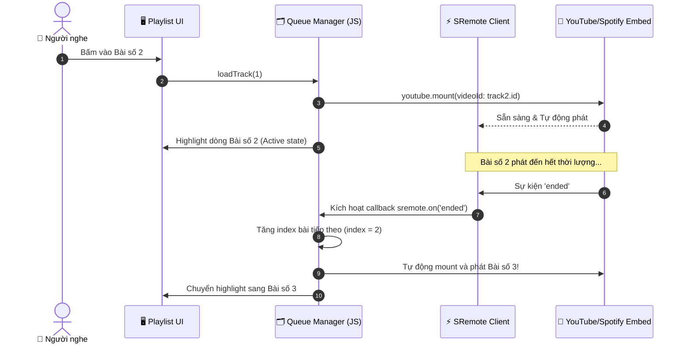

# Blueprint 02: Quản lý Danh sách phát & Hàng đợi Podcast (Playlist Queue)

Bài hướng dẫn này sẽ dẫn dắt bạn xây dựng một ứng dụng nghe nhạc / podcast hoàn chỉnh có **danh sách bài hát (Tracklist)**, hiển thị track đang phát, hỗ trợ chuyển bài thủ công (Next / Previous) và **tự động chuyển sang bài tiếp theo khi bài hiện tại kết thúc** thông qua **SRemote**.

---

## 1. Bài toán Thực tế & Mục tiêu

Khi xây dựng các web app âm nhạc (như Spotify web clone, audio course, hoặc podcast hub), một trải nghiệm không thể thiếu là:
- Người dùng nghe hết một tập podcast hoặc bài hát thì bài tiếp theo phải **tự động nạp và phát liền mạch (Continuous Playback)**.
- Giao diện danh sách bài hát (Playlist) phải tự động đánh dấu (highlight) bài đang được phát.
- Người dùng có thể nhấp vào bất kỳ bài nào trong danh sách để phát ngay, hoặc bấm nút Next / Prev.



---

## 2. Mã Nguồn Đầy Đủ (Full Working Project)

### Bước 1: Giao diện Playlist (`index.html`)

```html
<!DOCTYPE html>
<html lang="vi">
<head>
  <meta charset="UTF-8">
  <meta name="viewport" content="width=device-width, initial-scale=1.0">
  <title>Playlist & Podcast Queue - SRemote Blueprint 02</title>
  <link rel="stylesheet" href="style.css">
</head>
<body>

  <div class="podcast-app">
    <!-- Khung phát media ẩn hoặc thu nhỏ -->
    <div class="player-header">
      <div id="media-embed-slot" class="media-embed-slot"></div>
      <div class="now-playing-info">
        <span class="badge">Đang phát</span>
        <h2 id="current-title" class="track-title">Đang nạp danh sách...</h2>
        <p id="current-artist" class="track-artist">---</p>
      </div>
    </div>

    <!-- Thanh điều khiển điều hướng -->
    <div class="nav-controls">
      <button id="btn-prev" class="ctrl-btn" title="Bài trước">⏮ Bài trước</button>
      <button id="btn-toggle-play" class="ctrl-btn btn-primary" title="Phát / Dừng">▶ Phát</button>
      <button id="btn-next" class="ctrl-btn" title="Bài tiếp theo">Bài tiếp theo ⏭</button>
    </div>

    <!-- Danh sách hàng đợi bài hát (Tracklist) -->
    <div class="playlist-section">
      <h3 class="section-title">Hàng đợi phát (Queue)</h3>
      <ul id="track-list" class="track-list"></ul>
    </div>
  </div>

  <script type="module" src="app.js"></script>
</body>
</html>
```

---

### Bước 2: Thiết kế Giao diện Flat Dark (`style.css`)

```css
* {
  box-sizing: border-box;
  margin: 0;
  padding: 0;
}

body {
  background: #090d16;
  color: #f1f5f9;
  font-family: -apple-system, BlinkMacSystemFont, "Segoe UI", Roboto, sans-serif;
  padding: 30px 16px;
  display: flex;
  justify-content: center;
}

.podcast-app {
  width: 100%;
  max-width: 680px;
  background: #111827;
  border-radius: 14px;
  border: 1px solid rgba(255, 255, 255, 0.08);
  overflow: hidden;
  box-shadow: 0 20px 30px -10px rgba(0, 0, 0, 0.7);
}

.player-header {
  padding: 20px;
  background: linear-gradient(180deg, #1f2937, #111827);
  border-bottom: 1px solid rgba(255, 255, 255, 0.06);
}

.media-embed-slot {
  width: 100%;
  aspect-ratio: 16 / 9;
  background: #000;
  border-radius: 8px;
  overflow: hidden;
  margin-bottom: 16px;
}

.badge {
  display: inline-block;
  padding: 3px 8px;
  border-radius: 4px;
  background: #0284c7;
  color: #fff;
  font-size: 11px;
  font-weight: 600;
  text-transform: uppercase;
  margin-bottom: 6px;
}

.track-title {
  font-size: 18px;
  font-weight: 700;
  color: #f8fafc;
  margin-bottom: 4px;
}

.track-artist {
  font-size: 13.5px;
  color: #94a3b8;
}

.nav-controls {
  display: flex;
  justify-content: center;
  align-items: center;
  gap: 12px;
  padding: 16px 20px;
  background: #0f172a;
  border-bottom: 1px solid rgba(255, 255, 255, 0.06);
}

.ctrl-btn {
  padding: 8px 16px;
  background: #1e293b;
  border: 1px solid rgba(255, 255, 255, 0.1);
  color: #f8fafc;
  border-radius: 6px;
  cursor: pointer;
  font-size: 13px;
  font-weight: 500;
  transition: all 0.2s;
}

.ctrl-btn:hover {
  background: #334155;
}

.btn-primary {
  background: #0284c7;
  border-color: #38bdf8;
  color: #fff;
  font-weight: 600;
}

.btn-primary:hover {
  background: #0369a1;
}

.playlist-section {
  padding: 20px;
}

.section-title {
  font-size: 14px;
  color: #94a3b8;
  text-transform: uppercase;
  letter-spacing: 0.5px;
  margin-bottom: 12px;
}

.track-list {
  list-style: none;
}

.track-item {
  display: flex;
  align-items: center;
  justify-content: space-between;
  padding: 12px 14px;
  border-radius: 8px;
  margin-bottom: 6px;
  cursor: pointer;
  transition: all 0.2s;
  background: rgba(255, 255, 255, 0.02);
  border: 1px solid transparent;
}

.track-item:hover {
  background: rgba(255, 255, 255, 0.06);
}

.track-item.active {
  background: rgba(2, 132, 199, 0.15);
  border-color: rgba(56, 189, 248, 0.4);
}

.track-item-title {
  font-size: 14px;
  font-weight: 600;
  color: #f8fafc;
}

.track-item.active .track-item-title {
  color: #38bdf8;
}

.track-item-duration {
  font-size: 12px;
  color: #64748b;
  font-variant-numeric: tabular-nums;
}
```

---

### Bước 3: Logic Quản lý Hàng đợi & Chuyển bài (`app.js`)

```javascript
import { sremote } from 'https://cdn.jsdelivr.net/npm/@sremote/sdk/+esm';
import { youtube } from 'https://cdn.jsdelivr.net/npm/@sremote/ready2use/+esm';

// Danh sách phát mẫu (Tracklist)
const playlist = [
  { id: 'jfKfPfyJRdk', title: 'Tập 1: Lofi Beats to Relax / Study to', artist: 'Lofi Girl', duration: 'Live' },
  { id: 'dQw4w9WgXcQ', title: 'Tập 2: Never Gonna Give You Up', artist: 'Rick Astley', duration: '03:32' },
  { id: '4xDzrJKXOOY', title: 'Tập 3: Synthwave Chill Radio', artist: 'Lofi Records', duration: 'Live' }
];

let currentIndex = 0;
let currentMountHandle = null;

// Lấy các phần tử DOM
const currentTitleEl = document.getElementById('current-title');
const currentArtistEl = document.getElementById('current-artist');
const trackListEl = document.getElementById('track-list');
const btnTogglePlay = document.getElementById('btn-toggle-play');
const btnNext = document.getElementById('btn-next');
const btnPrev = document.getElementById('btn-prev');

// 1. Render danh sách các bài hát trong Queue
function renderTracklist() {
  trackListEl.innerHTML = '';
  playlist.forEach((track, index) => {
    const li = document.createElement('li');
    li.className = `track-item ${index === currentIndex ? 'active' : ''}`;
    li.innerHTML = `
      <div>
        <div class="track-item-title">${index + 1}. ${track.title}</div>
        <div style="font-size: 12px; color: #94a3b8;">${track.artist}</div>
      </div>
      <div class="track-item-duration">${track.duration}</div>
    `;

    // Nhấp vào bài bất kỳ trong danh sách -> phát ngay bài đó
    li.addEventListener('click', () => {
      if (currentIndex !== index) {
        loadTrack(index, true);
      }
    });

    trackListEl.appendChild(li);
  });
}

// 2. Hàm nạp và phát một bài hát cụ thể theo vị trí Index
async function loadTrack(index, autoPlay = true) {
  currentIndex = index;
  const track = playlist[currentIndex];

  // Cập nhật thông tin giao diện
  currentTitleEl.textContent = track.title;
  currentArtistEl.textContent = track.artist;
  renderTracklist();

  // Hủy instance cũ trước khi mount bài mới để giải phóng bộ nhớ
  if (currentMountHandle) {
    currentMountHandle.destroy();
  }

  // Mount player mới
  currentMountHandle = await youtube.mount('#media-embed-slot', {
    videoId: track.id,
    playerVars: {
      autoplay: autoPlay ? 1 : 0,
      controls: 1
    }
  });
}

// 3. Tự động chuyển bài khi kết thúc (Sự kiện 'ended')
sremote.on('ended', () => {
  console.log('✅ Bài hát kết thúc. Đang tự động chuyển bài tiếp theo...');
  const nextIndex = (currentIndex + 1) % playlist.length;
  loadTrack(nextIndex, true);
});

// Đồng bộ trạng thái nút Play / Pause
sremote.on('play', () => { btnTogglePlay.textContent = '⏸ Tạm dừng'; });
sremote.on('pause', () => { btnTogglePlay.textContent = '▶ Tiếp tục'; });

// 4. Xử lý các nút điều hướng
btnTogglePlay.addEventListener('click', async () => {
  await sremote.toggle();
});

btnNext.addEventListener('click', () => {
  const nextIndex = (currentIndex + 1) % playlist.length;
  loadTrack(nextIndex, true);
});

btnPrev.addEventListener('click', () => {
  const prevIndex = (currentIndex - 1 + playlist.length) % playlist.length;
  loadTrack(prevIndex, true);
});

// Nạp bài đầu tiên khi vào trang
loadTrack(0, false);
```

---

## 3. Deep Dive: Giải thích Kỹ thuật

1. **`currentMountHandle.destroy()` trước khi mount bài mới**:  
   Khi đổi video YouTube trong cùng một container bằng cách nạp lại thẻ iframe, nếu không gọi hàm `.destroy()` do SRemote trả về thì các trình lắng nghe sự kiện của video cũ vẫn tồn tại ngầm trong bộ nhớ (Event Listener Leak). Hàm `destroy()` sẽ gỡ sạch toàn bộ listeners và dọn dẹp DOM an toàn.
2. **Xử lý vòng lặp danh sách tuần hoàn**:  
   Sử dụng toán tử modulo `% playlist.length` giúp chỉ mục bài hát luôn hợp lệ:
   - Bài cuối cùng Next ➔ quay về bài 0.
   - Bài đầu tiên Prev ➔ nhảy về bài cuối `(index - 1 + length) % length`.

---

## 4. Xử lý Tình huống Biên & Tối ưu UX

- **Chặn Autoplay khi chuyển bài**:  
  Sau khi người dùng đã chủ động bấm Play bài đầu tiên (đã có user-gesture), trình duyệt sẽ cho phép các bài tiếp theo tự động phát có tiếng mà không bị chặn.
- **Tập stream trực tiếp (Livestream duration = Live)**:  
  Các video livestream (như Lofi Girl) sẽ không bao giờ phát ra sự kiện `ended`. Bạn có thể cung cấp thêm nút bỏ qua tập livestream nếu cần.
