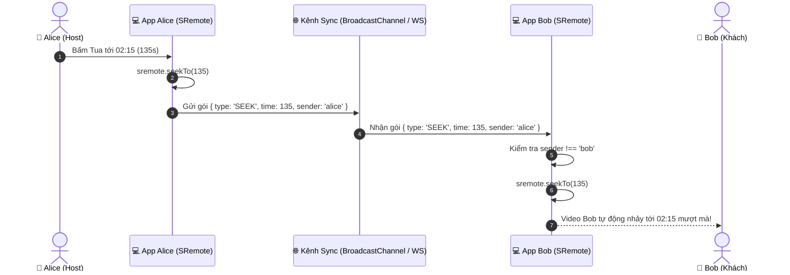

# Blueprint 03: Phòng Xem Phim Chung (WatchParty / SyncTheater)

Bài hướng dẫn này sẽ hướng dẫn bạn xây dựng hoàn chỉnh tính năng **Phòng xem phim chung (WatchParty)**: đồng bộ trạng thái phát (`play`), tạm dừng (`pause`) và tua (`seek`) giữa nhiều người xem theo thời gian thực, đồng thời áp dụng cơ chế **bù trừ độ lệch thời gian (Drift Compensation)** để tất cả mọi người đều xem cùng một khung hình.

---

## 1. Bài toán Thực tế & Mục tiêu

Khi xây dựng các tính năng xem phim hoặc nghe nhạc cùng bạn bè từ xa:
- Nếu một người bấm tạm dừng (để đi lấy nước), tất cả người xem trong phòng đều phải dừng lại.
- Nếu người chủ phòng (Host) tua tới phút 10:00, tất cả thành viên khác phải nhảy ngay tới phút 10:00.
- **Thách thức lớn nhất**: Tránh vòng lặp phản hồi vô tận (Echo Loop). Khi A gửi lệnh Pause đến B, máy B nhận lệnh Pause rồi lại phát tiếp một tín hiệu Pause ngược lại cho A! SRemote và cờ `isBroadcasting` sẽ giải quyết triệt để vấn đề này.



---

## 2. Mã Nguồn Đầy Đủ (Full Working Project)

### Bước 1: Giao diện Phòng WatchParty (`index.html`)

```html
<!DOCTYPE html>
<html lang="vi">
<head>
  <meta charset="UTF-8">
  <meta name="viewport" content="width=device-width, initial-scale=1.0">
  <title>WatchParty SyncTheater - SRemote Blueprint 03</title>
  <link rel="stylesheet" href="style.css">
</head>
<body>

  <div class="theater-container">
    <div class="theater-header">
      <h2>🎬 WatchParty SyncTheater</h2>
      <span class="room-status" id="room-status">📡 Đang kết nối phòng...</span>
    </div>

    <!-- Màn chiếu video -->
    <div id="theater-screen" class="theater-screen"></div>

    <!-- Thanh điều khiển phòng chung -->
    <div class="controls-row">
      <button id="btn-sync-play" class="btn btn-play">▶ Phát chung</button>
      <button id="btn-sync-pause" class="btn btn-pause">⏸ Dừng chung</button>
      <button id="btn-sync-seek-back" class="btn btn-seek">⏪ -10s</button>
      <button id="btn-sync-seek-forward" class="btn btn-seek">⏩ +15s</button>
      
      <div class="sync-drift-box">
        Độ lệch thời gian: <span id="drift-ms" class="drift-ms">0ms</span>
      </div>
    </div>

    <!-- Nhật ký đồng bộ thời gian thực -->
    <div class="log-section">
      <h3>Nhật ký sự kiện phòng:</h3>
      <div id="event-log" class="event-log"></div>
    </div>
  </div>

  <script type="module" src="app.js"></script>
</body>
</html>
```

---

### Bước 2: Thiết kế Giao diện Cinema Dark (`style.css`)

```css
* { box-sizing: border-box; margin: 0; padding: 0; }
body {
  background: #0b0f19;
  color: #f8fafc;
  font-family: -apple-system, BlinkMacSystemFont, "Segoe UI", Roboto, sans-serif;
  padding: 24px 16px;
  display: flex;
  justify-content: center;
}

.theater-container {
  width: 100%;
  max-width: 860px;
  background: #131b2e;
  border-radius: 12px;
  border: 1px solid rgba(255, 255, 255, 0.08);
  overflow: hidden;
  box-shadow: 0 25px 50px -12px rgba(0, 0, 0, 0.8);
}

.theater-header {
  display: flex;
  justify-content: space-between;
  align-items: center;
  padding: 16px 20px;
  background: #1e293b;
  border-bottom: 1px solid rgba(255, 255, 255, 0.06);
}

.room-status {
  font-size: 12px;
  padding: 4px 10px;
  border-radius: 20px;
  background: rgba(34, 197, 94, 0.15);
  color: #4ade80;
  border: 1px solid rgba(34, 197, 94, 0.3);
}

.theater-screen {
  width: 100%;
  aspect-ratio: 16 / 9;
  background: #000;
}

.controls-row {
  display: flex;
  flex-wrap: wrap;
  align-items: center;
  gap: 10px;
  padding: 14px 20px;
  background: #0f172a;
  border-bottom: 1px solid rgba(255, 255, 255, 0.06);
}

.btn {
  padding: 8px 16px;
  border-radius: 6px;
  font-size: 13.5px;
  font-weight: 600;
  border: none;
  cursor: pointer;
  transition: all 0.2s;
  color: #fff;
}

.btn-play { background: #22c55e; }
.btn-play:hover { background: #16a34a; }

.btn-pause { background: #eab308; color: #111; }
.btn-pause:hover { background: #ca8a04; }

.btn-seek { background: #3b82f6; }
.btn-seek:hover { background: #2563eb; }

.sync-drift-box {
  margin-left: auto;
  font-size: 12px;
  color: #94a3b8;
}

.drift-ms {
  font-weight: bold;
  color: #38bdf8;
}

.log-section {
  padding: 16px 20px;
}

.log-section h3 {
  font-size: 13px;
  color: #94a3b8;
  margin-bottom: 8px;
  text-transform: uppercase;
}

.event-log {
  height: 120px;
  background: #090d16;
  border-radius: 6px;
  border: 1px solid rgba(255, 255, 255, 0.05);
  padding: 10px;
  overflow-y: auto;
  font-family: monospace;
  font-size: 12px;
  color: #cbd5e1;
}

.log-item {
  margin-bottom: 4px;
}
```

---

### Bước 3: Logic Đồng bộ Thời gian thực & Chống Lặp (`app.js`)

```javascript
import { sremote } from 'https://cdn.jsdelivr.net/npm/@sremote/sdk/+esm';
import { youtube } from 'https://cdn.jsdelivr.net/npm/@sremote/ready2use/+esm';

// Tạo ID định danh ngẫu nhiên cho người dùng này
const clientId = 'user_' + Math.random().toString(36).substring(2, 7);
const channelName = 'watchparty_global_room_1';

// Sử dụng BroadcastChannel để mô phỏng đồng bộ thời gian thực (giữa các tab trình duyệt)
// Với ứng dụng production, bạn chỉ cần thay bằng WebSocket hoặc Socket.io!
const syncChannel = new BroadcastChannel(channelName);

// Cờ chống vòng lặp (Echo Suppression Flag)
let isProcessingRemoteCommand = false;

const logEl = document.getElementById('event-log');
const driftEl = document.getElementById('drift-ms');

function addLog(msg) {
  const time = new Date().toLocaleTimeString();
  const div = document.createElement('div');
  div.className = 'log-item';
  div.textContent = `[${time}] ${msg}`;
  logEl.prepend(div);
}

// 1. Khởi tạo player YouTube
await youtube.mount('#theater-screen', {
  videoId: 'dQw4w9WgXcQ',
  playerVars: { controls: 1 }
});

document.getElementById('room-status').textContent = `📡 Phòng: ${channelName} (${clientId})`;
addLog(`Đã tham gia phòng với tư cách: ${clientId}`);

// 2. Gửi tín hiệu đồng bộ ra toàn phòng
function sendSync(action, time = null) {
  if (isProcessingRemoteCommand) return; // Nếu đang thực thi lệnh từ xa thì không gửi lại

  const payload = {
    action,
    time,
    sender: clientId,
    sentAt: Date.now()
  };

  syncChannel.postMessage(payload);
  addLog(`📤 Bạn đã gửi lệnh: ${action}${time !== null ? ` tại ${Math.round(time)}s` : ''}`);
}

// Bắt các nút bấm của người dùng cục bộ:
document.getElementById('btn-sync-play').onclick = async () => {
  await sremote.play();
  sendSync('PLAY');
};

document.getElementById('btn-sync-pause').onclick = async () => {
  await sremote.pause();
  sendSync('PAUSE');
};

document.getElementById('btn-sync-seek-forward').onclick = async () => {
  const current = (await sremote.getState()).currentTime;
  const target = current + 15;
  await sremote.seekTo(target);
  sendSync('SEEK', target);
};

document.getElementById('btn-sync-seek-back').onclick = async () => {
  const current = (await sremote.getState()).currentTime;
  const target = Math.max(0, current - 10);
  await sremote.seekTo(target);
  sendSync('SEEK', target);
};

// 3. Tiếp nhận và thực thi tín hiệu từ các thành viên khác trong phòng
syncChannel.onmessage = async (event) => {
  const { action, time, sender, sentAt } = event.data;

  // Bỏ qua nếu tin nhắn do chính mình gửi
  if (sender === clientId) return;

  // Tính toán độ trễ mạng ước tính
  const latency = Date.now() - sentAt;
  driftEl.textContent = `${latency}ms`;

  isProcessingRemoteCommand = true;
  addLog(`📥 Nhận từ [${sender}]: ${action}${time !== null ? ` tại ${Math.round(time)}s` : ''} (trễ ${latency}ms)`);

  try {
    if (action === 'PLAY') {
      await sremote.play();
    } else if (action === 'PAUSE') {
      await sremote.pause();
    } else if (action === 'SEEK' && typeof time === 'number') {
      // Cơ chế bù trừ độ lệch thời gian (Drift Compensation):
      // Nếu video đang phát trong lúc gói tin di chuyển, cộng thêm thời gian di chuyển
      const compensatedTime = time + (latency / 1000);
      await sremote.seekTo(compensatedTime);
    }
  } finally {
    // Mở khóa cờ sau khi hoàn tất lệnh từ xa
    setTimeout(() => {
      isProcessingRemoteCommand = false;
    }, 400);
  }
};
```

---

## 3. Deep Dive: Giải thích Kỹ thuật

1. **Khử vòng lặp lặp lại (Echo Loop Suppression)**:  
   Nếu không có cờ `isProcessingRemoteCommand`, khi User A gửi `PLAY`, User B nhận được và gọi `sremote.play()`. Lệnh này có thể kích hoạt event `play` trên máy B, khiến máy B lại gửi một gói tin `PLAY` trả ngược về cho A, tạo thành vòng lặp mạng làm đơ trình duyệt. Cờ này đảm bảo rằng các hành động do tín hiệu từ xa kích hoạt sẽ **không được phát ngược lại ra mạng**.
2. **Bù trừ độ trễ mạng (Drift Compensation)**:  
   Gói tin mạng di chuyển mất `latency` mili-giây. Thay vì tua về đúng vị trí `time` của thời điểm gửi, ta lấy `time + (latency / 1000)` để người nhận được đồng bộ chính xác tới khung hình mà người gửi đang xem ở thời điểm hiện tại.

---

## 4. Xử lý Tình huống Biên & Tối ưu UX

- **Thành viên mới vào phòng giữa chừng**:  
  Khi có thành viên mới gia nhập, Host có thể định kỳ (mỗi 10 giây) phát một gói tin `SYNC_HEARTBEAT` chứa `{ currentTime, isPlaying }`. Máy người mới sẽ tự động tua và phát khớp theo phòng mà không cần bấm thủ công.
