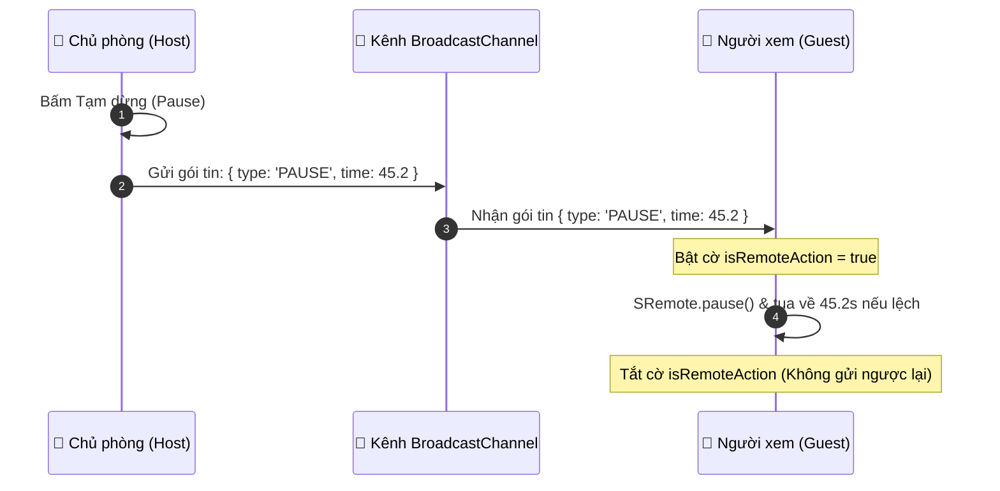

# Tutorial 03: Xây dựng Rạp Chiếu Phim Trực Tuyến Đồng Bộ (WatchParty SyncTheater)

Tính năng **WatchParty (Cùng xem phim từ xa)** là một trong những trải nghiệm thú vị và thách thức nhất trong lập trình web đa phương tiện. Khi một người bấm Tạm dừng để đi vệ sinh hoặc tua lại một cảnh ấn tượng, tất cả người xem trong phòng đều phải đồng bộ theo ngay lập tức.

Trong bài hướng dẫn thực chiến này, chúng ta sẽ tự tay dựng một ứng dụng WatchParty hoàn chỉnh hoạt động theo thời gian thực (Real-time) bằng **SRemote** và **BroadcastChannel API**.

> [!TIP]
> **Trải nghiệm ngay bản demo hoạt động thực tế**: Mở [🚀 Live Demo: 03-watchparty](../../../../demo/apps/03-watchparty/index.html) để tương tác trực tiếp trên trình duyệt.

---

## 🎯 Mục tiêu Bạn Sẽ Đạt Được

Sau bài học này, bạn sẽ nắm vững:
1. Cách thiết lập kênh truyền thông tin đồng bộ thời gian thực giữa các tab hoặc giữa Host và Guest.
2. **Kỹ thuật chống bẫy Vòng Lặp Vô Tận (Ping-Pong Echo Loop)**: Ngăn chặn hiện tượng sự kiện đồng bộ bị dội ngược qua lại giữa các máy.
3. **Cơ chế Bù trừ Độ trễ & Đồng hồ Lệch (Clock Drift & Seek Sync)**: Chỉ can thiệp tua video (`seekTo`) khi độ lệch thời gian thực sự vượt ngưỡng cho phép (Threshold), tránh giật lag khung hình.
4. Quản lý quyền: Host (Chủ phòng điều khiển) và Member (Khách xem đồng bộ).



---

## Bước 1: Khởi Tạo Giao Diện 2 Khung Nhìn (Host & Guest)

Để bạn dễ dàng kiểm thử ngay trên **cùng một máy tính**, chúng ta sẽ dựng một giao diện chia đôi: 1 bên giả lập **Host** và 1 bên giả lập **Guest**.

Hãy tạo file `index.html`:

```html
<!DOCTYPE html>
<html lang="vi">
<head>
  <meta charset="UTF-8">
  <meta name="viewport" content="width=device-width, initial-scale=1.0">
  <title>WatchParty SyncTheater - SRemote Tutorial 03</title>
  <link rel="stylesheet" href="style.css">
</head>
<body>

  <div class="watchparty-app">
    <header class="app-header">
      <h1>🎬 SRemote WatchParty SyncTheater</h1>
      <div class="room-status">
        <span class="status-dot"></span>
        <span id="sync-status">Phòng: #movie-night-2026 | Kênh đã kết nối</span>
      </div>
    </header>

    <div class="theater-grid">
      <!-- Cột 1: Màn hình của Host -->
      <div class="screen-card">
        <div class="screen-badge host-badge">👑 Chủ Phòng (Host Controller)</div>
        <div id="host-player" class="video-box"></div>
        <div class="screen-info">
          <span>Thời gian: <b id="host-time">00:00</b></span>
          <span id="host-state" class="state-pill">Paused</span>
        </div>
      </div>

      <!-- Cột 2: Màn hình của Guest -->
      <div class="screen-card">
        <div class="screen-badge guest-badge">👥 Khách Xem (Synced Guest)</div>
        <div id="guest-player" class="video-box"></div>
        <div class="screen-info">
          <span>Thời gian: <b id="guest-time">00:00</b></span>
          <span id="guest-state" class="state-pill">Syncing</span>
        </div>
      </div>
    </div>

    <!-- Nhật ký đồng bộ thời gian thực -->
    <div class="logs-console">
      <div class="logs-title">📡 Nhật ký đồng bộ gói tin (Real-time Sync Logs):</div>
      <div id="log-list" class="log-list"></div>
    </div>
  </div>

  <script type="module" src="app.js"></script>
</body>
</html>
```

Và định kiểu bằng file `style.css`:

```css
* {
  box-sizing: border-box;
  margin: 0;
  padding: 0;
}

body {
  background: #090d16;
  color: #f1f5f9;
  font-family: -apple-system, BlinkMacSystemFont, "Segoe UI", Roboto, sans-serif;
  padding: 24px;
}

.watchparty-app {
  max-width: 1100px;
  margin: 0 auto;
}

.app-header {
  display: flex;
  justify-content: space-between;
  align-items: center;
  margin-bottom: 24px;
  padding-bottom: 16px;
  border-bottom: 1px solid rgba(255, 255, 255, 0.1);
}

.status-dot {
  display: inline-block;
  width: 10px;
  height: 10px;
  background: #10b981;
  border-radius: 50%;
  margin-right: 6px;
  box-shadow: 0 0 10px #10b981;
}

.theater-grid {
  display: grid;
  grid-template-columns: 1fr 1fr;
  gap: 24px;
  margin-bottom: 24px;
}

.screen-card {
  background: #111827;
  border-radius: 12px;
  overflow: hidden;
  border: 1px solid rgba(255, 255, 255, 0.08);
}

.screen-badge {
  padding: 10px 16px;
  font-size: 13px;
  font-weight: 600;
}

.host-badge {
  background: #8b5cf6;
  color: #fff;
}

.guest-badge {
  background: #0284c7;
  color: #fff;
}

.video-box {
  width: 100%;
  aspect-ratio: 16 / 9;
  background: #000;
}

.screen-info {
  display: flex;
  justify-content: space-between;
  align-items: center;
  padding: 12px 16px;
  font-size: 13px;
  background: #0f172a;
}

.state-pill {
  padding: 2px 8px;
  border-radius: 4px;
  background: #334155;
  font-size: 11px;
  text-transform: uppercase;
}

.logs-console {
  background: #030712;
  border-radius: 8px;
  padding: 16px;
  border: 1px solid rgba(255, 255, 255, 0.06);
  font-family: monospace;
  font-size: 12px;
}

.logs-title {
  color: #94a3b8;
  margin-bottom: 8px;
  font-weight: bold;
}

.log-list {
  max-height: 140px;
  overflow-y: auto;
  display: flex;
  flex-direction: column;
  gap: 4px;
}

.log-item {
  color: #38bdf8;
}
```

---

## Bước 2: Thiết Lập Kênh Đồng Bộ Thời Gian Thực Với `BroadcastChannel`

Thay vì phải thiết lập server Node.js và WebSocket phức tạp chỉ để học nguyên lý, trình duyệt hiện đại cung cấp sẵn **`BroadcastChannel API`** cho phép các tab hoặc iframe trên cùng trình duyệt gửi nhận gói tin cho nhau với độ trễ gần như bằng 0 (Zero Latency).

Tạo file `app.js` và khởi tạo kênh:

```javascript
import { SRemoteClient } from 'https://cdn.jsdelivr.net/npm/@sremote/sdk/+esm';
import { youtube } from 'https://cdn.jsdelivr.net/npm/@sremote/ready2use/+esm';

// Tạo kênh đồng bộ chung
const syncChannel = new BroadcastChannel('watchparty_theater_room');

// Hàm ghi log ra giao diện
const logList = document.getElementById('log-list');
function logMessage(text) {
  const div = document.createElement('div');
  div.className = 'log-item';
  div.textContent = `[${new Date().toLocaleTimeString()}] ${text}`;
  logList.prepend(div);
}
```

---

## Bước 3: Khởi Tạo 2 Client SRemote Độc Lập Cho Host & Guest

Chúng ta khởi tạo 2 instance riêng biệt:
- Client của Host gắn vào `#host-player`.
- Client của Guest gắn vào `#guest-player` (tắt tiếng `mute: 1` để không bị vang âm thanh 2 lần trên cùng 1 máy).

```javascript
let hostClient = null;
let guestClient = null;

async function initTheater() {
  logMessage('⚡ Đang khởi tạo phòng chiếu phim...');

  // 1. Mount Host Player
  const hostHandle = await youtube.mount('#host-player', {
    videoId: 'dQw4w9WgXcQ',
    playerVars: { controls: 1 }
  });
  // Tạo client riêng cho Host
  hostClient = new SRemoteClient({ target: hostHandle.iframe });

  // 2. Mount Guest Player
  const guestHandle = await youtube.mount('#guest-player', {
    videoId: 'dQw4w9WgXcQ',
    playerVars: { controls: 0 } // Guest không cần controls để tránh thao tác nhầm
  });
  // Tạo client riêng cho Guest
  guestClient = new SRemoteClient({ target: guestHandle.iframe });

  // Tắt tiếng Guest để tránh dội âm trên cùng 1 máy
  await guestClient.setVolume(0);

  logMessage('✅ Cả 2 màn hình đã kết nối SRemote thành công!');
  setupSyncLogic();
}
```

---

## Bước 4: Giải Quyết Bẫy Vòng Lặp Vô Tận (Echo Loop) & Bù Lệch Thời Gian

### 1. Bẫy Echo Loop là gì?
Nếu Host Play ➔ gửi gói tin qua Guest ➔ Guest thực hiện Play ➔ Guest lại vô tình phát ra sự kiện `play` và gửi ngược lại Host ➔ Hai bên dội gói tin qua lại vô tận làm đơ trình duyệt!

### 2. Giải pháp: Biến cờ `isRemoteAction`
Khi Guest nhận được lệnh đồng bộ từ mạng và chuẩn bị gọi `guestClient.play()`, ta bật cờ `isRemoteAction = true`. Khi đó, sự kiện `play` nội bộ của Guest sẽ bị bỏ qua và không gửi đi đâu cả.

### 3. Ngưỡng dung sai độ lệch thời gian (Drift Threshold):
Mạng internet luôn có độ trễ 100ms - 300ms. Nếu Host ở giây 10.2s mà Guest ở giây 10.5s thì **không được gọi `seekTo`**, vì gọi tua liên tục sẽ khiến video bị khựng (Buffering). Chỉ khi độ lệch `|hostTime - guestTime| > 1.5s` ta mới thực hiện tua bù!

Thêm hàm `setupSyncLogic()` vào `app.js`:

```javascript
let isRemoteAction = false;

function setupSyncLogic() {
  const hostTimeEl = document.getElementById('host-time');
  const guestTimeEl = document.getElementById('guest-time');
  const hostStateEl = document.getElementById('host-state');
  const guestStateEl = document.getElementById('guest-state');

  // ==========================================
  // PHÍA HOST: Lắng nghe hành động và gửi gói tin
  // ==========================================
  
  hostClient.on('play', async () => {
    hostStateEl.textContent = 'Playing';
    const currentTime = await hostClient.getCurrentTime();
    logMessage(`👑 Host bấm Play tại giây ${currentTime.toFixed(1)} -> Gửi gói tin`);
    
    syncChannel.postMessage({
      action: 'PLAY',
      time: currentTime
    });
  });

  hostClient.on('pause', async () => {
    hostStateEl.textContent = 'Paused';
    const currentTime = await hostClient.getCurrentTime();
    logMessage(`👑 Host bấm Pause tại giây ${currentTime.toFixed(1)} -> Gửi gói tin`);

    syncChannel.postMessage({
      action: 'PAUSE',
      time: currentTime
    });
  });

  hostClient.on('seeked', async ({ currentTime }) => {
    logMessage(`👑 Host tua video tới ${currentTime.toFixed(1)}s -> Gửi gói tin`);
    syncChannel.postMessage({
      action: 'SEEK',
      time: currentTime
    });
  });

  hostClient.on('timeupdate', ({ currentTime }) => {
    hostTimeEl.textContent = `${currentTime.toFixed(1)}s`;
  });

  // ==========================================
  // PHÍA GUEST: Nhận gói tin và đồng bộ video
  // ==========================================

  guestClient.on('timeupdate', ({ currentTime }) => {
    guestTimeEl.textContent = `${currentTime.toFixed(1)}s`;
  });

  syncChannel.onmessage = async (event) => {
    const { action, time } = event.data;
    const currentGuestTime = await guestClient.getCurrentTime();
    const timeDelta = Math.abs(currentGuestTime - time);

    logMessage(`👥 Guest nhận lệnh: [${action}] mốc ${time.toFixed(1)}s (Lệch: ${timeDelta.toFixed(2)}s)`);

    // Bật cờ chặn Echo Loop
    isRemoteAction = true;

    if (action === 'PLAY') {
      guestStateEl.textContent = 'Playing';
      // Nếu lệch quá 1.5 giây thì mới tua lại cho khớp
      if (timeDelta > 1.5) {
        await guestClient.seekTo(time);
      }
      await guestClient.play();
    } 
    else if (action === 'PAUSE') {
      guestStateEl.textContent = 'Paused';
      await guestClient.pause();
      if (timeDelta > 0.5) {
        await guestClient.seekTo(time);
      }
    } 
    else if (action === 'SEEK') {
      await guestClient.seekTo(time);
    }

    // Tắt cờ sau khi lệnh thực thi xong
    setTimeout(() => {
      isRemoteAction = false;
    }, 200);
  };
}
```

---

## Bước 5: Kiểm Thử Thực Tế

Khởi chạy bằng cách gọi `initTheater()` ở cuối file `app.js`:

```javascript
initTheater();
```

Bây giờ bạn mở trang trên trình duyệt:
1. Bấm nút **Play** trên khung hình của Host: Màn hình của Guest sẽ lập tức chạy theo.
2. Bấm nút **Pause** hoặc **Tua đến phút 01:30** trên Host: Màn hình Guest sẽ tự động nhảy đến đúng mốc 01:30 mà không có bất kỳ hiện tượng giật vòng lặp nào!

---

## 💡 Bài Tập Thử Thách Mở Rộng

1. **Thay thế bằng Socket.io / WebRTC DataChannel**: Thay vì `BroadcastChannel` (chỉ chạy trên cùng trình duyệt), hãy tích hợp thêm một máy chủ WebSocket để bạn bè ở hai đầu đất nước có thể xem phim cùng nhau.
2. **Nút "Đồng bộ lại" (Resync Button)**: Tạo một nút bấm bên phía Guest để nếu Guest bị rớt mạng lag, bấm nút sẽ đọc thời gian của Host và tua thẳng tới mốc hiện tại.
