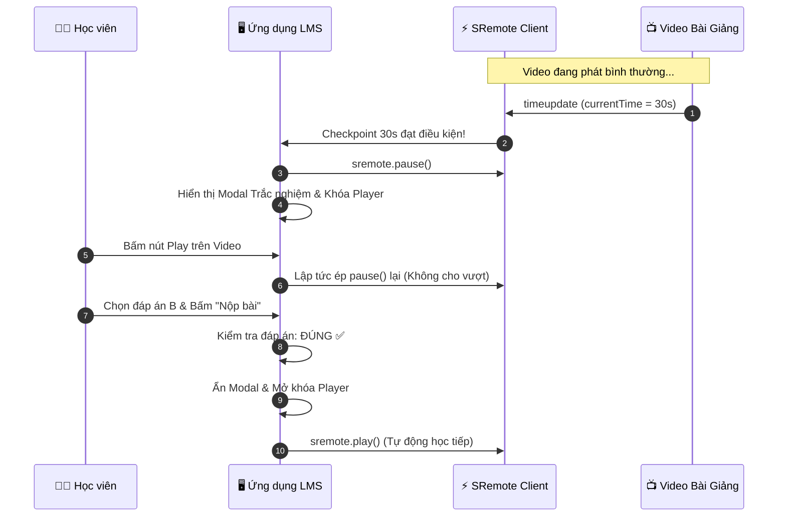

# Blueprint 04: Nền tảng Học Trực Tuyến LMS Video Quiz (Trắc nghiệm Dừng Video)

Bài hướng dẫn này sẽ hướng dẫn bạn xây dựng tính năng **Interactive Video Checkpoint Quiz** cho hệ thống học tập trực tuyến (E-Learning / LMS): video bài giảng YouTube/Vimeo sẽ **tự động tạm dừng chính xác ở mốc giây quy định**, màn hình khóa lại và hiện Modal câu hỏi trắc nghiệm. Học viên **bắt buộc phải trả lời đúng** thì video mới được mở khóa để học tiếp.

---

## 1. Bài toán Thực tế & Mục tiêu

Trong đào tạo trực tuyến (Corporate Training hoặc EdTech):
- Tỷ lệ học viên mở video rồi bỏ đi làm việc khác là rất cao.
- Cần có cơ chế kiểm tra mức độ tập trung (Attention Check) tại các mốc kiến thức trọng tâm (ví dụ: phút 00:30, phút 05:00).
- Khi đến checkpoint:
  1. Tự động gọi `sremote.pause()`.
  2. Khóa không cho học viên bấm nút Play hoặc kéo thanh tua video để vượt qua bài kiểm tra.
  3. Chỉ mở khóa và tự động phát tiếp (`sremote.play()`) khi đã nộp bài trắc nghiệm đúng.



---

## 2. Mã Nguồn Đầy Đủ (Full Working Project)

### Bước 1: Giao diện Khung Video & Modal Trắc Nghiệm (`index.html`)

```html
<!DOCTYPE html>
<html lang="vi">
<head>
  <meta charset="UTF-8">
  <meta name="viewport" content="width=device-width, initial-scale=1.0">
  <title>LMS Video Checkpoint Quiz - SRemote Blueprint 04</title>
  <link rel="stylesheet" href="style.css">
</head>
<body>

  <div class="lms-container">
    <div class="header">
      <h2>Khóa học SRemote Masterclass: Bài 1</h2>
      <span class="checkpoint-badge">Checkpoint tại: 00:30</span>
    </div>

    <!-- Khung chứa video bài giảng -->
    <div class="video-relative-box">
      <div id="lecture-slot" class="lecture-slot"></div>

      <!-- Modal trắc nghiệm phủ đè lên video -->
      <div id="quiz-modal" class="quiz-modal">
        <div class="quiz-card">
          <span class="quiz-tag">❓ Điểm kiểm tra kiến thức</span>
          <h3 class="quiz-question">SRemote sử dụng cơ chế nào để điều khiển iframe từ domain khác?</h3>
          
          <div class="quiz-options">
            <button class="opt-btn" onclick="answer(0)">A. Can thiệp trực tiếp vào DOM của Iframe</button>
            <button class="opt-btn" onclick="answer(1)">B. Kênh MessageChannel và Userscript Bridge</button>
            <button class="opt-btn" onclick="answer(2)">C. Đọc LocalStorage của trình duyệt</button>
          </div>

          <div id="quiz-msg" class="quiz-msg"></div>
        </div>
      </div>
    </div>

    <div class="footer-info">
      <p>💡 <em>Lưu ý: Bạn không thể tua qua mốc 00:30 nếu chưa hoàn thành câu hỏi kiểm tra trên.</em></p>
    </div>
  </div>

  <script type="module" src="app.js"></script>
</body>
</html>
```

---

### Bước 2: Thiết kế Giao diện Phủ Modal (`style.css`)

```css
* { box-sizing: border-box; margin: 0; padding: 0; }
body {
  background: #0f172a;
  color: #f8fafc;
  font-family: -apple-system, BlinkMacSystemFont, "Segoe UI", Roboto, sans-serif;
  padding: 30px 16px;
  display: flex;
  justify-content: center;
}

.lms-container {
  width: 100%;
  max-width: 800px;
  background: #1e293b;
  border-radius: 12px;
  overflow: hidden;
  box-shadow: 0 20px 25px -5px rgba(0, 0, 0, 0.5);
  border: 1px solid rgba(255, 255, 255, 0.08);
}

.header {
  display: flex;
  justify-content: space-between;
  align-items: center;
  padding: 16px 20px;
  background: #111827;
  border-bottom: 1px solid rgba(255, 255, 255, 0.06);
}

.checkpoint-badge {
  font-size: 12px;
  background: #0284c7;
  padding: 4px 10px;
  border-radius: 4px;
  font-weight: 600;
}

.video-relative-box {
  position: relative;
  width: 100%;
  aspect-ratio: 16 / 9;
  background: #000;
}

.lecture-slot {
  width: 100%;
  height: 100%;
}

.quiz-modal {
  display: none;
  position: absolute;
  inset: 0;
  background: rgba(15, 23, 42, 0.95);
  backdrop-filter: blur(8px);
  z-index: 50;
  justify-content: center;
  align-items: center;
  padding: 20px;
}

.quiz-modal.active {
  display: flex;
  animation: fadeIn 0.3s ease;
}

.quiz-card {
  max-width: 500px;
  width: 100%;
  text-align: center;
}

.quiz-tag {
  color: #38bdf8;
  font-size: 12px;
  font-weight: bold;
  text-transform: uppercase;
  letter-spacing: 0.5px;
}

.quiz-question {
  font-size: 17px;
  color: #f8fafc;
  margin: 12px 0 20px;
  line-height: 1.5;
}

.quiz-options {
  display: flex;
  flex-direction: column;
  gap: 10px;
}

.opt-btn {
  padding: 12px 16px;
  background: #334155;
  border: 1px solid rgba(255, 255, 255, 0.1);
  color: #f1f5f9;
  border-radius: 8px;
  cursor: pointer;
  font-size: 14px;
  text-align: left;
  transition: all 0.2s;
}

.opt-btn:hover {
  background: #0284c7;
  border-color: #38bdf8;
}

.quiz-msg {
  margin-top: 14px;
  font-size: 13.5px;
  font-weight: 600;
}

.footer-info {
  padding: 14px 20px;
  background: #0f172a;
  font-size: 13px;
  color: #94a3b8;
}

@keyframes fadeIn {
  from { opacity: 0; } to { opacity: 1; }
}
```

---

### Bước 3: Logic Giám Sát Checkpoint & Khóa Video (`app.js`)

```javascript
import { sremote } from 'https://cdn.jsdelivr.net/npm/@sremote/sdk/+esm';
import { youtube } from 'https://cdn.jsdelivr.net/npm/@sremote/ready2use/+esm';

const CHECKPOINT_TIME = 30; // Giây thứ 30
const CORRECT_ANSWER_INDEX = 1; // Đáp án B

let isQuizCompleted = false;
let isQuizLocked = false;

const modalEl = document.getElementById('quiz-modal');
const msgEl = document.getElementById('quiz-msg');

// 1. Khởi tạo bài giảng
await youtube.mount('#lecture-slot', {
  videoId: 'dQw4w9WgXcQ',
  playerVars: { controls: 1 }
});

// 2. Giám sát thời gian thực
sremote.on('timeupdate', async ({ state }) => {
  // Nếu chưa làm bài và thời gian vượt qua checkpoint
  if (!isQuizCompleted && state.currentTime >= CHECKPOINT_TIME) {
    if (!isQuizLocked) {
      isQuizLocked = true;
      await sremote.pause();
      modalEl.classList.add('active');
    }
  }
});

// 3. Cơ chế Khóa chống gian lận (Anti-Cheat / Anti-Bypass)
// Nếu học viên cố bấm Play khi modal đang hiện, lập tức pause lại
sremote.on('play', async () => {
  if (isQuizLocked && !isQuizCompleted) {
    await sremote.pause();
  }
});

// 4. Xử lý câu trả lời của học viên
window.answer = async function(selectedIndex) {
  if (selectedIndex === CORRECT_ANSWER_INDEX) {
    msgEl.style.color = '#4ade80';
    msgEl.textContent = '🎉 Chính xác! Bạn đã hoàn thành câu hỏi kiểm tra.';
    isQuizCompleted = true;
    isQuizLocked = false;

    setTimeout(async () => {
      modalEl.classList.remove('active');
      await sremote.play(); // Tự động phát tiếp bài học
    }, 1200);
  } else {
    msgEl.style.color = '#f87171';
    msgEl.textContent = '❌ Chưa chính xác! Vui lòng chọn lại đáp án đúng.';
  }
};
```

---

## 3. Deep Dive: Chống Bỏ qua Checkpoint (Anti-Bypass Guard)

Khi bạn nhúng iframe của YouTube có thanh `controls: 1`, học viên hoàn toàn có thể dùng chuột bấm nút Play trên giao diện YouTube hoặc kéo thanh trượt vượt qua giây 30.

Để ngăn chặn triệt để:
1. Trong sự kiện `timeupdate`: Nếu `currentTime >= CHECKPOINT_TIME` và chưa hoàn thành quiz, ta gọi `sremote.seekTo(CHECKPOINT_TIME)` và `sremote.pause()`.
2. Trong sự kiện `play`: Nếu cờ `isQuizLocked` đang bật, ta lập tức gọi `await sremote.pause()`. Nhờ đó dù học viên có bấm nút Play bao nhiêu lần trên video, SRemote cũng sẽ ngay lập tức dập tắt lệnh phát!

---

## 4. Xử lý Tình huống Biên & Tối ưu UX

- **Lưu trạng thái học tập vào cơ sở dữ liệu**:  
  Khi học viên hoàn thành quiz (`isQuizCompleted = true`), bạn có thể gọi API backend gửi `{ studentId, lessonId, checkpoint: 30, passed: true }`. Khi học viên quay lại bài học lần sau, hệ thống nạp cờ này lên và không bắt họ làm lại câu hỏi cũ nữa.
- **Hỗ trợ nhiều Checkpoint trong một bài giảng**:  
  Bạn có thể khai báo một mảng các checkpoint: `const checkpoints = [{ time: 30, quizId: 1 }, { time: 180, quizId: 2 }]` và duyệt qua danh sách để kích hoạt từng câu hỏi theo trình tự bài học.
