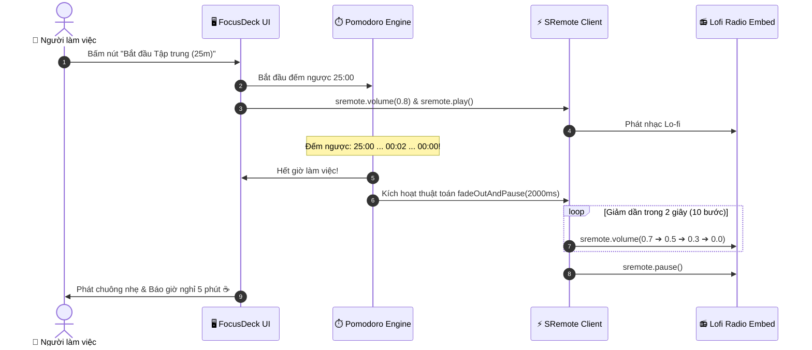

# Blueprint 05: Bàn Làm Việc Năng Suất FocusDeck Pomodoro

Bài hướng dẫn này sẽ hướng dẫn bạn xây dựng ứng dụng đồng hồ năng suất **Pomodoro** kết hợp luồng âm thanh thư giãn (Lo-fi Ambient Audio): tự động kích hoạt phát nhạc khi bắt đầu phiên làm việc 25 phút, **tự động giảm dần âm lượng (Fade-out) mượt mà** và tạm dừng khi hết giờ để phát chuông giải lao.

---

## 1. Bài toán Thực tế & Mục tiêu

Kỹ thuật Pomodoro yêu cầu người làm việc tập trung cao độ trong 25 phút và nghỉ ngơi 5 phút:
- Âm nhạc nền (Lo-fi / White Noise / Rain Sounds) giúp não bộ duy trì trạng thái tập trung sâu (Flow State).
- Tuy nhiên, nếu hết 25 phút mà nhạc đột ngột ngắt ngang thì sẽ tạo cảm giác giật mình, khó chịu.
- Ngược lại, nếu nhạc cứ tiếp tục phát thì người dùng thường quên mất giờ nghỉ giải lao.
- **Giải pháp**: Tự động giảm âm lượng từ từ (Fade-out trong 2 giây) rồi mới tạm dừng, tạo trải nghiệm chuyển trạng thái cực kỳ êm ái và tinh tế.



---

## 2. Mã Nguồn Đầy Đủ (Full Working Project)

### Bước 1: Giao diện FocusDeck (`index.html`)

```html
<!DOCTYPE html>
<html lang="vi">
<head>
  <meta charset="UTF-8">
  <meta name="viewport" content="width=device-width, initial-scale=1.0">
  <title>FocusDeck Pomodoro - SRemote Blueprint 05</title>
  <link rel="stylesheet" href="style.css">
</head>
<body>

  <div class="pomodoro-card">
    <div class="header">
      <h2>🍅 FocusDeck Pomodoro</h2>
      <span class="mode-tag" id="mode-tag">Phiên làm việc</span>
    </div>

    <!-- Màn hình đồng hồ đếm ngược lớn -->
    <div class="timer-display" id="timer-display">25:00</div>

    <!-- Các nút thao tác -->
    <div class="btn-group">
      <button id="btn-start" class="btn btn-start">▶ Bắt đầu tập trung</button>
      <button id="btn-pause" class="btn btn-pause">⏸ Tạm dừng</button>
      <button id="btn-reset" class="btn btn-reset">🔄 Đặt lại</button>
    </div>

    <!-- Khung phát nhạc Lo-fi (Có thể thu nhỏ hoặc ẩn) -->
    <div class="lofi-widget">
      <div class="lofi-title">📻 Đài nhạc nền Lo-fi:</div>
      <div id="lofi-player-slot" class="lofi-player-slot"></div>
    </div>
  </div>

  <script type="module" src="app.js"></script>
</body>
</html>
```

---

### Bước 2: Thiết kế Giao diện Catppuccin Theme (`style.css`)

```css
* { box-sizing: border-box; margin: 0; padding: 0; }
body {
  background: #11111b;
  color: #cdd6f4;
  font-family: -apple-system, BlinkMacSystemFont, "Segoe UI", Roboto, sans-serif;
  min-height: 100vh;
  display: flex;
  justify-content: center;
  align-items: center;
  padding: 20px;
}

.pomodoro-card {
  width: 100%;
  max-width: 480px;
  background: #181825;
  border-radius: 16px;
  padding: 28px;
  border: 1px solid rgba(255, 255, 255, 0.08);
  box-shadow: 0 25px 40px -10px rgba(0, 0, 0, 0.7);
  text-align: center;
}

.header {
  display: flex;
  justify-content: space-between;
  align-items: center;
  margin-bottom: 24px;
}

.mode-tag {
  font-size: 12px;
  background: rgba(166, 227, 161, 0.2);
  color: #a6e3a1;
  padding: 4px 10px;
  border-radius: 20px;
  font-weight: 600;
}

.timer-display {
  font-size: 76px;
  font-weight: 800;
  color: #a6e3a1;
  font-variant-numeric: tabular-nums;
  margin: 16px 0 24px;
  letter-spacing: -2px;
}

.btn-group {
  display: flex;
  justify-content: center;
  gap: 10px;
  margin-bottom: 28px;
}

.btn {
  padding: 10px 18px;
  border-radius: 8px;
  font-weight: 600;
  font-size: 14px;
  border: none;
  cursor: pointer;
  transition: all 0.2s;
}

.btn-start { background: #a6e3a1; color: #11111b; }
.btn-start:hover { background: #94d38f; transform: translateY(-1px); }

.btn-pause { background: #fab387; color: #11111b; }
.btn-pause:hover { background: #e8a278; }

.btn-reset { background: #313244; color: #cdd6f4; }
.btn-reset:hover { background: #45475a; }

.lofi-widget {
  background: #1e1e2e;
  border-radius: 10px;
  padding: 14px;
  text-align: left;
  border: 1px solid rgba(255, 255, 255, 0.05);
}

.lofi-title {
  font-size: 12px;
  color: #9399b2;
  margin-bottom: 10px;
  text-transform: uppercase;
}

.lofi-player-slot {
  width: 100%;
  aspect-ratio: 16 / 9;
  border-radius: 6px;
  overflow: hidden;
  background: #000;
}
```

---

### Bước 3: Logic Đếm Ngược & Giải Thuật Fade-Out (`app.js`)

```javascript
import { sremote } from 'https://cdn.jsdelivr.net/npm/@sremote/sdk/+esm';
import { youtube } from 'https://cdn.jsdelivr.net/npm/@sremote/ready2use/+esm';

const WORK_TIME = 25 * 60; // 25 phút (tính bằng giây)
let timeLeft = WORK_TIME;
let timerInterval = null;
let isRunning = false;

const displayEl = document.getElementById('timer-display');
const btnStart = document.getElementById('btn-start');
const btnPause = document.getElementById('btn-pause');
const btnReset = document.getElementById('btn-reset');

// Cập nhật text hiển thị đồng hồ
function updateDisplay() {
  const m = Math.floor(timeLeft / 60);
  const s = timeLeft % 60;
  displayEl.textContent = `${String(m).padStart(2, '0')}:${String(s).padStart(2, '0')}`;
}

// 1. Khởi tạo Stream nhạc Lo-fi
await youtube.mount('#lofi-player-slot', {
  videoId: 'jfKfPfyJRdk', // Lofi Girl Radio Stream
  playerVars: { controls: 1, autoplay: 0 }
});

// 2. Thuật toán Fade-out: Giảm âm lượng từ từ rồi mới tạm dừng
async function fadeOutAndPause(durationMs = 2000) {
  const steps = 10;
  const stepDelay = durationMs / steps;
  const startVolume = (await sremote.getState()).volume || 0.8;

  for (let i = steps; i >= 0; i--) {
    const vol = (startVolume * (i / steps)).toFixed(2);
    await sremote.volume(parseFloat(vol));
    await new Promise(r => setTimeout(r, stepDelay));
  }

  await sremote.pause();
  // Khôi phục lại âm lượng mặc định cho lần phát sau
  await sremote.volume(startVolume);
}

// 3. Xử lý Bắt đầu phiên làm việc
btnStart.addEventListener('click', async () => {
  if (isRunning) return;
  isRunning = true;

  // Bật nhạc nền
  await sremote.volume(0.8);
  await sremote.play();

  timerInterval = setInterval(async () => {
    timeLeft--;
    updateDisplay();

    // Khi hết hiệp làm việc:
    if (timeLeft <= 0) {
      clearInterval(timerInterval);
      isRunning = false;
      displayEl.textContent = '00:00';
      
      // Giảm âm lượng êm ái và dừng nhạc
      await fadeOutAndPause(2500);
      alert('⏰ Hết hiệp làm việc 25 phút! Hãy đứng dậy uống nước và giải lao 5 phút nhé.');
    }
  }, 1000);
});

// 4. Xử lý Tạm dừng
btnPause.addEventListener('click', async () => {
  if (!isRunning) return;
  clearInterval(timerInterval);
  isRunning = false;
  await fadeOutAndPause(800);
});

// 5. Xử lý Đặt lại (Reset)
btnReset.addEventListener('click', async () => {
  clearInterval(timerInterval);
  isRunning = false;
  timeLeft = WORK_TIME;
  updateDisplay();
  await sremote.pause();
});

updateDisplay();
```

---

## 3. Deep Dive: Thuật toán Audio Fade-Out mượt mà

Trong hàm `fadeOutAndPause`:
```javascript
for (let i = steps; i >= 0; i--) {
  const vol = (startVolume * (i / steps)).toFixed(2);
  await sremote.volume(parseFloat(vol));
  await new Promise(r => setTimeout(r, stepDelay));
}
```
- Ta chia tổng thời gian (ví dụ 2000ms) thành 10 chặng nhỏ (mỗi chặng 200ms).
- Tại mỗi chặng, âm lượng được hạ dần theo hệ số `i / steps` (`0.8 ➔ 0.72 ➔ 0.64 ... ➔ 0.0`).
- Nhờ hàm `new Promise(r => setTimeout(r, stepDelay))`, tiến trình chuyển tiếp diễn ra hoàn toàn bất đồng bộ (non-blocking), giao diện vẫn hiển thị mượt mà không bị treo.

---

## 4. Xử lý Tình huống Biên & Tối ưu UX

- **Tự động chuyển sang phiên nghỉ (Break Phase)**:  
  Sau khi hoàn thành 25 phút, bạn có thể tự động đổi màu giao diện sang xanh dương, đặt lại thời gian thành `05:00` (Nghỉ ngắn) và chuyển sang danh sách âm thanh thiên nhiên (tiếng chim hót, tiếng suối).
