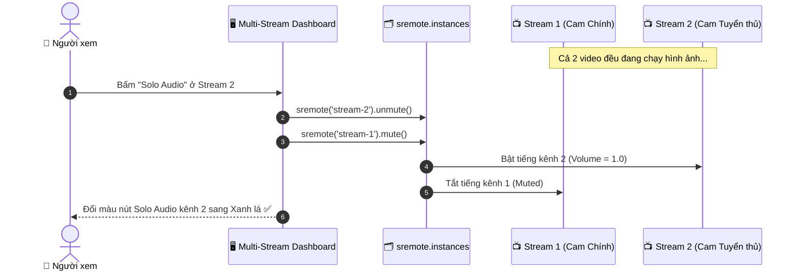

# Blueprint 06: Trung Tâm Điều Hành Đa Kênh Stream (Multi-Stream Command Center)

Bài hướng dẫn này sẽ hướng dẫn bạn xây dựng trang **Command Center theo dõi 4 luồng phát trực tiếp (Live Streams) đồng thời** (e.g. Esports đa góc máy, camera an ninh, hoặc sự kiện âm nhạc nhiều sân khấu): cung cấp tính năng **Solo Audio** (bật tiếng kênh chỉ định thì 3 kênh còn lại tự động Mute), và nút **Master Mute All** để dập tắt toàn bộ âm thanh chỉ với 1 click thông qua namespace `sremote.instances`.

---

## 1. Bài toán Thực tế & Mục tiêu

Khi người dùng theo dõi một trận chung kết Esports hoặc giải đua xe F1:
- Họ muốn mở 4 góc máy cùng lúc trên một màn hình: Góc tổng thể, Góc camera tuyển thủ A, Góc camera tuyển thủ B và Góc bản đồ chiến thuật.
- Nếu cả 4 kênh đều phát tiếng, âm thanh sẽ bị nhiễu loạn và không thể nghe được gì.
- Yêu cầu đặt ra:
  1. Tất cả 4 video phải **phát đồng thời về mặt hình ảnh (Video playing)**.
  2. Về mặt âm thanh: Chỉ **duy nhất 1 kênh được phép bật tiếng (Unmute)** tại một thời điểm (Chế độ Solo Audio).
  3. Cung cấp nút dập tắt toàn bộ âm thanh khẩn cấp (Mute All).



---

## 2. Mã Nguồn Đầy Đủ (Full Working Project)

### Bước 1: Giao diện Lưới 4 Màn Hình (`index.html`)

```html
<!DOCTYPE html>
<html lang="vi">
<head>
  <meta charset="UTF-8">
  <meta name="viewport" content="width=device-width, initial-scale=1.0">
  <title>Multi-Stream Command Center - SRemote Blueprint 06</title>
  <link rel="stylesheet" href="style.css">
</head>
<body>

  <div class="dashboard">
    <div class="top-bar">
      <h2>📺 Esports Multi-View Command Center</h2>
      <div class="top-actions">
        <button id="btn-mute-all" class="btn btn-danger">🔇 Mute Toàn Bộ</button>
        <button id="btn-unmute-first" class="btn btn-primary">🔊 Mặc định (Kênh 1)</button>
      </div>
    </div>

    <!-- Lưới 4 màn hình stream -->
    <div class="stream-grid">
      
      <!-- Kênh 1 -->
      <div class="stream-card" id="card-stream-1">
        <div class="stream-header">
          <span>Kênh 1: Camera Toàn Cảnh</span>
          <button class="solo-btn active" data-target="stream-1">🎧 Solo Audio</button>
        </div>
        <div id="player-stream-1" class="stream-slot"></div>
      </div>

      <!-- Kênh 2 -->
      <div class="stream-card" id="card-stream-2">
        <div class="stream-header">
          <span>Kênh 2: Góc Tuyển Thủ A</span>
          <button class="solo-btn" data-target="stream-2">🎧 Solo Audio</button>
        </div>
        <div id="player-stream-2" class="stream-slot"></div>
      </div>

      <!-- Kênh 3 -->
      <div class="stream-card" id="card-stream-3">
        <div class="stream-header">
          <span>Kênh 3: Góc Tuyển Thủ B</span>
          <button class="solo-btn" data-target="stream-3">🎧 Solo Audio</button>
        </div>
        <div id="player-stream-3" class="stream-slot"></div>
      </div>

      <!-- Kênh 4 -->
      <div class="stream-card" id="card-stream-4">
        <div class="stream-header">
          <span>Kênh 4: Bản Đồ Chiến Thuật</span>
          <button class="solo-btn" data-target="stream-4">🎧 Solo Audio</button>
        </div>
        <div id="player-stream-4" class="stream-slot"></div>
      </div>

    </div>
  </div>

  <script type="module" src="app.js"></script>
</body>
</html>
```

---

### Bước 2: Thiết kế Lưới Đa Kênh Grid (`style.css`)

```css
* { box-sizing: border-box; margin: 0; padding: 0; }
body {
  background: #09090b;
  color: #f4f4f5;
  font-family: -apple-system, BlinkMacSystemFont, "Segoe UI", Roboto, sans-serif;
  padding: 16px;
}

.dashboard {
  max-width: 1300px;
  margin: 0 auto;
}

.top-bar {
  display: flex;
  justify-content: space-between;
  align-items: center;
  margin-bottom: 16px;
  flex-wrap: wrap;
  gap: 12px;
}

.top-actions {
  display: flex;
  gap: 10px;
}

.btn {
  padding: 8px 14px;
  border-radius: 6px;
  font-size: 13px;
  font-weight: 600;
  border: none;
  cursor: pointer;
  transition: all 0.2s;
}

.btn-danger { background: #ef4444; color: #fff; }
.btn-danger:hover { background: #dc2626; }

.btn-primary { background: #0284c7; color: #fff; }
.btn-primary:hover { background: #0369a1; }

.stream-grid {
  display: grid;
  grid-template-columns: repeat(2, 1fr);
  gap: 14px;
}

@media (max-width: 768px) {
  .stream-grid { grid-template-columns: 1fr; }
}

.stream-card {
  background: #18181b;
  border: 1px solid #27272a;
  border-radius: 10px;
  overflow: hidden;
  transition: border-color 0.2s;
}

.stream-card.has-audio {
  border-color: #22c55e;
  box-shadow: 0 0 15px rgba(34, 197, 94, 0.2);
}

.stream-header {
  display: flex;
  justify-content: space-between;
  align-items: center;
  padding: 10px 14px;
  background: #27272a;
  font-size: 13px;
  font-weight: 600;
}

.solo-btn {
  background: #3f3f46;
  border: 1px solid rgba(255, 255, 255, 0.1);
  color: #d4d4d8;
  padding: 4px 10px;
  border-radius: 4px;
  cursor: pointer;
  font-size: 12px;
  font-weight: 600;
  transition: all 0.2s;
}

.solo-btn:hover {
  background: #52525b;
}

.solo-btn.active {
  background: #22c55e;
  color: #052e16;
  border-color: #4ade80;
}

.stream-slot {
  width: 100%;
  aspect-ratio: 16 / 9;
  background: #000;
}
```

---

### Bước 3: Logic Điều Phối Âm Thanh Đa Instance (`app.js`)

```javascript
import { sremote } from 'https://cdn.jsdelivr.net/npm/@sremote/sdk/+esm';
import { youtube } from 'https://cdn.jsdelivr.net/npm/@sremote/ready2use/+esm';

// Danh sách các instance ID
const streamConfigs = [
  { id: 'stream-1', slot: '#player-stream-1', videoId: 'jfKfPfyJRdk' },
  { id: 'stream-2', slot: '#player-stream-2', videoId: 'dQw4w9WgXcQ' },
  { id: 'stream-3', slot: '#player-stream-3', videoId: '4xDzrJKXOOY' },
  { id: 'stream-4', slot: '#player-stream-4', videoId: '76979871' }
];

const soloButtons = document.querySelectorAll('.solo-btn');

// 1. Khởi tạo đồng thời 4 luồng stream
for (const config of streamConfigs) {
  await youtube.mount(config.slot, {
    videoId: config.videoId,
    playerVars: { controls: 1, autoplay: 1 }
  });

  // Gán nhãn ngữ nghĩa cố định cho từng instance
  sremote.instances.assign(config.slot, config.id);
}

// 2. Hàm kích hoạt Solo Audio cho một kênh chỉ định
async function activateSoloAudio(activeId) {
  for (const config of streamConfigs) {
    if (config.id === activeId) {
      // Bật tiếng kênh được chọn
      await sremote(config.id).unmute();
      await sremote(config.id).volume(1.0);
    } else {
      // Tắt tiếng tất cả các kênh còn lại
      await sremote(config.id).mute();
    }

    // Cập nhật giao diện thẻ stream
    const cardEl = document.getElementById(`card-${config.id}`);
    cardEl.classList.toggle('has-audio', config.id === activeId);
  }

  // Cập nhật trạng thái active cho nút Solo
  soloButtons.forEach(btn => {
    btn.classList.toggle('active', btn.getAttribute('data-target') === activeId);
  });
}

// 3. Bắt sự kiện click vào các nút Solo Audio
soloButtons.forEach(btn => {
  btn.addEventListener('click', async () => {
    const targetId = btn.getAttribute('data-target');
    await activateSoloAudio(targetId);
  });
});

// 4. Nút Mute Toàn Bộ
document.getElementById('btn-mute-all').addEventListener('click', async () => {
  for (const config of streamConfigs) {
    await sremote(config.id).mute();
    document.getElementById(`card-${config.id}`).classList.remove('has-audio');
  }
  soloButtons.forEach(btn => btn.classList.remove('active'));
});

// 5. Nút Bật lại Kênh 1
document.getElementById('btn-unmute-first').addEventListener('click', async () => {
  await activateSoloAudio('stream-1');
});

// Mặc định ban đầu: Chỉ mở tiếng Kênh 1
activateSoloAudio('stream-1');
```

---

## 3. Deep Dive: `sremote(instanceId)` và Polymorphic Selector

1. **`sremote.instances.assign(slot, instanceId)`**:  
   Mặc định, SRemote cấp phát một ID ngẫu nhiên cho mỗi iframe được mount (ví dụ `sv_youtube_a1b2`). Bằng cách gọi `.assign('#player-stream-1', 'stream-1')`, bạn liên kết trực tiếp một ID dễ nhớ vào phần tử đó.
2. **Cú pháp Fluent Selector `sremote('stream-1').mute()`**:  
   Từ SRemote 4.0, bạn có thể truyền thẳng `instanceId` hoặc DOM selector vào `sremote(...)` để gửi lệnh tới đích danh một player cụ thể mà không ảnh hưởng tới các player khác trên trang.

---

## 4. Xử lý Tình huống Biên & Tối ưu UX

- **Tiết kiệm tài nguyên mạng khi mở 4 video**:  
  Với các luồng livestream độ phân giải cao, mở 4 video cùng lúc có thể gây lag máy người dùng. Với các kênh đang bị Mute, bạn có thể cân nhắc giảm kích thước hiển thị hoặc thiết lập chất lượng thấp hơn (e.g. 360p) qua `playerVars`.
