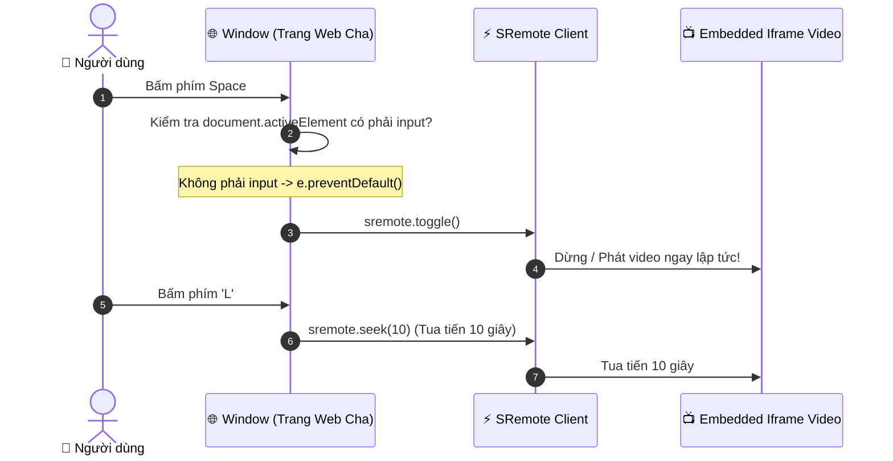

# Blueprint 07: Bộ Phím Tắt Toàn Cục & Trợ Năng (Global Keyboard Shortcuts & A11y)

Bài hướng dẫn này sẽ hướng dẫn bạn xây dựng hệ thống **phím tắt bàn phím toàn cầu (Global Keyboard Shortcuts)** điều khiển mọi player nhúng trên website mà **người dùng không cần phải click chuột focus vào bên trong thẻ iframe**.

---

## 1. Bài toán Thực tế & Mục tiêu

Khi người dùng xem video nhúng iframe trên web:
- Nếu con trỏ chuột đang ở ngoài trang chính, bấm phím `Space` sẽ làm trình duyệt cuộn trang xuống đáy thay vì dừng video!
- Để bấm phím `J` / `K` / `L` như trên YouTube, người dùng buộc phải nhấp chuột vào bên trong video.
- Nhưng khi đã click vào iframe, các phím tắt khác của trang web cha lại bị vô hiệu hóa!
- **Giải pháp**: Lắng nghe sự kiện `keydown` ở cấp độ `window` của trang web cha, xử lý thông minh để tránh bắt nhầm khi người dùng đang gõ văn bản (`<input>`, `<textarea>`) và chuyển tiếp lệnh trực tiếp tới SRemote.



---

## 2. Bảng Phím Tắt Chuẩn Cần Cài Đặt

| Phím tắt | Tác vụ | Lệnh SRemote tương ứng |
| :--- | :--- | :--- |
| **`Space`** hoặc **`K`** | Đảo trạng thái Play / Pause | `sremote.toggle()` |
| **`J`** hoặc **`←`** | Tua lùi 10 giây | `sremote.seek(-10)` |
| **`L`** hoặc **`→`** | Tua tiến 10 giây | `sremote.seek(10)` |
| **`M`** | Tắt / Bật tiếng (Mute) | `sremote.toggleMuted()` |
| **`↑` (ArrowUp)** | Tăng âm lượng thêm 10% | `sremote.volume(current + 0.1)` |
| **`↓` (ArrowDown)** | Giảm âm lượng 10% | `sremote.volume(current - 0.1)` |
| **`0` .. `9`** | Nhảy tới 0% .. 90% thời lượng | `sremote.seekTo((key / 10) * duration)` |

---

## 3. Mã Nguồn Đầy Đủ (Full Working Project)

### Bước 1: Giao diện Trang (`index.html`)

```html
<!DOCTYPE html>
<html lang="vi">
<head>
  <meta charset="UTF-8">
  <meta name="viewport" content="width=device-width, initial-scale=1.0">
  <title>Global Keyboard Shortcuts - SRemote Blueprint 07</title>
  <link rel="stylesheet" href="style.css">
</head>
<body>

  <div class="shortcut-app">
    <h2>⌨️ Phím Tắt Toàn Cục & Trợ Năng (A11y)</h2>
    <p class="subtitle">Bấm bất kỳ phím nào dưới đây mà không cần click chuột vào video!</p>

    <div id="video-frame" class="video-frame"></div>

    <!-- Bảng tra cứu phím tắt trực quan trên màn hình -->
    <div class="shortcut-guide">
      <div class="shortcut-pill"><kbd>Space</kbd> hoặc <kbd>K</kbd> <span>Play / Pause</span></div>
      <div class="shortcut-pill"><kbd>J</kbd> / <kbd>←</kbd> <span>Tua lùi 10s</span></div>
      <div class="shortcut-pill"><kbd>L</kbd> / <kbd>→</kbd> <span>Tua tiến 10s</span></div>
      <div class="shortcut-pill"><kbd>M</kbd> <span>Bật / Tắt tiếng</span></div>
      <div class="shortcut-pill"><kbd>↑</kbd> / <kbd>↓</kbd> <span>Tăng / Giảm Volume</span></div>
      <div class="shortcut-pill"><kbd>0</kbd> .. <kbd>9</kbd> <span>Nhảy tới % thời lượng</span></div>
    </div>

    <!-- Ô thử nghiệm gõ văn bản -->
    <div class="input-test-box">
      <label>Thử gõ vào đây (Phím tắt sẽ tự động nhường chỗ cho bạn gõ chữ):</label>
      <input type="text" placeholder="Nhập văn bản thử nghiệm...">
    </div>

    <!-- Thông báo nổi Toast khi bấm phím -->
    <div id="shortcut-toast" class="shortcut-toast"></div>
  </div>

  <script type="module" src="app.js"></script>
</body>
</html>
```

---

### Bước 2: Thiết kế Giao diện Phím Tắt (`style.css`)

```css
* { box-sizing: border-box; margin: 0; padding: 0; }
body {
  background: #0f172a;
  color: #f8fafc;
  font-family: -apple-system, BlinkMacSystemFont, "Segoe UI", Roboto, sans-serif;
  padding: 30px 16px;
  display: flex;
  justify-content: center;
}

.shortcut-app {
  width: 100%;
  max-width: 760px;
  background: #1e293b;
  border-radius: 14px;
  padding: 24px;
  border: 1px solid rgba(255, 255, 255, 0.08);
  position: relative;
}

h2 { font-size: 20px; margin-bottom: 6px; }
.subtitle { font-size: 13.5px; color: #94a3b8; margin-bottom: 18px; }

.video-frame {
  width: 100%;
  aspect-ratio: 16 / 9;
  background: #000;
  border-radius: 8px;
  overflow: hidden;
  margin-bottom: 20px;
}

.shortcut-guide {
  display: grid;
  grid-template-columns: repeat(auto-fit, minmax(200px, 1fr));
  gap: 10px;
  margin-bottom: 20px;
}

.shortcut-pill {
  background: #0f172a;
  padding: 8px 12px;
  border-radius: 6px;
  font-size: 12.5px;
  display: flex;
  align-items: center;
  gap: 8px;
  border: 1px solid rgba(255, 255, 255, 0.05);
}

kbd {
  background: #334155;
  color: #38bdf8;
  padding: 2px 6px;
  border-radius: 4px;
  font-family: monospace;
  font-weight: bold;
  font-size: 11.5px;
  border: 1px solid rgba(255, 255, 255, 0.15);
}

.input-test-box {
  background: #111827;
  padding: 14px;
  border-radius: 8px;
  font-size: 13px;
  color: #94a3b8;
}

.input-test-box input {
  width: 100%;
  margin-top: 8px;
  padding: 8px 12px;
  border-radius: 6px;
  background: #1e293b;
  border: 1px solid #334155;
  color: #fff;
  outline: none;
}

.shortcut-toast {
  position: absolute;
  top: 20px;
  right: 20px;
  background: rgba(2, 132, 199, 0.9);
  color: #fff;
  padding: 8px 14px;
  border-radius: 6px;
  font-size: 13px;
  font-weight: bold;
  opacity: 0;
  pointer-events: none;
  transition: opacity 0.2s, transform 0.2s;
  transform: translateY(-8px);
}

.shortcut-toast.show {
  opacity: 1;
  transform: translateY(0);
}
```

---

### Bước 3: Logic Bắt Phím Toàn Cục & Bảo Vệ Input (`app.js`)

```javascript
import { sremote } from 'https://cdn.jsdelivr.net/npm/@sremote/sdk/+esm';
import { youtube } from 'https://cdn.jsdelivr.net/npm/@sremote/ready2use/+esm';

const toastEl = document.getElementById('shortcut-toast');
let toastTimer = null;

function showToast(msg) {
  clearTimeout(toastTimer);
  toastEl.textContent = msg;
  toastEl.classList.add('show');
  toastTimer = setTimeout(() => {
    toastEl.classList.remove('show');
  }, 1200);
}

// 1. Mount YouTube player
await youtube.mount('#video-frame', {
  videoId: 'dQw4w9WgXcQ',
  playerVars: { controls: 1 }
});

// 2. Lắng nghe phím bấm trên toàn trang
window.addEventListener('keydown', async (e) => {
  // QUAN TRỌNG: Không can thiệp nếu người dùng đang nhập liệu vào form/input!
  const activeEl = document.activeElement;
  const isInputActive = activeEl && (
    activeEl.tagName === 'INPUT' ||
    activeEl.tagName === 'TEXTAREA' ||
    activeEl.isContentEditable
  );

  if (isInputActive) return;

  // Bắt phím số từ 0 đến 9: Nhảy tới 0% .. 90% thời lượng
  if (e.code.startsWith('Digit')) {
    const digit = parseInt(e.code.replace('Digit', ''), 10);
    if (!isNaN(digit)) {
      e.preventDefault();
      const state = await sremote.getState();
      const targetTime = (digit / 10) * (state.duration || 100);
      await sremote.seekTo(targetTime);
      showToast(`⏩ Nhảy tới ${digit * 10}% (${Math.round(targetTime)}s)`);
      return;
    }
  }

  switch (e.code) {
    case 'Space':
    case 'KeyK':
      e.preventDefault(); // Ngăn trình duyệt cuộn trang
      await sremote.toggle();
      const isPaused = (await sremote.getState()).paused;
      showToast(isPaused ? '⏸ Tạm dừng' : '▶ Đang phát');
      break;

    case 'KeyJ':
    case 'ArrowLeft':
      e.preventDefault();
      await sremote.seek(-10);
      showToast('⏪ Tua lùi 10 giây');
      break;

    case 'KeyL':
    case 'ArrowRight':
      e.preventDefault();
      await sremote.seek(10);
      showToast('⏩ Tua tiến 10 giây');
      break;

    case 'KeyM':
      e.preventDefault();
      await sremote.toggleMuted();
      const isMuted = (await sremote.getState()).muted;
      showToast(isMuted ? '🔇 Đã tắt tiếng' : '🔊 Đã bật tiếng');
      break;

    case 'ArrowUp':
      e.preventDefault();
      const curVolUp = (await sremote.getState()).volume || 1.0;
      const newVolUp = Math.min(1.0, curVolUp + 0.1);
      await sremote.volume(newVolUp);
      showToast(`🔊 Âm lượng: ${Math.round(newVolUp * 100)}%`);
      break;

    case 'ArrowDown':
      e.preventDefault();
      const curVolDown = (await sremote.getState()).volume || 1.0;
      const newVolDown = Math.max(0.0, curVolDown - 0.1);
      await sremote.volume(newVolDown);
      showToast(`🔉 Âm lượng: ${Math.round(newVolDown * 100)}%`);
      break;
  }
});
```

---

## 4. Deep Dive: Chống Xung Đột Nhập Liệu (Input Guard)

Đoạn mã:
```javascript
const isInputActive = activeEl && (
  activeEl.tagName === 'INPUT' ||
  activeEl.tagName === 'TEXTAREA' ||
  activeEl.isContentEditable
);
if (isInputActive) return;
```
Là nguyên tắc số 1 khi xây dựng phím tắt toàn cục. Nếu thiếu đoạn kiểm tra này, khi người dùng gõ phím `Space` vào ô tìm kiếm hoặc bình luận bên dưới, video sẽ bị dừng lại liên tục, tạo ra trải nghiệm người dùng cực kỳ tồi tệ.
