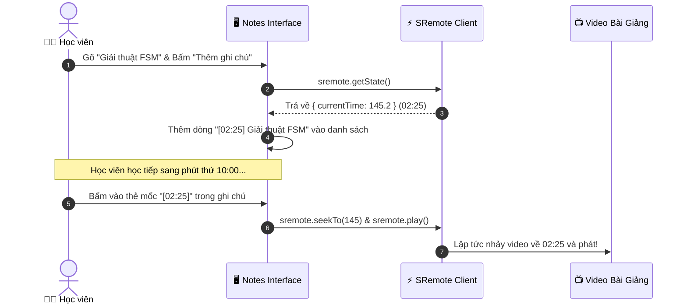

# Blueprint 08: Ghi Chú Bài Giảng Kèm Mốc Giây (Timestamped Notes)

Bài hướng dẫn này sẽ hướng dẫn bạn xây dựng ứng dụng **Ghi chú bài giảng video thông minh (Notion-style Timestamped Notes)**: học viên vừa xem bài giảng vừa gõ ghi chú, hệ thống tự động gắn kèm mốc thời gian hiện tại (`currentTime`). Khi nhấp chuột vào bất kỳ ghi chú nào, video sẽ **tự động tua ngay tới đúng giây đó** thông qua **SRemote**.

---

## 1. Bài toán Thực tế & Mục tiêu

Khi học trực tuyến (Coursera, Udemy, YouTube Education):
- Bài giảng kéo dài 45 phút - 1 tiếng, chứa rất nhiều công thức hoặc khái niệm phức tạp.
- Học viên cần ghi lại: *"Đoạn này thầy giải thích về State Machine rất hay"* nhưng sau này muốn xem lại thì không biết nó nằm ở phút thứ mấy.
- Với ứng dụng này:
  1. Khi bấm nút "Thêm ghi chú", SRemote lập tức chụp lại `currentTime` (ví dụ `04:12`).
  2. Dòng ghi chú được lưu vào danh sách với thẻ mốc thời gian `[04:12]`.
  3. Bấm vào mốc `[04:12]`, video sẽ tự động gọi `sremote.seekTo(252)` và phát ngay lập tức.



---

## 2. Mã Nguồn Đầy Đủ (Full Working Project)

### Bước 1: Giao diện 2 Cột (Video & Ghi Chú) (`index.html`)

```html
<!DOCTYPE html>
<html lang="vi">
<head>
  <meta charset="UTF-8">
  <meta name="viewport" content="width=device-width, initial-scale=1.0">
  <title>Timestamped Notes - SRemote Blueprint 08</title>
  <link rel="stylesheet" href="style.css">
</head>
<body>

  <div class="app-layout">
    <!-- Cột trái: Màn hình video bài giảng -->
    <div class="video-column">
      <div id="lecture-screen" class="lecture-screen"></div>
      <div class="video-caption">
        <h3>Bài giảng: Kiến trúc Hệ thống Phân tán</h3>
        <p>Mẹo: Nhấp vào mốc thời gian màu xanh bên phải để tua video đến đúng vị trí.</p>
      </div>
    </div>

    <!-- Cột phải: Khung ghi chú thông minh -->
    <div class="notes-column">
      <div class="notes-header">
        <h3>📝 Ghi chú của bạn</h3>
        <span id="notes-count" class="badge">0 ghi chú</span>
      </div>

      <!-- Form nhập ghi chú mới -->
      <div class="note-input-box">
        <textarea id="note-text" placeholder="Nhập nội dung ghi chú tại thời điểm đang xem..."></textarea>
        <button id="btn-save-note" class="btn-save">
          <span>📌 Gắn mốc thời gian hiện tại</span>
        </button>
      </div>

      <!-- Danh sách các ghi chú đã lưu -->
      <div class="notes-list-container">
        <ul id="notes-list" class="notes-list"></ul>
      </div>
    </div>
  </div>

  <script type="module" src="app.js"></script>
</body>
</html>
```

---

### Bước 2: Thiết kế Giao diện 2 Cột Hiện Đại (`style.css`)

```css
* { box-sizing: border-box; margin: 0; padding: 0; }
body {
  background: #0f172a;
  color: #f8fafc;
  font-family: -apple-system, BlinkMacSystemFont, "Segoe UI", Roboto, sans-serif;
  padding: 24px;
  min-height: 100vh;
}

.app-layout {
  display: grid;
  grid-template-columns: 1.6fr 1fr;
  gap: 24px;
  max-width: 1200px;
  margin: 0 auto;
}

@media (max-width: 860px) {
  .app-layout { grid-template-columns: 1fr; }
}

.video-column {
  background: #1e293b;
  border-radius: 12px;
  overflow: hidden;
  border: 1px solid rgba(255, 255, 255, 0.08);
}

.lecture-screen {
  width: 100%;
  aspect-ratio: 16 / 9;
  background: #000;
}

.video-caption {
  padding: 16px 20px;
}

.video-caption h3 { font-size: 17px; margin-bottom: 4px; }
.video-caption p { font-size: 13px; color: #94a3b8; }

.notes-column {
  background: #1e293b;
  border-radius: 12px;
  border: 1px solid rgba(255, 255, 255, 0.08);
  display: flex;
  flex-direction: column;
  height: calc(100vh - 48px);
  max-height: 620px;
}

.notes-header {
  display: flex;
  justify-content: space-between;
  align-items: center;
  padding: 16px 20px;
  border-bottom: 1px solid rgba(255, 255, 255, 0.06);
}

.badge {
  font-size: 12px;
  background: #334155;
  padding: 2px 8px;
  border-radius: 12px;
  color: #94a3b8;
}

.note-input-box {
  padding: 16px 20px;
  border-bottom: 1px solid rgba(255, 255, 255, 0.06);
}

.note-input-box textarea {
  width: 100%;
  height: 60px;
  background: #0f172a;
  border: 1px solid #334155;
  border-radius: 6px;
  padding: 10px;
  color: #fff;
  font-size: 13px;
  resize: none;
  outline: none;
}

.btn-save {
  width: 100%;
  margin-top: 8px;
  padding: 8px;
  background: #0284c7;
  color: #fff;
  border: none;
  border-radius: 6px;
  font-size: 13px;
  font-weight: 600;
  cursor: pointer;
  transition: all 0.2s;
}

.btn-save:hover { background: #0369a1; }

.notes-list-container {
  flex: 1;
  overflow-y: auto;
  padding: 16px 20px;
}

.notes-list { list-style: none; }

.note-card {
  background: rgba(255, 255, 255, 0.03);
  border: 1px solid rgba(255, 255, 255, 0.06);
  border-radius: 8px;
  padding: 12px 14px;
  margin-bottom: 10px;
  transition: all 0.2s;
}

.note-card:hover {
  background: rgba(255, 255, 255, 0.06);
  border-color: rgba(56, 189, 248, 0.3);
}

.note-meta {
  display: flex;
  justify-content: space-between;
  margin-bottom: 6px;
}

.timestamp-btn {
  background: rgba(2, 132, 199, 0.2);
  color: #38bdf8;
  border: 1px solid rgba(56, 189, 248, 0.4);
  padding: 2px 8px;
  border-radius: 4px;
  font-size: 11.5px;
  font-weight: bold;
  cursor: pointer;
  font-family: monospace;
}

.timestamp-btn:hover {
  background: #0284c7;
  color: #fff;
}

.note-content {
  font-size: 13.5px;
  color: #cbd5e1;
  line-height: 1.5;
}
```

---

### Bước 3: Logic Chụp Timestamp & Điều Hướng (`app.js`)

```javascript
import { sremote } from 'https://cdn.jsdelivr.net/npm/@sremote/sdk/+esm';
import { youtube } from 'https://cdn.jsdelivr.net/npm/@sremote/ready2use/+esm';

const notesListEl = document.getElementById('notes-list');
const noteTextEl = document.getElementById('note-text');
const btnSave = document.getElementById('btn-save-note');
const notesCountEl = document.getElementById('notes-count');

// Mảng lưu trữ danh sách ghi chú
let notes = JSON.parse(localStorage.getItem('my_lecture_notes') || '[]');

function formatTime(sec) {
  const m = Math.floor(sec / 60);
  const s = Math.floor(sec % 60);
  return `${String(m).padStart(2, '0')}:${String(s).padStart(2, '0')}`;
}

// 1. Gắn YouTube video bài giảng
await youtube.mount('#lecture-screen', {
  videoId: 'dQw4w9WgXcQ',
  playerVars: { controls: 1 }
});

// 2. Render danh sách ghi chú
function renderNotes() {
  notesListEl.innerHTML = '';
  notesCountEl.textContent = `${notes.length} ghi chú`;

  // Sắp xếp ghi chú theo thứ tự thời gian tăng dần
  notes.sort((a, b) => a.time - b.time);

  notes.forEach((item, index) => {
    const li = document.createElement('li');
    li.className = 'note-card';
    li.innerHTML = `
      <div class="note-meta">
        <button class="timestamp-btn" data-time="${item.time}">⏱ ${formatTime(item.time)}</button>
        <button class="del-btn" style="background:none;border:none;color:#ef4444;cursor:pointer;font-size:11px;" data-index="${index}">Xóa</button>
      </div>
      <div class="note-content">${item.text}</div>
    `;

    // Khi bấm vào nút Timestamp: tua video tới đúng giây đó
    li.querySelector('.timestamp-btn').addEventListener('click', async () => {
      await sremote.seekTo(item.time);
      await sremote.play();
    });

    // Xóa ghi chú
    li.querySelector('.del-btn').addEventListener('click', () => {
      notes.splice(index, 1);
      localStorage.setItem('my_lecture_notes', JSON.stringify(notes));
      renderNotes();
    });

    notesListEl.appendChild(li);
  });
}

// 3. Xử lý lưu ghi chú mới
btnSave.addEventListener('click', async () => {
  const text = noteTextEl.value.trim();
  if (!text) return;

  // Lấy chính xác thời điểm giây hiện tại từ SRemote
  const state = await sremote.getState();
  const currentTime = Math.round(state.currentTime || 0);

  notes.push({ time: currentTime, text });
  localStorage.setItem('my_lecture_notes', JSON.stringify(notes));

  noteTextEl.value = '';
  renderNotes();
});

renderNotes();
```

---

## 3. Deep Dive: Độ Chính Xác của `sremote.getState()`

Khi người dùng bấm "Gắn mốc thời gian hiện tại", hàm `await sremote.getState()` trả về snapshot tức thời của video player:
```typescript
interface MediaState {
  currentTime: number; // Ví dụ 145.24 giây
  duration: number;
  paused: boolean;
}
```
Bằng cách làm tròn `Math.round(currentTime)`, ta có một mốc số nguyên giây chuẩn xác mà người học có thể nhấp chuột vào bất cứ lúc nào để xem lại phần giảng dạy.
