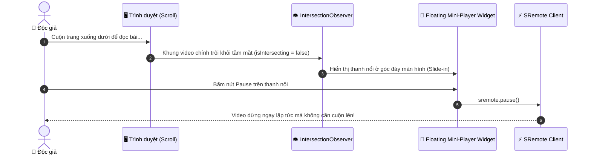

# Blueprint 09: Trình Phát Nổi Mini-Player (PiP Floating Widget)

Bài hướng dẫn này sẽ hướng dẫn bạn xây dựng tính năng **Floating Mini-Player (Widget nghe nhạc / xem video nổi ở góc màn hình)**: khi người dùng cuộn trang web xuống sâu để đọc bài viết dài, video player chính sẽ tự động co lại thành một thanh điều khiển nổi (Picture-in-Picture Floating Bar) ở góc dưới màn hình mà **không làm gián đoạn luồng âm thanh** thông qua `IntersectionObserver` và **SRemote**.

---

## 1. Bài toán Thực tế & Mục tiêu

Trên các trang tin tức (như BBC, The Verge, Medium) hoặc blog công nghệ:
- Video phỏng vấn hoặc podcast được đặt ở đầu bài viết.
- Khi độc giả cuộn chuột xuống dưới để đọc nội dung văn bản dài, video sẽ bị trôi khỏi màn hình.
- Người dùng muốn vừa đọc bài viết vừa có thể bấm tạm dừng, chỉnh âm lượng hoặc tua nhanh mà không phải cuộn ngược hàng ngàn pixel lên đầu trang.
- **Giải pháp**: Dùng API `IntersectionObserver` để phát hiện khi khung video trôi khỏi viewport, sau đó kích hoạt thanh **Floating Mini-Player** dính chặt ở góc dưới phải màn hình.



---

## 2. Mã Nguồn Đầy Đủ (Full Working Project)

### Bước 1: Giao diện Bài Viết & Widget Nổi (`index.html`)

```html
<!DOCTYPE html>
<html lang="vi">
<head>
  <meta charset="UTF-8">
  <meta name="viewport" content="width=device-width, initial-scale=1.0">
  <title>Floating Mini-Player - SRemote Blueprint 09</title>
  <link rel="stylesheet" href="style.css">
</head>
<body>

  <!-- Nội dung bài viết dài -->
  <article class="article-container">
    <h1>Khám phá Kiến trúc Web Hiện Đại năm 2026</h1>
    <p class="meta">Đăng bởi SweetSea • 5 phút đọc</p>

    <!-- Khung video chính ở đầu bài -->
    <div id="main-player-box" class="main-player-box"></div>

    <div class="article-body">
      <p>Việc điều khiển các trình phát media nhúng bên trong thẻ iframe luôn là thách thức lớn đối với lập trình viên web frontend do rào cản Same-Origin Policy...</p>
      <p style="height: 600px; background: rgba(255,255,255,0.02); padding: 20px; border-radius: 8px; margin: 20px 0;">
        (Cuộn trang xuống đây để thấy thanh Floating Mini-Player tự động trượt ra ở góc dưới màn hình!)
      </p>
      <p>Khi sử dụng SRemote, bạn có thể dễ dàng quản lý vòng đời của player và đồng bộ trạng thái tới bất kỳ widget nổi nào trên trang...</p>
      <p style="height: 400px;"></p>
    </div>
  </article>

  <!-- Widget nổi dính ở góc dưới màn hình (Floating Widget) -->
  <div id="floating-bar" class="floating-bar">
    <div class="mini-info">
      <div class="mini-title">Đang phát: Rick Astley</div>
      <div id="mini-time" class="mini-time">00:00 / 00:00</div>
    </div>
    <div class="mini-controls">
      <button id="mini-btn-play" class="mini-btn" title="Phát/Dừng">⏸</button>
      <button id="mini-btn-seek" class="mini-btn" title="Tua 15s">⏩ +15s</button>
      <button id="mini-btn-mute" class="mini-btn" title="Mute">🔊</button>
    </div>
  </div>

  <script type="module" src="app.js"></script>
</body>
</html>
```

---

### Bước 2: Thiết kế Giao diện Widget Nổi (`style.css`)

```css
* { box-sizing: border-box; margin: 0; padding: 0; }
body {
  background: #0f172a;
  color: #f1f5f9;
  font-family: -apple-system, BlinkMacSystemFont, "Segoe UI", Roboto, sans-serif;
  line-height: 1.7;
}

.article-container {
  max-width: 760px;
  margin: 40px auto;
  padding: 0 20px;
}

h1 { font-size: 28px; margin-bottom: 8px; color: #f8fafc; }
.meta { font-size: 13px; color: #94a3b8; margin-bottom: 24px; }

.main-player-box {
  width: 100%;
  aspect-ratio: 16 / 9;
  background: #000;
  border-radius: 10px;
  overflow: hidden;
  margin-bottom: 30px;
  box-shadow: 0 15px 30px -10px rgba(0, 0, 0, 0.6);
}

.article-body p { margin-bottom: 20px; font-size: 16px; color: #cbd5e1; }

/* Thanh Floating Mini-Player dính ở góc dưới màn hình */
.floating-bar {
  position: fixed;
  bottom: 24px;
  right: 24px;
  background: rgba(30, 41, 59, 0.95);
  backdrop-filter: blur(12px);
  border: 1px solid rgba(56, 189, 248, 0.3);
  box-shadow: 0 20px 25px -5px rgba(0, 0, 0, 0.5), 0 0 15px rgba(56, 189, 248, 0.2);
  border-radius: 12px;
  padding: 12px 18px;
  display: flex;
  align-items: center;
  gap: 16px;
  z-index: 999;
  
  /* Mặc định ẩn bằng hiệu ứng trượt xuống */
  transform: translateY(120px);
  opacity: 0;
  pointer-events: none;
  transition: transform 0.35s cubic-bezier(0.16, 1, 0.3, 1), opacity 0.3s ease;
}

.floating-bar.visible {
  transform: translateY(0);
  opacity: 1;
  pointer-events: auto;
}

.mini-info {
  display: flex;
  flex-direction: column;
}

.mini-title {
  font-size: 13px;
  font-weight: 600;
  color: #f8fafc;
}

.mini-time {
  font-size: 11.5px;
  color: #94a3b8;
  font-variant-numeric: tabular-nums;
}

.mini-controls {
  display: flex;
  gap: 8px;
}

.mini-btn {
  background: #334155;
  border: none;
  color: #fff;
  padding: 6px 12px;
  border-radius: 6px;
  font-size: 12px;
  cursor: pointer;
  font-weight: 600;
  transition: all 0.2s;
}

.mini-btn:hover {
  background: #0284c7;
}
```

---

### Bước 3: Logic Giám Sát IntersectionObserver (`app.js`)

```javascript
import { sremote } from 'https://cdn.jsdelivr.net/npm/@sremote/sdk/+esm';
import { youtube } from 'https://cdn.jsdelivr.net/npm/@sremote/ready2use/+esm';

const floatingBar = document.getElementById('floating-bar');
const mainPlayerBox = document.getElementById('main-player-box');
const miniTime = document.getElementById('mini-time');
const miniBtnPlay = document.getElementById('mini-btn-play');
const miniBtnMute = document.getElementById('mini-btn-mute');

function formatTime(sec) {
  const m = Math.floor(sec / 60);
  const s = Math.floor(sec % 60);
  return `${String(m).padStart(2, '0')}:${String(s).padStart(2, '0')}`;
}

// 1. Mount video YouTube chính
await youtube.mount('#main-player-box', {
  videoId: 'dQw4w9WgXcQ',
  playerVars: { controls: 1 }
});

// 2. Sử dụng IntersectionObserver để phát hiện khi video trôi khỏi màn hình
const observer = new IntersectionObserver(([entry]) => {
  // isIntersecting = false có nghĩa là video đã cuộn khỏi màn hình
  if (!entry.isIntersecting) {
    floatingBar.classList.add('visible');
  } else {
    floatingBar.classList.remove('visible');
  }
}, {
  threshold: 0.15 // Kích hoạt khi còn dưới 15% diện tích video hiển thị
});

observer.observe(mainPlayerBox);

// 3. Lắng nghe tiến độ phát từ SRemote để cập nhật thời gian trên thanh nổi
sremote.on('timeupdate', ({ state }) => {
  const cur = Math.round(state.currentTime || 0);
  const dur = Math.round(state.duration || 1);
  miniTime.textContent = `${formatTime(cur)} / ${formatTime(dur)}`;
});

// Cập nhật trạng thái nút Play / Pause
sremote.on('play', () => { miniBtnPlay.textContent = '⏸'; });
sremote.on('pause', () => { miniBtnPlay.textContent = '▶'; });

// 4. Bắt các nút thao tác trên Floating Bar
miniBtnPlay.addEventListener('click', async () => {
  await sremote.toggle();
});

document.getElementById('mini-btn-seek').addEventListener('click', async () => {
  await sremote.seek(15);
});

miniBtnMute.addEventListener('click', async () => {
  await sremote.toggleMuted();
  const isMuted = (await sremote.getState()).muted;
  miniBtnMute.textContent = isMuted ? '🔇' : '🔊';
});
```

---

## 3. Deep Dive: Hiệu năng Của `IntersectionObserver`

So với kỹ thuật cũ lắng nghe sự kiện `window.addEventListener('scroll')` làm tiêu tốn CPU và gây giật khung hình (Layout Thrashing):
- `IntersectionObserver` chạy ngầm ở luồng riêng của trình duyệt (Browser Internal Thread).
- Chỉ kích hoạt hàm callback đúng 2 lần: khi video bắt đầu rời màn hình và khi video quay trở lại.
- Giữ tốc độ khung hình (FPS) của website luôn đạt 60fps mượt mà.
