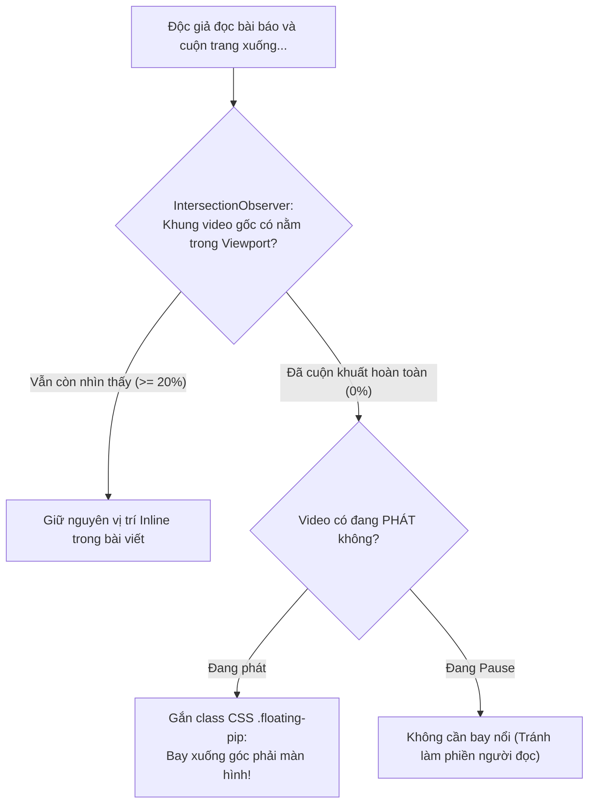

# Tutorial 09: Video Mini Nổi Góc Màn Hình Khi Cuộn Trang (Sticky Floating Picture-in-Picture)

Khi đọc các bài báo công nghệ dài hoặc diễn đàn tin tức (như The Verge, TechCrunch hay VnExpress), độc giả thường vừa muốn đọc nội dung văn bản bên dưới, vừa muốn tiếp tục theo dõi video thuyết minh đang phát.

Trải nghiệm chuẩn mực trong thiết kế web hiện đại là **Sticky Floating Video (Mini-Player)**:
- Khi người dùng ở đầu trang, video nằm đúng vị trí tự nhiên giữa bài viết.
- Khi người dùng **cuộn chuột xuống dưới làm video lọt ra khỏi tầm nhìn**, video sẽ tự động thu nhỏ lại và **nổi cố định ở góc dưới bên phải màn hình** (Floating PiP Widget).
- Khi người dùng cuộn chuột ngược lại đầu trang, video sẽ tự động bay về vị trí cũ một cách mượt mà.
- **Quan trọng**: Video **không bao giờ bị gián đoạn hay tải lại** trong suốt quá trình chuyển đổi vị trí.

Trong tutorial này, chúng ta sẽ xây dựng tính năng này bằng **IntersectionObserver API** và **SRemote**.

> [!TIP]
> **Trải nghiệm ngay bản demo hoạt động thực tế**: Mở [🚀 Live Demo: 09-floating-player](../../../../demo/apps/09-floating-player/index.html) để tương tác trực tiếp trên trình duyệt.

---

## 🎯 Mục tiêu Bạn Sẽ Đạt Được

Sau bài học này, bạn sẽ nắm vững:
1. Cách sử dụng **`IntersectionObserver API`** hiệu quả cao (Zero Scroll Lag) để phát hiện khi nào video rời khỏi màn hình.
2. **Kỹ thuật Giữ Nguyên Vị Trí DOM (DOM Node Preservation)**: Tuyệt đối không tháo gỡ thẻ `<iframe>` ra khỏi DOM (vì tháo ra gắn lại sẽ làm iframe bị reload và mất trạng thái). Thay vào đó, ta sử dụng CSS `position: fixed` kết hợp chuyển đổi kích thước mượt mà.
3. Thêm các nút điều khiển nhanh trên widget nổi: Nút Đóng (Tạm dừng & tắt nổi) và Nút Play/Pause.



---

## Bước 1: Khởi Tạo Trang Bài Báo Dài Chứa Khung Video

Hãy tạo file `index.html`. Chúng ta thiết kế một bài báo dài với nhiều đoạn văn bản để người dùng có thể cuộn trang thoải mái:

```html
<!DOCTYPE html>
<html lang="vi">
<head>
  <meta charset="UTF-8">
  <meta name="viewport" content="width=device-width, initial-scale=1.0">
  <title>Sticky Floating Mini-Player - SRemote Tutorial 09</title>
  <link rel="stylesheet" href="style.css">
</head>
<body>

  <article class="article-container">
    <header class="article-header">
      <span class="category">Công Nghệ & AI</span>
      <h1>Kỷ Nguyên Đa Phương Tiện Web: Cách Thức Tối Ưu Trải Nghiệm Người Dùng</h1>
      <p class="meta">Đăng ngày 22/09/2026 • 8 phút đọc</p>
    </header>

    <p class="paragraph">
      Trải nghiệm video trên trình duyệt đã trải qua một chặng đường dài từ thời kỳ Flash Player cho đến HTML5 Media Source Extensions và các giao thức đồng bộ thời gian thực hiện đại. Ngày nay, người dùng đòi hỏi sự liền mạch tuyệt đối khi duyệt qua các nội dung bài viết dài...
    </p>

    <!-- Khung Neo Giữ Chỗ (Placeholder Sentinel) -->
    <div id="video-anchor" class="video-anchor">
      <!-- Thẻ chứa Video thực tế -->
      <div id="pip-player-box" class="player-box">
        <div id="media-embed-slot" class="media-embed-slot"></div>
        <!-- Thanh điều khiển thu nhỏ khi ở chế độ Floating -->
        <div class="mini-controls">
          <button id="btn-mini-toggle" class="mini-btn">⏸</button>
          <span class="mini-title">Đang phát nổi PiP</span>
          <button id="btn-mini-close" class="mini-btn close-btn" title="Đóng & Tạm dừng">✕</button>
        </div>
      </div>
    </div>

    <p class="paragraph">
      Khi một đoạn video phỏng vấn hoặc bài giảng minh họa nằm ở giữa bài báo, nếu người dùng muốn vừa theo dõi bình luận hoặc tài liệu tham khảo bên dưới, việc bị che khuất tầm nhìn video là một rào cản lớn...
    </p>

    <p class="paragraph">
      Giải pháp Picture-in-Picture tự động (Floating Sticky Widget) thông qua IntersectionObserver giúp theo dõi tỷ lệ hiển thị của phần tử trên khung nhìn mà không gây hao tốn tài nguyên CPU như các hàm lắng nghe sự kiện window.onscroll cũ kỹ...
    </p>

    <div class="dummy-content-box">
      <h3>Nội Dung Thảo Luận Chi Tiết</h3>
      <p>Cuộn xuống tiếp để kiểm tra trải nghiệm Video bay xuống góc phải màn hình nhé! 👇</p>
      <div class="extra-scroll-space"></div>
    </div>
  </article>

  <script type="module" src="app.js"></script>
</body>
</html>
```

Và định dạng chuyển đổi CSS mượt mà bằng file `style.css`:

```css
* {
  box-sizing: border-box;
  margin: 0;
  padding: 0;
}

body {
  background: #090d16;
  color: #cbd5e1;
  font-family: -apple-system, BlinkMacSystemFont, "Segoe UI", Roboto, sans-serif;
  line-height: 1.7;
  padding: 40px 20px;
}

.article-container {
  max-width: 760px;
  margin: 0 auto;
}

.category {
  color: #38bdf8;
  font-size: 12px;
  font-weight: 700;
  text-transform: uppercase;
}

.article-header h1 {
  font-size: 32px;
  color: #f8fafc;
  margin: 8px 0;
  line-height: 1.3;
}

.meta {
  color: #64748b;
  font-size: 13px;
  margin-bottom: 24px;
}

.paragraph {
  font-size: 16px;
  margin-bottom: 20px;
}

/* 1. KHUNG NEO GIỮ CHỖ (Tránh giật trang khi video bay ra) */
.video-anchor {
  width: 100%;
  aspect-ratio: 16 / 9;
  margin: 32px 0;
  background: #020617;
  border-radius: 12px;
}

/* 2. KHUNG CHỨA VIDEO CHÍNH */
.player-box {
  width: 100%;
  height: 100%;
  background: #000;
  border-radius: 12px;
  overflow: hidden;
  position: relative;
  transition: all 0.3s cubic-bezier(0.4, 0, 0.2, 1);
  box-shadow: 0 10px 25px -5px rgba(0, 0, 0, 0.5);
}

.media-embed-slot {
  width: 100%;
  height: 100%;
}

.mini-controls {
  display: none; /* Mặc định ẩn khi ở vị trí bình thường */
  position: absolute;
  top: 0;
  left: 0;
  right: 0;
  padding: 8px 12px;
  background: linear-gradient(180deg, rgba(0, 0, 0, 0.8), transparent);
  justify-content: space-between;
  align-items: center;
  z-index: 10;
}

/* 3. TRẠNG THÁI FLOATING PIP KHI CUỘN XUỐNG DƯỚI */
.player-box.floating-pip {
  position: fixed;
  bottom: 24px;
  right: 24px;
  width: 320px;
  aspect-ratio: 16 / 9;
  height: auto;
  border-radius: 10px;
  border: 1px solid rgba(255, 255, 255, 0.15);
  box-shadow: 0 20px 30px rgba(0, 0, 0, 0.8);
  z-index: 9999;
  animation: slideUp 0.3s ease-out;
}

.player-box.floating-pip .mini-controls {
  display: flex; /* Hiện thanh điều khiển khi đang nổi */
}

.mini-btn {
  background: rgba(15, 23, 42, 0.7);
  border: 1px solid rgba(255, 255, 255, 0.2);
  color: #fff;
  border-radius: 4px;
  padding: 3px 8px;
  cursor: pointer;
  font-size: 12px;
}

.mini-title {
  font-size: 11px;
  color: #94a3b8;
  font-weight: 500;
}

.close-btn:hover {
  background: #ef4444;
}

@keyframes slideUp {
  from { opacity: 0; transform: translateY(20px); }
  to { opacity: 1; transform: translateY(0); }
}

.dummy-content-box {
  margin-top: 40px;
  background: #1e293b;
  padding: 24px;
  border-radius: 12px;
}

.extra-scroll-space {
  height: 800px;
}
```

---

## Bước 2: Nạp Video & Kết Nối SRemote

Tạo file `app.js`:

```javascript
import { sremote } from 'https://cdn.jsdelivr.net/npm/@sremote/sdk/+esm';
import { youtube } from 'https://cdn.jsdelivr.net/npm/@sremote/ready2use/+esm';

const videoAnchor = document.getElementById('video-anchor');
const pipPlayerBox = document.getElementById('pip-player-box');
const btnMiniToggle = document.getElementById('btn-mini-toggle');
const btnMiniClose = document.getElementById('btn-mini-close');

let isFloatingManuallyDismissed = false;
let isCurrentlyPlaying = false;

async function init() {
  await youtube.mount('#media-embed-slot', {
    videoId: 'dQw4w9WgXcQ',
    playerVars: { controls: 1, autoplay: 0 }
  });

  console.log('✅ Player sẵn sàng kết nối!');

  // Theo dõi trạng thái phát của video
  sremote.on('play', () => {
    isCurrentlyPlaying = true;
    btnMiniToggle.textContent = '⏸';
  });

  sremote.on('pause', () => {
    isCurrentlyPlaying = false;
    btnMiniToggle.textContent = '▶';
  });

  setupIntersectionObserver();
  setupMiniControls();
}
```

---

## Bước 3: Giám Sát Tầm Nhìn Bằng `IntersectionObserver`

Thay vì lắng nghe `window.addEventListener('scroll')` làm tụt FPS của trình duyệt, chúng ta dùng `IntersectionObserver` gắn vào `#video-anchor`:

```javascript
function setupIntersectionObserver() {
  const observer = new IntersectionObserver((entries) => {
    entries.forEach((entry) => {
      // entry.isIntersecting = true tức là khung neo vẫn đang nằm trong màn hình
      if (entry.isIntersecting) {
        // Độc giả đã cuộn về lại vị trí ban đầu -> Tắt chế độ nổi
        pipPlayerBox.classList.remove('floating-pip');
        isFloatingManuallyDismissed = false;
      } else {
        // Khung neo đã bị cuộn khuất khỏi màn hình!
        // Chỉ bật Floating nếu video ĐANG PHÁT và người dùng CHƯA bấm nút tắt
        if (isCurrentlyPlaying && !isFloatingManuallyDismissed) {
          pipPlayerBox.classList.add('floating-pip');
        }
      }
    });
  }, {
    threshold: 0.1 // Kích hoạt khi ít hơn 10% khung hình video còn nhìn thấy
  });

  // Bắt đầu theo dõi khung neo
  observer.observe(videoAnchor);
}
```

---

## Bước 4: Lập Trình Các Nút Điều Khiển Nổi (Mini Controls)

```javascript
function setupMiniControls() {
  // Nút Play / Pause trên widget nổi
  btnMiniToggle.addEventListener('click', async () => {
    await sremote.toggle();
  });

  // Nút Đóng (Tạm dừng video và gập widget nổi lại)
  btnMiniClose.addEventListener('click', async () => {
    await sremote.pause();
    pipPlayerBox.classList.remove('floating-pip');
    isFloatingManuallyDismissed = true; // Đánh dấu người dùng đã chủ động tắt
  });
}

// Khởi chạy
init();
```

---

## 💡 Bài Tập Thử Thách Mở Rộng

1. **Kéo thả Widget nổi (Draggable Widget)**: Cho phép người dùng bấm giữ chuột vào thanh `.mini-controls` để kéo widget nổi đến bất kỳ góc nào trên màn hình.
2. **Kích đúp để cuộn nhanh về vị trí gốc**: Khi người dùng nhấp đúp vào video nổi, tự động cuộn màn hình trang web ngược về vị trí `#video-anchor` bằng `videoAnchor.scrollIntoView({ behavior: 'smooth' })`.
