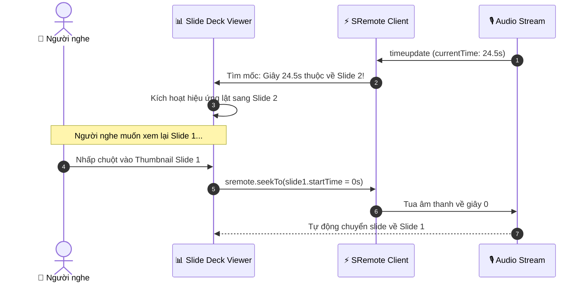

# Tutorial 10: Bộ Trình Chiếu Slide Thuyết Trình Tự Động Lật Theo Giọng Nói (Audio-Driven Slide Deck)

Trong các buổi đào tạo nội bộ của doanh nghiệp hoặc khóa học trực tuyến bán tự động, việc kết hợp giữa **file âm thanh thuyết minh (Voiceover / Audio)** và **bộ Slide trình chiếu** là giải pháp cực kỳ tiết kiệm băng thông so với việc render một file video MP4 cồng kềnh.

Để có trải nghiệm mượt mà, bài toán đặt ra là:
- Khi diễn giả nói đến phần nội dung nào trong file âm thanh, **Slide tương ứng phải tự động lật trang (Auto-Flip)**.
- Người nghe có thể bấm vào mục lục slide bất kỳ để **tua ngược âm thanh** đến đúng thời điểm diễn giả bắt đầu giải thích slide đó (2-way Navigation).

Trong bài hướng dẫn này, chúng ta sẽ xây dựng một **Audio-Driven Slide Deck** hoàn chỉnh bằng **SRemote**.

---

## 🎯 Mục tiêu Bạn Sẽ Đạt Được

Sau bài học này, bạn sẽ nắm vững:
1. Cách định nghĩa siêu dữ liệu dòng thời gian (**Timeline Cue Points / Slide Metadata**).
2. Thuật toán tìm kiếm nhị phân hoặc `findLast()` để xác định slide đang kích hoạt theo `currentTime`.
3. Cơ chế đồng bộ 2 chiều:
   - Âm thanh chạy ➔ Tự động kích hoạt hiệu ứng chuyển slide.
   - Bấm vào thumbnail của slide ➔ Tua âm thanh đến đúng mốc giây bắt đầu của slide đó.
4. Xây dựng thanh tiến độ (Progress Indicator) riêng cho từng slide.



---

## Bước 1: Khởi Tạo Giao Diện Slide Deck & Bộ Điều Khiển Âm Thanh

Hãy tạo file `index.html`:

```html
<!DOCTYPE html>
<html lang="vi">
<head>
  <meta charset="UTF-8">
  <meta name="viewport" content="width=device-width, initial-scale=1.0">
  <title>Audio-Driven Slide Deck - SRemote Tutorial 10</title>
  <link rel="stylesheet" href="style.css">
</head>
<body>

  <div class="deck-app">
    <!-- Header thông tin bài thuyết trình -->
    <header class="deck-header">
      <div>
        <h2>📊 Kiến Trúc Microservices & Event-Driven</h2>
        <p class="meta">Thuyết trình bởi: Tech Lead • Tự động lật slide theo giọng đọc</p>
      </div>
      <div class="slide-counter" id="slide-counter">Slide 1 / 4</div>
    </header>

    <!-- Màn hình hiển thị Slide chính -->
    <div class="slide-stage">
      <div id="active-slide-card" class="slide-card">
        <h1 id="slide-title" class="slide-title">Đang nạp slide...</h1>
        <p id="slide-desc" class="slide-desc"></p>
        <div id="slide-graphic" class="slide-graphic"></div>
      </div>
    </div>

    <!-- Khung phát âm thanh thuyết minh (Voiceover Slot) -->
    <div class="audio-control-panel">
      <div id="audio-slot" class="audio-slot"></div>
    </div>

    <!-- Thanh thumbnail danh sách tất cả các slide (Bấm để nhảy) -->
    <div class="thumbnails-bar" id="thumbnails-bar"></div>
  </div>

  <script type="module" src="app.js"></script>
</body>
</html>
```

Và định dạng chuyển slide mượt mà bằng `style.css`:

```css
* {
  box-sizing: border-box;
  margin: 0;
  padding: 0;
}

body {
  background: #090d16;
  color: #f1f5f9;
  font-family: -apple-system, BlinkMacSystemFont, "Segoe UI", Roboto, sans-serif;
  padding: 24px;
  display: flex;
  justify-content: center;
}

.deck-app {
  max-width: 900px;
  width: 100%;
}

.deck-header {
  display: flex;
  justify-content: space-between;
  align-items: center;
  margin-bottom: 20px;
  border-bottom: 1px solid rgba(255, 255, 255, 0.08);
  padding-bottom: 14px;
}

.deck-header h2 {
  font-size: 22px;
}

.meta {
  font-size: 13px;
  color: #94a3b8;
}

.slide-counter {
  background: #0284c7;
  color: #fff;
  padding: 4px 12px;
  border-radius: 20px;
  font-size: 13px;
  font-weight: 600;
}

/* Sân khấu trình chiếu Slide */
.slide-stage {
  width: 100%;
  aspect-ratio: 16 / 9;
  background: linear-gradient(135deg, #1e293b, #0f172a);
  border-radius: 14px;
  border: 1px solid rgba(255, 255, 255, 0.1);
  box-shadow: 0 25px 50px -12px rgba(0, 0, 0, 0.7);
  overflow: hidden;
  position: relative;
  display: flex;
  align-items: center;
  justify-content: center;
  padding: 40px;
  margin-bottom: 20px;
}

.slide-card {
  text-align: center;
  max-width: 600px;
  animation: fadeIn 0.4s ease-out;
}

.slide-title {
  font-size: 32px;
  color: #38bdf8;
  margin-bottom: 16px;
  line-height: 1.3;
}

.slide-desc {
  font-size: 16px;
  color: #cbd5e1;
  line-height: 1.6;
}

.slide-graphic {
  font-size: 48px;
  margin-top: 24px;
}

@keyframes fadeIn {
  from { opacity: 0; transform: translateY(10px); }
  to { opacity: 1; transform: translateY(0); }
}

.audio-control-panel {
  background: #111827;
  border-radius: 10px;
  padding: 12px;
  margin-bottom: 20px;
  border: 1px solid rgba(255, 255, 255, 0.06);
}

.audio-slot {
  width: 100%;
  height: 80px;
}

/* Thanh Thumbnails */
.thumbnails-bar {
  display: grid;
  grid-template-columns: repeat(4, 1fr);
  gap: 12px;
}

.thumb-item {
  background: #1e293b;
  border-radius: 8px;
  padding: 10px;
  cursor: pointer;
  border: 2px solid transparent;
  transition: all 0.2s;
}

.thumb-item:hover {
  background: #334155;
}

.thumb-item.active {
  border-color: #38bdf8;
  background: rgba(2, 132, 199, 0.2);
}

.thumb-num {
  font-size: 11px;
  color: #38bdf8;
  font-weight: bold;
}

.thumb-title {
  font-size: 12.5px;
  font-weight: 600;
  color: #f1f5f9;
  margin: 4px 0;
  white-space: nowrap;
  overflow: hidden;
  text-overflow: ellipsis;
}

.thumb-time {
  font-size: 11px;
  color: #64748b;
}
```

---

## Bước 2: Định Nghĩa Siêu Dữ Liệu Timeline Cues Của Slide

Tạo file `app.js`. Chúng ta định nghĩa mảng `slides` chứa thời điểm bắt đầu (`startTime`) của từng slide trong bài thuyết trình:

```javascript
import { sremote } from 'https://cdn.jsdelivr.net/npm/@sremote/sdk/+esm';
import { youtube } from 'https://cdn.jsdelivr.net/npm/@sremote/ready2use/+esm';

// Danh sách các Slide kèm mốc thời gian (Cue points)
const slidesData = [
  {
    id: 1,
    startTime: 0,
    title: "1. Tổng Quan Về Kiến Trúc Phân Tán",
    desc: "Tại sao các hệ thống monolithic truyền thống gặp khó khăn khi mở rộng và cách thức microservices giải quyết bài toán này.",
    icon: "🌐"
  },
  {
    id: 2,
    startTime: 20, // Bắt đầu tại giây 20
    title: "2. Giao Thức Event-Driven Messaging",
    desc: "Sử dụng Message Broker (Kafka / RabbitMQ) để tách rời sự phụ thuộc trực tiếp giữa các dịch vụ độc lập.",
    icon: "⚡"
  },
  {
    id: 3,
    startTime: 50, // Bắt đầu tại giây 50
    title: "3. Database Per Service Pattern",
    desc: "Mỗi dịch vụ sở hữu cơ sở dữ liệu riêng biệt để đảm bảo tính độc lập và khả năng triển khai linh hoạt.",
    icon: "🗄️"
  },
  {
    id: 4,
    startTime: 85, // Bắt đầu tại giây 85
    title: "4. Tổng Kết & Q&A Thảo Luận",
    desc: "Tóm lược các nguyên lý cốt lõi và bắt đầu phần giải đáp câu hỏi của người tham dự.",
    icon: "💡"
  }
];

let currentSlideIndex = 0;

const slideTitleEl = document.getElementById('slide-title');
const slideDescEl = document.getElementById('slide-desc');
const slideGraphicEl = document.getElementById('slide-graphic');
const slideCounterEl = document.getElementById('slide-counter');
const thumbnailsBarEl = document.getElementById('thumbnails-bar');
```

---

## Bước 3: Nạp Âm Thanh & Render Thumbnails Slide

```javascript
async function initSlideDeck() {
  renderThumbnails();
  displaySlide(0);

  // Gắn audio stream thuyết minh vào slot
  await youtube.mount('#audio-slot', {
    videoId: 'jfKfPfyJRdk', // Audio stream mẫu
    playerVars: { controls: 1, autoplay: 0 }
  });

  console.log('✅ Bộ trình chiếu đã sẵn sàng!');
  setupTimeTracking();
}

function renderThumbnails() {
  thumbnailsBarEl.innerHTML = '';
  slidesData.forEach((slide, index) => {
    const div = document.createElement('div');
    div.className = `thumb-item ${index === 0 ? 'active' : ''}`;
    div.id = `thumb-${slide.id}`;
    div.innerHTML = `
      <div class="thumb-num">SLIDE ${slide.id}</div>
      <div class="thumb-title">${slide.title}</div>
      <div class="thumb-time">⏱ Bắt đầu: ${slide.startTime}s</div>
    `;

    // Nhấp vào Thumbnail -> Tua âm thanh tới đúng mốc slide đó!
    div.addEventListener('click', async () => {
      console.log(`⏩ Người dùng nhấp vào Slide ${slide.id} -> Tua về ${slide.startTime}s`);
      await sremote.seekTo(slide.startTime);
      await sremote.play();
    });

    thumbnailsBarEl.appendChild(div);
  });
}

function displaySlide(index) {
  currentSlideIndex = index;
  const slide = slidesData[index];

  slideTitleEl.textContent = slide.title;
  slideDescEl.textContent = slide.desc;
  slideGraphicEl.textContent = slide.icon;
  slideCounterEl.textContent = `Slide ${slide.id} / ${slidesData.length}`;

  // Highlight thumbnail tương ứng
  document.querySelectorAll('.thumb-item').forEach(el => el.classList.remove('active'));
  const activeThumb = document.getElementById(`thumb-${slide.id}`);
  if (activeThumb) activeThumb.classList.add('active');
}
```

---

## Bước 4: Lập Trình Thuật Toán Tự Động Lật Slide Theo `timeupdate`

Khi SRemote bắn sự kiện `timeupdate`, chúng ta duyệt từ cuối mảng `slidesData` về đầu (hoặc dùng `findLast`) để tìm slide có `startTime <= currentTime`:

```javascript
function setupTimeTracking() {
  sremote.on('timeupdate', ({ currentTime }) => {
    // Tìm slide phù hợp nhất với thời gian hiện tại
    let targetIndex = 0;
    for (let i = slidesData.length - 1; i >= 0; i--) {
      if (currentTime >= slidesData[i].startTime) {
        targetIndex = i;
        break;
      }
    }

    // Nếu phát hiện chuyển sang slide mới -> Cập nhật hiển thị
    if (targetIndex !== currentSlideIndex) {
      console.log(`🔄 Tự động lật sang Slide ${slidesData[targetIndex].id} tại giây ${currentTime.toFixed(1)}s`);
      displaySlide(targetIndex);
    }
  });
}

// Khởi chạy
initSlideDeck();
```

---

## 💡 Bài Tập Thử Thách Mở Rộng

1. **Hiệu ứng chuyển trang 3D (Page Flip Effect)**: Bổ sung thư viện CSS 3D Transform để khi lật slide có hiệu ứng trang sách mở ra chân thực.
2. **Xuất bản PDF Handout**: Tích hợp nút in tài liệu bài giảng ra file PDF với đầy đủ nội dung của 4 slide.
