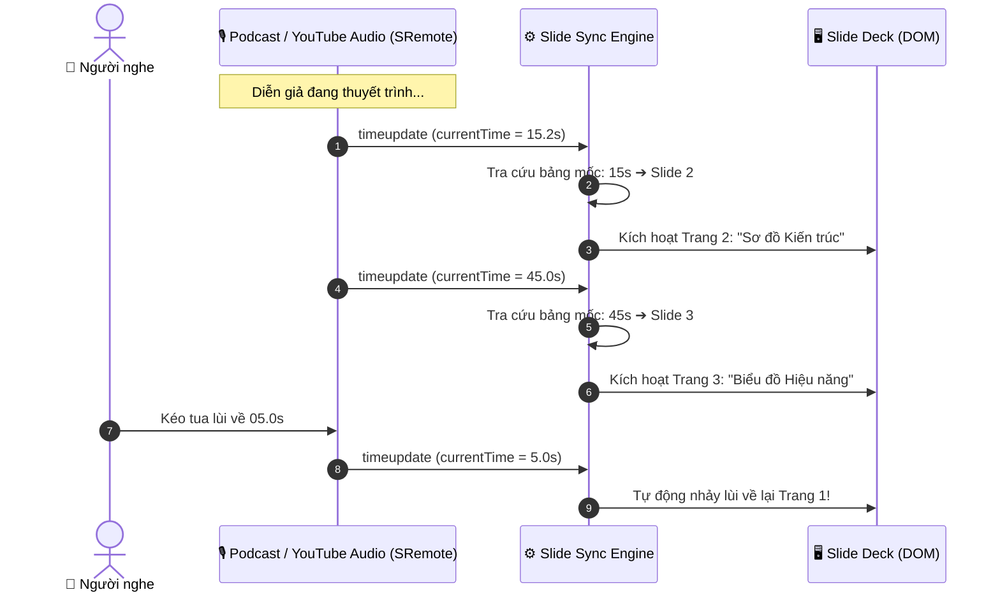

# Blueprint 10: Trình Chiếu Slide Đồng Bộ Âm Thanh (Audio-Driven Slide Deck)

Bài hướng dẫn này sẽ hướng dẫn bạn xây dựng ứng dụng **Thuyết trình / Slide Deck tự động lật trang theo bài nói (Audio-Driven Slide Deck)**: khi file âm thanh podcast hoặc bài giảng video chạy tới mốc thời gian nào, trang slide tương ứng sẽ **tự động chuyển trang và kích hoạt hiệu ứng hoạt cảnh** thông qua **SRemote**.

---

## 1. Bài toán Thực tế & Mục tiêu

Khi xây dựng các trang thuyết trình sản phẩm (Keynote Showcase), bài giảng e-learning hoặc webinar:
- Diễn giả nói đến đâu thì slide minh họa bên cạnh phải lật trang đến đó.
- Nếu người nghe kéo thanh tua lùi lại 30 giây để nghe lại một ý quan trọng, slide cũng phải **tự động nhảy ngược về trang trước tương ứng**.
- Thay vì bắt lập trình viên phải viết các hàm đếm giờ `setInterval` phức tạp dễ bị lệch nhịp, SRemote cung cấp sự kiện `timeupdate` với độ chính xác cao để đồng bộ bảng mốc tín hiệu (Cues Table).



---

## 2. Mã Nguồn Đầy Đủ (Full Working Project)

### Bước 1: Giao diện Slide & Khung Âm Thanh (`index.html`)

```html
<!DOCTYPE html>
<html lang="vi">
<head>
  <meta charset="UTF-8">
  <meta name="viewport" content="width=device-width, initial-scale=1.0">
  <title>Audio-Driven Slide Deck - SRemote Blueprint 10</title>
  <link rel="stylesheet" href="style.css">
</head>
<body>

  <div class="presentation-layout">
    <!-- Khung trình chiếu Slide lớn bên trái -->
    <div class="slide-viewport">
      <div class="slide-deck" id="slide-deck">
        
        <!-- Slide 1 -->
        <div class="slide-card active" data-slide="0">
          <span class="slide-num">Trang 1 / 3</span>
          <h2>🚀 Giới thiệu Kiến trúc SRemote</h2>
          <p>Giải pháp toàn diện vượt rào Same-Origin Policy trong trình duyệt web.</p>
          <div class="slide-graphic">📦 Monorepo Overview</div>
        </div>

        <!-- Slide 2 -->
        <div class="slide-card" data-slide="1">
          <span class="slide-num">Trang 2 / 3</span>
          <h2>⚡ Giao Thức MessageChannel & FSM</h2>
          <p>Kênh truyền thông hai chiều bảo mật cao giữa trang cha và thẻ iframe.</p>
          <div class="slide-graphic">🌉 Dual-Engine Bridge</div>
        </div>

        <!-- Slide 3 -->
        <div class="slide-card" data-slide="2">
          <span class="slide-num">Trang 3 / 3</span>
          <h2>🎯 Kết Luận & Ứng Dụng Thực Tế</h2>
          <p>Tương thích 22 nền tảng media hàng đầu thế giới mà không cần proprietary SDK.</p>
          <div class="slide-graphic">🏆 Universal Standards</div>
        </div>

      </div>
    </div>

    <!-- Cột bên phải: Audio Player & Timeline mốc thời gian -->
    <div class="audio-sidebar">
      <div class="sidebar-header">
        <h3>🎙️ Bản thu âm bài giảng</h3>
        <p>Slide sẽ tự động chuyển trang khớp theo giọng nói diễn giả.</p>
      </div>

      <!-- Khung nhúng âm thanh podcast/video YouTube -->
      <div id="audio-slot" class="audio-slot"></div>

      <!-- Mục lục timeline các slide -->
      <div class="cues-list">
        <h4>Mốc nội dung (Timeline Cues):</h4>
        <div class="cue-item active" data-index="0" data-time="0">
          <span>00:00</span> Giới thiệu kiến trúc tổng thể
        </div>
        <div class="cue-item" data-index="1" data-time="15">
          <span>00:15</span> Giao thức MessageChannel
        </div>
        <div class="cue-item" data-index="2" data-time="45">
          <span>00:45</span> Kết luận & Ứng dụng
        </div>
      </div>
    </div>
  </div>

  <script type="module" src="app.js"></script>
</body>
</html>
```

---

### Bước 2: Thiết kế Giao diện Keynote (`style.css`)

```css
* { box-sizing: border-box; margin: 0; padding: 0; }
body {
  background: #090d16;
  color: #f1f5f9;
  font-family: -apple-system, BlinkMacSystemFont, "Segoe UI", Roboto, sans-serif;
  min-height: 100vh;
  padding: 24px;
}

.presentation-layout {
  display: grid;
  grid-template-columns: 2fr 1fr;
  gap: 24px;
  max-width: 1200px;
  margin: 0 auto;
}

@media (max-width: 860px) {
  .presentation-layout { grid-template-columns: 1fr; }
}

.slide-viewport {
  background: #131b2e;
  border-radius: 14px;
  border: 1px solid rgba(255, 255, 255, 0.08);
  aspect-ratio: 16 / 10;
  position: relative;
  overflow: hidden;
  box-shadow: 0 20px 40px -10px rgba(0, 0, 0, 0.8);
}

.slide-card {
  position: absolute;
  inset: 0;
  padding: 40px;
  display: flex;
  flex-direction: column;
  justify-content: center;
  align-items: center;
  text-align: center;
  opacity: 0;
  transform: scale(0.96);
  pointer-events: none;
  transition: opacity 0.4s ease, transform 0.4s ease;
}

.slide-card.active {
  opacity: 1;
  transform: scale(1);
  pointer-events: auto;
}

.slide-num {
  font-size: 12px;
  text-transform: uppercase;
  color: #38bdf8;
  font-weight: bold;
  margin-bottom: 12px;
}

.slide-card h2 {
  font-size: 28px;
  color: #f8fafc;
  margin-bottom: 12px;
}

.slide-card p {
  font-size: 16px;
  color: #94a3b8;
  max-width: 500px;
  margin-bottom: 24px;
}

.slide-graphic {
  width: 260px;
  height: 140px;
  background: rgba(56, 189, 248, 0.1);
  border: 2px dashed #38bdf8;
  border-radius: 10px;
  display: flex;
  align-items: center;
  justify-content: center;
  font-size: 14px;
  font-weight: bold;
  color: #38bdf8;
}

.audio-sidebar {
  background: #131b2e;
  border-radius: 14px;
  border: 1px solid rgba(255, 255, 255, 0.08);
  padding: 20px;
  display: flex;
  flex-direction: column;
}

.sidebar-header h3 { font-size: 16px; margin-bottom: 4px; }
.sidebar-header p { font-size: 12.5px; color: #94a3b8; margin-bottom: 16px; }

.audio-slot {
  width: 100%;
  aspect-ratio: 16 / 9;
  background: #000;
  border-radius: 8px;
  overflow: hidden;
  margin-bottom: 20px;
}

.cues-list h4 {
  font-size: 13px;
  color: #94a3b8;
  text-transform: uppercase;
  margin-bottom: 10px;
}

.cue-item {
  padding: 10px 12px;
  border-radius: 6px;
  background: rgba(255, 255, 255, 0.03);
  font-size: 13px;
  margin-bottom: 6px;
  cursor: pointer;
  display: flex;
  align-items: center;
  gap: 10px;
  border: 1px solid transparent;
  transition: all 0.2s;
}

.cue-item span {
  font-family: monospace;
  font-weight: bold;
  color: #38bdf8;
  background: rgba(56, 189, 248, 0.15);
  padding: 2px 6px;
  border-radius: 4px;
}

.cue-item:hover { background: rgba(255, 255, 255, 0.06); }

.cue-item.active {
  background: rgba(2, 132, 199, 0.2);
  border-color: #38bdf8;
  font-weight: 600;
}
```

---

### Bước 3: Logic Đồng Bộ Slide & Bảng Mốc Thời Gian (`app.js`)

```javascript
import { sremote } from 'https://cdn.jsdelivr.net/npm/@sremote/sdk/+esm';
import { youtube } from 'https://cdn.jsdelivr.net/npm/@sremote/ready2use/+esm';

// Bảng ánh xạ mốc thời gian (giây) -> chỉ mục Slide
const timelineCues = [
  { time: 0, slideIndex: 0 },
  { time: 15, slideIndex: 1 },
  { time: 45, slideIndex: 2 }
];

let currentActiveIndex = -1;

const slideCards = document.querySelectorAll('.slide-card');
const cueItems = document.querySelectorAll('.cue-item');

// Hàm kích hoạt hiển thị slide chỉ định
function setActiveSlide(index) {
  if (currentActiveIndex === index) return;
  currentActiveIndex = index;

  slideCards.forEach((card, i) => {
    card.classList.toggle('active', i === currentActiveIndex);
  });

  cueItems.forEach((item, i) => {
    item.classList.toggle('active', i === currentActiveIndex);
  });
}

// 1. Mount YouTube video/audio
await youtube.mount('#audio-slot', {
  videoId: 'dQw4w9WgXcQ',
  playerVars: { controls: 1 }
});

// 2. Lắng nghe sự kiện timeupdate để tự động khớp slide
sremote.on('timeupdate', ({ state }) => {
  const currentTime = state.currentTime || 0;

  // Tìm mốc thời gian phù hợp nhất (lấy mốc lớn nhất mà currentTime >= cue.time)
  const matchedCue = [...timelineCues]
    .reverse()
    .find(cue => currentTime >= cue.time);

  if (matchedCue) {
    setActiveSlide(matchedCue.slideIndex);
  }
});

// 3. Cho phép người dùng bấm vào mốc timeline để tua video
cueItems.forEach(item => {
  item.addEventListener('click', async () => {
    const time = parseFloat(item.getAttribute('data-time'));
    await sremote.seekTo(time);
    await sremote.play();
  });
});

// Khởi tạo ở slide 0
setActiveSlide(0);
```

---

## 3. Deep Dive: Giải Thuật Tìm Mốc Ngược (Reverse Search)

```javascript
const matchedCue = [...timelineCues]
  .reverse()
  .find(cue => currentTime >= cue.time);
```
Bằng cách sao chép mảng và đảo ngược (`.reverse()`), khi `currentTime = 25s`, hàm `.find()` sẽ kiểm tra từ mốc 45s (không thỏa mãn) ➔ mốc 15s (thỏa mãn `25 >= 15`), và dừng ngay lập tức. Giải thuật này đảm bảo độ phức tạp $O(N)$ cực kỳ nhẹ nhàng ngay cả khi bài thuyết trình có hàng trăm slide.
