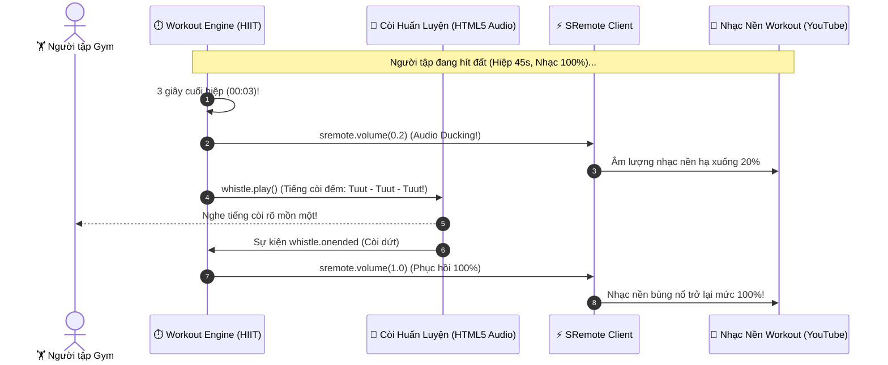

# Blueprint 11: Đồng Hồ Tập Thể Hình TABATA/HIIT (Smart Audio Ducking)

Bài hướng dẫn này sẽ hướng dẫn bạn xây dựng ứng dụng **Đồng hồ tập luyện ngắt quãng (Interval Workout Timer / TABATA / HIIT)** kết hợp nhạc nền tập luyện sôi động: áp dụng kỹ thuật **Audio Ducking** chuyên nghiệp để tự động hạ nhỏ âm lượng nhạc nền xuống 20% mỗi khi có tiếng còi đếm nhịp ("3 - 2 - 1 - Hết giờ / Đổi bài tập") vang lên, sau đó **tự động phục hồi lại 100% âm lượng** thông qua **SRemote**.

---

## 1. Bài toán Thực tế & Mục tiêu

Trong các ứng dụng thể dục thể thao (như Nike Training Club, Peloton, Freeletics):
- Nhạc nền (EDM / Workout Beats từ YouTube hoặc Spotify) cần phát thật to (100% Volume) để tạo năng lượng cho người tập.
- Nhưng khi đếm ngược 3 giây cuối hiệp tập hoặc có tiếng còi báo chuyển bài tập (Whistle / Voice Coach):
  - Nếu không hạ âm lượng nhạc nền, tiếng còi sẽ bị tiếng trống nhạc dìm mất, người tập không nghe thấy hiệu lệnh.
  - Nếu dừng hẳn nhạc (`pause`), nhịp độ hưng phấn của buổi tập sẽ bị ngắt quãng.
- **Kỹ thuật Audio Ducking**: Tự động hạ âm lượng nhạc nền xuống mức 20% (`sremote.volume(0.2)`), phát âm thanh hiệu lệnh còi, và ngay khi âm thanh còi dứt (`whistle.onended`), âm lượng nhạc nền lập tức được tăng lại mức 100% (`sremote.volume(1.0)`).



---

## 2. Mã Nguồn Đầy Đủ (Full Working Project)

### Bước 1: Giao diện Đồng Hồ Thể Thao HIIT (`index.html`)

```html
<!DOCTYPE html>
<html lang="vi">
<head>
  <meta charset="UTF-8">
  <meta name="viewport" content="width=device-width, initial-scale=1.0">
  <title>Smart Gym Audio Ducking - SRemote Blueprint 11</title>
  <link rel="stylesheet" href="style.css">
</head>
<body>

  <div class="workout-card">
    <div class="header">
      <h2>🔥 HIIT Interval Timer</h2>
      <span id="phase-badge" class="badge badge-work">Hiệp Tập (Work)</span>
    </div>

    <!-- Màn hình đếm ngược số giây to -->
    <div id="workout-timer" class="workout-timer">45</div>

    <!-- Thông tin bài tập -->
    <div class="exercise-info">
      <h3 id="exercise-name">Bài tập: Hít đất (Push-ups)</h3>
      <p id="round-info">Hiệp 1 / 4 • Nghỉ 15s giữa các hiệp</p>
    </div>

    <!-- Nút bắt đầu tập -->
    <div class="actions">
      <button id="btn-start-workout" class="btn btn-start">▶ Bắt đầu buổi tập</button>
      <button id="btn-stop-workout" class="btn btn-stop">⏹ Dừng buổi tập</button>
    </div>

    <!-- Khung phát nhạc nền tập gym -->
    <div class="music-box">
      <div class="music-label">🎵 Nhạc nền tập luyện (Tự hạ âm lượng khi có còi):</div>
      <div id="workout-music-slot" class="workout-music-slot"></div>
    </div>
  </div>

  <script type="module" src="app.js"></script>
</body>
</html>
```

---

### Bước 2: Thiết kế Giao diện Thể Thao Năng Động (`style.css`)

```css
* { box-sizing: border-box; margin: 0; padding: 0; }
body {
  background: #09090b;
  color: #f4f4f5;
  font-family: -apple-system, BlinkMacSystemFont, "Segoe UI", Roboto, sans-serif;
  min-height: 100vh;
  display: flex;
  justify-content: center;
  align-items: center;
  padding: 20px;
}

.workout-card {
  width: 100%;
  max-width: 480px;
  background: #18181b;
  border-radius: 16px;
  padding: 28px;
  border: 1px solid rgba(255, 255, 255, 0.08);
  box-shadow: 0 25px 50px -12px rgba(0, 0, 0, 0.8);
  text-align: center;
}

.header {
  display: flex;
  justify-content: space-between;
  align-items: center;
  margin-bottom: 16px;
}

.badge {
  font-size: 12px;
  font-weight: bold;
  padding: 4px 12px;
  border-radius: 20px;
  text-transform: uppercase;
}

.badge-work { background: #ef4444; color: #fff; }
.badge-rest { background: #22c55e; color: #052e16; }

.workout-timer {
  font-size: 96px;
  font-weight: 900;
  color: #f4f4f5;
  font-variant-numeric: tabular-nums;
  margin: 10px 0;
  line-height: 1;
}

.exercise-info h3 { font-size: 18px; margin-bottom: 4px; color: #f8fafc; }
.exercise-info p { font-size: 13px; color: #a1a1aa; margin-bottom: 24px; }

.actions {
  display: flex;
  justify-content: center;
  gap: 12px;
  margin-bottom: 28px;
}

.btn {
  padding: 12px 22px;
  border-radius: 8px;
  font-weight: 700;
  font-size: 14px;
  border: none;
  cursor: pointer;
  transition: all 0.2s;
}

.btn-start { background: #ef4444; color: #fff; }
.btn-start:hover { background: #dc2626; transform: scale(1.02); }

.btn-stop { background: #27272a; color: #d4d4d8; }
.btn-stop:hover { background: #3f3f46; }

.music-box {
  background: #09090b;
  border-radius: 10px;
  padding: 14px;
  border: 1px solid rgba(255, 255, 255, 0.05);
  text-align: left;
}

.music-label { font-size: 12px; color: #71717a; margin-bottom: 10px; }

.workout-music-slot {
  width: 100%;
  aspect-ratio: 16 / 9;
  border-radius: 6px;
  overflow: hidden;
  background: #000;
}
```

---

### Bước 3: Logic Đếm Giờ & Thuật Toán Audio Ducking (`app.js`)

```javascript
import { sremote } from 'https://cdn.jsdelivr.net/npm/@sremote/sdk/+esm';
import { youtube } from 'https://cdn.jsdelivr.net/npm/@sremote/ready2use/+esm';

const timerEl = document.getElementById('workout-timer');
const badgeEl = document.getElementById('phase-badge');
const btnStart = document.getElementById('btn-start-workout');
const btnStop = document.getElementById('btn-stop-workout');

let currentPhase = 'WORK'; // 'WORK' (45s) hoặc 'REST' (15s)
let secondsLeft = 45;
let workoutInterval = null;

// Giả lập âm thanh còi bằng Web Audio API (Không cần tải file mp3 bên ngoài!)
function playWhistleSound() {
  return new Promise((resolve) => {
    const audioCtx = new (window.AudioContext || window.webkitAudioContext)();
    const osc = audioCtx.createOscillator();
    const gain = audioCtx.createGain();

    osc.type = 'sine';
    osc.frequency.setValueAtTime(880, audioCtx.currentTime); // Nốt La (880Hz)
    osc.frequency.exponentialRampToValueAtTime(440, audioCtx.currentTime + 0.8);

    gain.gain.setValueAtTime(1, audioCtx.currentTime);
    gain.gain.exponentialRampToValueAtTime(0.01, audioCtx.currentTime + 0.8);

    osc.connect(gain);
    gain.connect(audioCtx.destination);

    osc.start();
    osc.stop(audioCtx.currentTime + 0.8);

    osc.onended = () => {
      audioCtx.close();
      resolve();
    };
  });
}

// 1. Mount YouTube EDM Workout Radio
await youtube.mount('#workout-music-slot', {
  videoId: '4xDzrJKXOOY',
  playerVars: { controls: 1, autoplay: 0 }
});

// 2. Kỹ thuật Audio Ducking cốt lõi
async function triggerAudioDuckingWhistle() {
  console.log('🔉 Hạ âm lượng nhạc nền xuống 20% (Audio Ducking)...');
  // 1. Hạ nhạc nền xuống 20%
  await sremote.volume(0.2);

  // 2. Phát âm thanh còi huấn luyện
  await playWhistleSound();

  // 3. Phục hồi âm lượng nhạc nền về lại 100%
  console.log('🔊 Phục hồi âm lượng nhạc nền về 100%!');
  await sremote.volume(1.0);
}

// 3. Vòng lặp đếm nhịp Interval HIIT
btnStart.addEventListener('click', async () => {
  if (workoutInterval) return;

  // Bắt đầu phát nhạc tập luyện ở mức 100%
  await sremote.volume(1.0);
  await sremote.play();

  workoutInterval = setInterval(async () => {
    secondsLeft--;
    timerEl.textContent = secondsLeft;

    // Khi còn 1 giây trước khi chuyển hiệp: Kích hoạt Audio Ducking
    if (secondsLeft === 1) {
      await triggerAudioDuckingWhistle();
    }

    // Khi hết hiệp: Đổi giữa WORK (45s) và REST (15s)
    if (secondsLeft <= 0) {
      if (currentPhase === 'WORK') {
        currentPhase = 'REST';
        secondsLeft = 15;
        badgeEl.textContent = 'Nghỉ ngơi (Rest)';
        badgeEl.className = 'badge badge-rest';
        timerEl.textContent = '15';
      } else {
        currentPhase = 'WORK';
        secondsLeft = 45;
        badgeEl.textContent = 'Hiệp Tập (Work)';
        badgeEl.className = 'badge badge-work';
        timerEl.textContent = '45';
      }
    }
  }, 1000);
});

// 4. Dừng buổi tập
btnStop.addEventListener('click', async () => {
  clearInterval(workoutInterval);
  workoutInterval = null;
  secondsLeft = 45;
  timerEl.textContent = '45';
  await sremote.pause();
});
```

---

## 3. Deep Dive: Sự Khác Biệt Giữa Audio Ducking và Pause

Nhiều lập trình viên khi làm ứng dụng thể thao thường chọn cách gọi `sremote.pause()`, phát còi xong rồi gọi `sremote.play()`. Tuy nhiên cách làm này có 2 nhược điểm chết người:
1. **Lỗi Autoplay Rejection**: Sau khi bị dừng, một số trình duyệt có thể từ chối lệnh `play()` thứ hai nếu không có tương tác trực tiếp của người dùng tại thời điểm đó.
2. **Ngắt nhịp tâm lý (Momentum Killer)**: Trong phòng gym, việc nhạc nền bị tắt ngúm trong 1 giây tạo cảm giác như "mất mạng" hoặc "bị lỗi app". Với **Audio Ducking** (`volume 0.2 ➔ 1.0`), âm nhạc vẫn dập nhẹ bên dưới, tạo cảm giác cực kỳ chuyên nghiệp như các ứng dụng thể thao hàng đầu thế giới.
