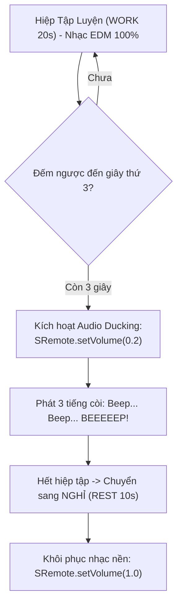

# Tutorial 11: Đồng Hồ Tập Luyện Smart Gym HIIT / TABATA với Kỹ Thuật Audio Ducking

Trong các ứng dụng phòng tập thể hình thông minh (Smart Gym App) hay ứng dụng đếm giờ HIIT/TABATA (như Nike Training Club hay Freeletics), một trải nghiệm âm thanh cực kỳ chuyên nghiệp là **Audio Ducking (Nén âm lượng nhạc nền)**:
- Người tập đang nghe một bản nhạc Remix / EDM sôi động từ YouTube hoặc Spotify với âm lượng 100%.
- Khi hiệp tập sắp kết thúc (3 giây đếm ngược cuối cùng: 3... 2... 1... BEEP!), hệ thống **tự động hạ nhỏ âm lượng nhạc nền xuống 20% (Ducking)** để người tập nghe rõ mồn một tiếng còi hiệu lệnh của huấn luyện viên.
- Ngay khi tiếng còi kết thúc và bước vào hiệp nghỉ ngơi (hoặc hiệp tập mới), âm lượng nhạc nền sẽ **tự động bùng nổ trở lại 100%**!

Trong tutorial này, chúng ta sẽ xây dựng ứng dụng đếm giờ HIIT chuyên nghiệp này bằng **Web Audio API** và **SRemote**.

> [!TIP]
> **Trải nghiệm ngay bản demo hoạt động thực tế**: Mở [🚀 Live Demo: 11-gym-ducking](../../../../demo/apps/11-gym-ducking/index.html) để tương tác trực tiếp trên trình duyệt.

---

## 🎯 Mục tiêu Bạn Sẽ Đạt Được

Sau bài học này, bạn sẽ nắm vững:
1. Cách xây dựng máy trạng thái hữu hạn (FSM) cho bộ đếm HIIT: `WORK (Tập 20s)` ➔ `REST (Nghỉ 10s)` ➔ `Lặp lại số hiệp (Rounds)`.
2. Tạo âm thanh tiếng còi Beep chuẩn xác bằng **Web Audio API** (`OscillatorNode`) mà không cần nạp file mp3 ngoài.
3. **Kỹ thuật Audio Ducking Thời Gian Thực**: Tự động hạ âm lượng nhạc nền qua `sremote.setVolume(0.2)` khi phát hiệu lệnh và hồi phục `1.0` khi dứt còi.
4. Cơ chế giữ màn hình điện thoại không bị tắt (**Screen WakeLock API**).



---

## Bước 1: Khởi Tạo Giao Diện Bộ Đếm HIIT & Vùng Phát Nhạc

Hãy tạo file `index.html`:

```html
<!DOCTYPE html>
<html lang="vi">
<head>
  <meta charset="UTF-8">
  <meta name="viewport" content="width=device-width, initial-scale=1.0">
  <title>Smart Gym HIIT Audio Ducking - SRemote Tutorial 11</title>
  <link rel="stylesheet" href="style.css">
</head>
<body>

  <div class="gym-app">
    <!-- Thẻ trạng thái Hiệp tập / Nghỉ ngơi -->
    <div class="phase-card" id="phase-card">
      <div class="round-indicator" id="round-indicator">HIỆP 1 / 8</div>
      <div class="phase-name" id="phase-name">CHUẨN BỊ</div>
      <div class="timer-countdown" id="timer-countdown">05</div>
    </div>

    <!-- Nút điều khiển tập luyện -->
    <div class="controls-row">
      <button id="btn-start-workout" class="btn btn-start">🔥 Bắt Đầu Tập</button>
      <button id="btn-pause-workout" class="btn btn-pause">⏸ Tạm Dừng</button>
    </div>

    <!-- Khung nhạc nền Gym Workout -->
    <div class="music-section">
      <div class="music-header">
        <span>🎧 Nhạc nền phòng Gym: Workout EDM Remix</span>
        <span id="ducking-status" class="ducking-badge">Bình thường (100%)</span>
      </div>
      <div id="workout-music-slot" class="music-slot"></div>
    </div>
  </div>

  <script type="module" src="app.js"></script>
</body>
</html>
```

Và định dạng bằng `style.css`:

```css
* {
  box-sizing: border-box;
  margin: 0;
  padding: 0;
}

body {
  background: #090d16;
  color: #f1f5f9;
  font-family: -apple-system, BlinkMacSystemFont, "Segoe UI", Roboto, sans-serif;
  min-height: 100vh;
  display: flex;
  align-items: center;
  justify-content: center;
  padding: 20px;
}

.gym-app {
  max-width: 480px;
  width: 100%;
}

.phase-card {
  background: #1e293b;
  border-radius: 20px;
  padding: 36px 20px;
  text-align: center;
  border: 2px solid rgba(255, 255, 255, 0.1);
  box-shadow: 0 25px 50px -12px rgba(0, 0, 0, 0.8);
  margin-bottom: 24px;
  transition: all 0.3s;
}

/* Đổi màu đỏ rực khi vào hiệp tập cường độ cao */
.phase-card.work-phase {
  background: linear-gradient(180deg, #991b1b, #450a0a);
  border-color: #ef4444;
}

/* Đổi màu xanh lá khi vào hiệp nghỉ ngơi */
.phase-card.rest-phase {
  background: linear-gradient(180deg, #065f46, #022c22);
  border-color: #10b981;
}

.round-indicator {
  font-size: 14px;
  font-weight: 700;
  color: #94a3b8;
  letter-spacing: 1px;
  margin-bottom: 8px;
}

.phase-name {
  font-size: 32px;
  font-weight: 900;
  text-transform: uppercase;
  margin-bottom: 12px;
}

.timer-countdown {
  font-size: 88px;
  font-weight: 900;
  font-variant-numeric: tabular-nums;
  line-height: 1;
}

.controls-row {
  display: flex;
  gap: 12px;
  margin-bottom: 24px;
}

.btn {
  flex: 1;
  padding: 14px;
  border-radius: 10px;
  border: none;
  font-size: 15px;
  font-weight: 700;
  cursor: pointer;
  transition: all 0.2s;
}

.btn-start {
  background: #38bdf8;
  color: #0f172a;
}

.btn-start:hover {
  background: #0284c7;
  color: #fff;
}

.btn-pause {
  background: #334155;
  color: #f1f5f9;
}

.btn-pause:hover {
  background: #475569;
}

.music-section {
  background: #111827;
  border-radius: 12px;
  padding: 16px;
  border: 1px solid rgba(255, 255, 255, 0.06);
}

.music-header {
  display: flex;
  justify-content: space-between;
  align-items: center;
  font-size: 12.5px;
  color: #94a3b8;
  margin-bottom: 12px;
}

.ducking-badge {
  background: #1e293b;
  color: #38bdf8;
  padding: 2px 8px;
  border-radius: 4px;
  font-weight: 600;
}

.ducking-badge.active {
  background: #f59e0b;
  color: #000;
  font-weight: 700;
}

.music-slot {
  width: 100%;
  aspect-ratio: 16 / 9;
  background: #000;
  border-radius: 8px;
  overflow: hidden;
}
```

---

## Bước 2: Tạo Tiếng Còi Beep Bằng Web Audio API (Không Cần File MP3)

Mở file `app.js`. Trình duyệt tích hợp sẵn bộ tổng hợp âm thanh `AudioContext`. Chúng ta viết hàm phát tiếng còi Beep ngắn:

```javascript
import { sremote } from 'https://cdn.jsdelivr.net/npm/@sremote/sdk/+esm';
import { youtube } from 'https://cdn.jsdelivr.net/npm/@sremote/ready2use/+esm';

// Bộ phát âm thanh Web Audio
const audioCtx = new (window.AudioContext || window.webkitAudioContext)();

function playBeepSound(frequency = 880, duration = 0.2) {
  if (audioCtx.state === 'suspended') {
    audioCtx.resume();
  }
  const osc = audioCtx.createOscillator();
  const gain = audioCtx.createGain();

  osc.type = 'sine';
  osc.frequency.value = frequency; // 880Hz = Nốt La cao

  gain.gain.setValueAtTime(0.3, audioCtx.currentTime);
  gain.gain.exponentialRampToValueAtTime(0.001, audioCtx.currentTime + duration);

  osc.connect(gain);
  gain.connect(audioCtx.destination);

  osc.start();
  osc.stop(audioCtx.currentTime + duration);
}
```

---

## Bước 3: Nạp Nhạc Nền Gym & Cấu Hình Các Hiệp HIIT

```javascript
// Cấu hình bài tập HIIT
const WORK_SECONDS = 20; // 20 giây tập hết sức
const REST_SECONDS = 10; // 10 giây nghỉ
const TOTAL_ROUNDS = 8;  // 8 hiệp Tabata

let currentRound = 1;
let currentPhase = 'PREPARE'; // 'PREPARE' | 'WORK' | 'REST'
let secondsLeft = 5;
let timerId = null;
let isWorkingOut = false;

const phaseCard = document.getElementById('phase-card');
const phaseNameEl = document.getElementById('phase-name');
const timerCountdownEl = document.getElementById('timer-countdown');
const roundIndicatorEl = document.getElementById('round-indicator');
const duckingStatusEl = document.getElementById('ducking-status');
const btnStartWorkout = document.getElementById('btn-start-workout');
const btnPauseWorkout = document.getElementById('btn-pause-workout');

async function initGymApp() {
  await youtube.mount('#workout-music-slot', {
    videoId: '4xDzrJKXOOY', // Workout EDM Livestream
    playerVars: { controls: 1, autoplay: 0 }
  });
  await sremote.setVolume(1);
  console.log('✅ Hệ thống phòng Gym thông minh đã sẵn sàng!');
}
```

---

## Bước 4: Lập Trình Kỹ Thuật Audio Ducking (Hạ Nhạc Nền 20%)

Đây là điểm then chốt:
1. Khi `secondsLeft === 3`: Hạ nhạc nền xuống 20% bằng `await sremote.setVolume(0.2)` và phát tiếng còi Beep 1.
2. Khi `secondsLeft === 2`: Tiếp tục phát Beep 2.
3. Khi `secondsLeft === 1`: Tiếp tục phát Beep 3.
4. Khi chuyển sang hiệp mới (`secondsLeft === 0`): Phát còi dài tần số cao và **khôi phục âm lượng 100%** bằng `await sremote.setVolume(1.0)`!

```javascript
function startWorkout() {
  if (isWorkingOut) return;
  isWorkingOut = true;
  sremote.play(); // Bật nhạc nền

  timerId = setInterval(async () => {
    secondsLeft--;
    timerCountdownEl.textContent = String(secondsLeft).padStart(2, '0');

    // 1. KÍCH HOẠT AUDIO DUCKING TẠI 3 GIÂY CUỐI
    if (secondsLeft === 3) {
      console.log('🔉 Bắt đầu Audio Ducking: Giảm nhạc nền xuống 20%');
      await sremote.setVolume(0.2);
      duckingStatusEl.textContent = 'Ducking (20%)';
      duckingStatusEl.classList.add('active');
      playBeepSound(660, 0.2); // Beep thấp
    } 
    else if (secondsLeft === 2 || secondsLeft === 1) {
      playBeepSound(660, 0.2); // Beep thấp
    }

    // 2. KHI HẾT THỜI GIAN HIỆP
    if (secondsLeft <= 0) {
      playBeepSound(1320, 0.6); // Tiếng còi dài kết thúc hiệp!
      switchPhase();
    }
  }, 1000);
}

async function switchPhase() {
  // Khôi phục lại âm lượng nhạc nền 100%
  await sremote.setVolume(1);
  duckingStatusEl.textContent = 'Bình thường (100%)';
  duckingStatusEl.classList.remove('active');

  if (currentPhase === 'PREPARE' || currentPhase === 'REST') {
    // Chuyển sang hiệp WORK
    currentPhase = 'WORK';
    secondsLeft = WORK_SECONDS;
    phaseNameEl.textContent = '🔥 TẬP HẾT SỨC!';
    phaseCard.className = 'phase-card work-phase';
  } else if (currentPhase === 'WORK') {
    // Chuyển sang hiệp REST hoặc kết thúc bài tập
    if (currentRound >= TOTAL_ROUNDS) {
      clearInterval(timerId);
      isWorkingOut = false;
      phaseNameEl.textContent = '🎉 HOÀN THÀNH!';
      timerCountdownEl.textContent = '00';
      alert('Chúc mừng bạn đã hoàn thành trọn vẹn 8 hiệp TABATA!');
      return;
    }
    currentRound++;
    currentPhase = 'REST';
    secondsLeft = REST_SECONDS;
    phaseNameEl.textContent = '☕ NGHỈ NGƠI';
    phaseCard.className = 'phase-card rest-phase';
    roundIndicatorEl.textContent = `HIỆP ${currentRound} / ${TOTAL_ROUNDS}`;
  }

  timerCountdownEl.textContent = String(secondsLeft).padStart(2, '0');
}

btnStartWorkout.addEventListener('click', startWorkout);
btnPauseWorkout.addEventListener('click', () => {
  isWorkingOut = false;
  clearInterval(timerId);
  sremote.pause();
});

// Khởi chạy
initGymApp();
```

---

## 💡 Bài Tập Thử Thách Mở Rộng

1. **Giữ sáng màn hình (Screen WakeLock)**: Sử dụng `navigator.wakeLock.request('screen')` để màn hình điện thoại người tập không bị khóa tự động trong suốt buổi tập.
2. **Tùy biến thời gian (Custom Intervals)**: Thêm các ô input cho phép người tập tự điều chỉnh số giây Work (ví dụ 45s) và Rest (ví dụ 15s) theo thể lực cá nhân.
