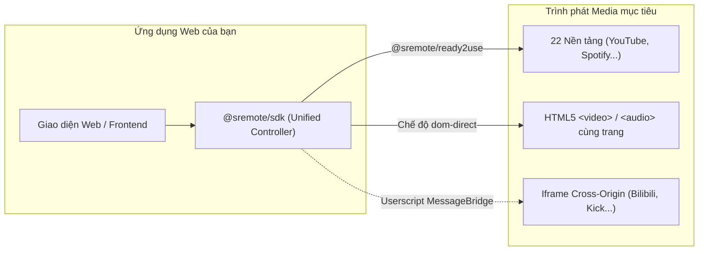

# Bắt đầu nhanh với SRemote trong 5 phút

Chào mừng bạn đến với **SRemote**! Hướng dẫn này sẽ giúp bạn hiểu rõ cách thức tích hợp SRemote vào ứng dụng web của mình một cách nhanh chóng và chuẩn xác nhất.

> [!TIP]
> **Bạn thích trải nghiệm hướng dẫn từng bước trực quan?**  
> Hãy mở **[🧙 Trình Hướng Dẫn Tích Hợp Tương Tác (Interactive Wizard)](wizard.html)** với thanh tiến trình Stepper, sơ đồ Mermaid tự động định vị bước và 11 bài toán ứng dụng thực tế có sẵn code mẫu để chạy ngay!

---

## 1. Bản chất & Cơ chế Tích hợp

SRemote được thiết kế nhằm thống nhất việc điều khiển mọi loại media player trên web:



---

## 2. Quy trình Tích hợp 3 Bước Chuẩn

### Bước 1: Chuẩn bị Container hoặc Thẻ Iframe

#### A. Nền tảng phổ biến (YouTube, Vimeo, Spotify... qua `@sremote/ready2use`):
Chỉ cần tạo một thẻ `<div>` trống làm vùng chứa (container):
```html
<div id="player-box" style="width: 100%; max-width: 720px; aspect-ratio: 16/9;"></div>
```

#### B. Thẻ Iframe Cross-Origin không có SDK (Bilibili, Kick, Rumble...):
Thẻ iframe bắt buộc phải được cấp quyền qua thuộc tính `allow`:
```html
<iframe
  id="video-frame"
  src="https://player.bilibili.com/player.html?bvid=BV1xx411c7mD"
  allow="autoplay; encrypted-media; fullscreen"
  style="width: 100%; height: 450px; border: none;">
</iframe>
```

---

### Bước 2: Cài đặt Gói Thư viện

Tùy vào kịch bản sử dụng:

```bash
# 1. Nhúng các nền tảng phổ biến (Khuyên dùng cho 90% nhu cầu)
npm install @sremote/sdk @sremote/ready2use

# 2. Hoặc chỉ điều khiển media nội bộ / phối hợp Userscript
npm install @sremote/sdk
```

Hoặc sử dụng trực tiếp qua CDN (ES Modules):
```html
<script type="module">
  import { sremote } from 'https://cdn.jsdelivr.net/npm/@sremote/sdk/+esm';
  import { youtube } from 'https://cdn.jsdelivr.net/npm/@sremote/ready2use/+esm';
</script>
```

---

### Bước 3: Khởi tạo & Điều khiển

#### Triển khai với `@sremote/ready2use` (YouTube):
```javascript
import { sremote } from '@sremote/sdk';
import { youtube } from '@sremote/ready2use';

// 1. Gắn player vào container
await youtube.mount('#player-box', {
  videoId: 'dQw4w9WgXcQ',
  playerVars: { controls: 1, autoplay: 0 }
});

// 2. Điều khiển thông qua API chuẩn HTML5 Media
await sremote.play();
await sremote.seek(15);      // Tua tiến 15 giây
await sremote.volume(0.8);   // Âm lượng 80%

// 3. Lắng nghe tiến độ phát
sremote.on('timeupdate', ({ state }) => {
  console.log(`⏱️ Thời gian: ${Math.round(state.currentTime)}s / ${Math.round(state.duration)}s`);
});
```

#### Quản lý Lifecycle an toàn trong React:
```jsx
import React, { useEffect, useRef } from 'react';
import { youtube } from '@sremote/ready2use';

export function VideoPlayer({ videoId }) {
  const containerRef = useRef(null);

  useEffect(() => {
    let instance = null;

    async function init() {
      // mount() trả về đối tượng { remote, destroy }
      instance = await youtube.mount(containerRef.current, { videoId });
    }

    init();

    // Dọn dẹp thẻ iframe và listeners khi component unmount
    return () => {
      if (instance) instance.destroy();
    };
  }, [videoId]);

  return <div ref={containerRef} style={{ width: '100%', aspectRatio: '16/9' }} />;
}
```

---

## 3. Các Bước Tiếp Theo

- **Trải nghiệm từng bước với 11 ứng dụng thực tế**: Mở ngay [🧙 Interactive Integration Wizard](wizard.html) để xem các bài toán: WatchParty, LMS Quiz, Pomodoro Lo-fi, Multi-Streamer, Phím tắt bàn phím, Playlist queue...
- **Tra cứu nền tảng**: Xem [Ma trận tương thích 22 dịch vụ](../advanced/compatibility-matrix.md).
- **Tra cứu hàm & sự kiện**: Mở [Tài liệu API Reference](../../api.html).
