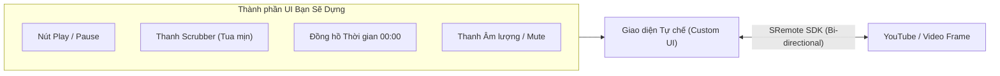

# Tutorial 01: Tự tay Chế tạo Custom Video/Audio Player từ Số 0

Chào mừng bạn đến với bài hướng dẫn thực hành đầu tiên! Trong bài học này, chúng ta sẽ không dùng bộ điều khiển mặc định của YouTube hay trình duyệt, mà sẽ **tự tay xây dựng một giao diện Custom Media Player hoàn chỉnh** bằng HTML/CSS và JavaScript thuần, kết nối và điều khiển mượt mà thông qua **SRemote**.

> [!TIP]
> **Trải nghiệm ngay bản demo hoạt động thực tế**: Mở [🚀 Live Demo: 01-simple-player](../../../../demo/apps/01-simple-player/index.html) để tương tác trực tiếp trên trình duyệt.

---

## 🎯 Mục tiêu Bạn Sẽ Đạt Được

Sau khi hoàn thành bài tutorial này, bạn sẽ nắm vững:
1. Cách ẩn hoặc tùy biến giao diện nhúng của bên thứ 3 và thay thế bằng nút bấm của riêng mình.
2. Cơ chế đồng bộ trạng thái 2 chiều (Bi-directional State Sync) giữa Player và UI.
3. **Kỹ thuật Scrubber Tua Mượt (Smooth Scrubbing)**: Giải quyết dứt điểm lỗi kinh điển "giằng co con trỏ" (Scrubber Fighting) khi người dùng đang kéo thanh tua.
4. Điều khiển âm lượng và tính năng ghi nhớ mức âm lượng khi Mute/Unmute.



---

## Bước 1: Chuẩn Bị Giao Diện & Bộ Styling (HTML/CSS)

> [!TIP]
> **🚀 Lối Tắt Tiết Kiệm Thời Gian (Khuyên Dùng)**  
> Để tập trung 100% vào tư duy lập trình JavaScript và điều khiển **SRemote SDK**, bạn không cần gõ lại toàn bộ mã giao diện từ đầu. Hãy tải hoặc sao chép sẵn các file mẫu đã được căn chỉnh chuẩn theo hệ thống Flat 2.0 từ thư mục `demo/apps/01-simple-player`:
> - 📄 **HTML mẫu**: [`index.html`](../../../../demo/apps/01-simple-player/index.html)
> - 🎨 **CSS dùng chung (Design System & Variables)**: [`common.css`](../../../../demo/apps/common.css)
> - 🎨 **CSS riêng của bài (Layout Player)**: [`style.css`](../../../../demo/apps/01-simple-player/style.css)
>
> *Cấu trúc thư mục làm việc khuyến nghị khi bạn tự thực hành:*
> ```text
> my-player/
> ├── common.css     <-- Tải từ demo/apps/common.css
> ├── style.css      <-- Tải từ demo/apps/01-simple-player/style.css
> ├── index.html     <-- Đã link sẵn common.css & style.css
> └── app.js         <-- Nơi bạn sẽ viết toàn bộ code logic trong bài này!
> ```

### 🔑 Các Phần Tử DOM Trọng Tâm Cần Điều Khiển Trong JS
Cho dù bạn tự gõ hay tải file mẫu, hãy ghi nhớ các `id` quan trọng sau đây mà file `app.js` sẽ kết nối và xử lý:

| Phần tử DOM | `id` | Vai trò trong ứng dụng |
| :--- | :--- | :--- |
| `<div>` Slot Video | `#video-container` | Khung hiển thị rỗng để SRemote gắn (mount) video iframe |
| `<button>` Play | `#btn-play` | Nút chuyển đổi trạng thái Play / Pause |
| `<span>` Đồng hồ | `#time-display` | Nhãn hiển thị thời gian phát (`00:00 / 00:00`) |
| `<input type="range">` | `#seek-bar` | Thanh kéo tua video (Scrubber) mượt mà |
| `<button>` Mute | `#btn-mute` | Nút bật / tắt tiếng |
| `<input type="range">` | `#volume-bar` | Thanh trượt tăng giảm âm lượng (0 - 1) |

<details>
<summary><b>👀 Nhấn vào đây nếu bạn muốn xem hoặc tự viết toàn bộ mã HTML & CSS</b></summary>

#### Mã nguồn `index.html`:
```html
<!DOCTYPE html>
<html lang="vi">
<head>
  <meta charset="UTF-8">
  <meta name="viewport" content="width=device-width, initial-scale=1.0">
  <title>Custom Media Player - SRemote Tutorial 01</title>
  <!-- 1. CSS Dùng chung: Biến màu sắc, Typography, Flat Button & Sliders -->
  <link rel="stylesheet" href="common.css">
  <!-- 2. CSS Riêng của bài: Khung thẻ Player Card -->
  <link rel="stylesheet" href="style.css">
</head>
<body>

  <main class="demo-main-layout">
    <div class="player-card">
      <!-- 1. Vùng hiển thị video nhúng -->
      <div id="video-container" class="video-container"></div>

      <!-- 2. Thanh điều khiển Flat 2.0 -->
      <div class="controls-bar">
        <!-- Nút Play/Pause -->
        <button id="btn-play" class="btn-flat btn-flat-primary btn-flat-icon" aria-label="Play/Pause">▶</button>

        <!-- Đồng hồ thời gian -->
        <span id="time-display" class="time-text">00:00 / 00:00</span>

        <!-- Thanh Scrubber tua video -->
        <div class="seek-container">
          <input type="range" id="seek-bar" class="flat-slider seek-slider" min="0" max="100" value="0" step="0.1">
        </div>

        <!-- Nút Mute & Thanh âm lượng -->
        <button id="btn-mute" class="btn-flat btn-flat-icon" aria-label="Mute/Unmute">🔊</button>
        <div class="volume-container">
          <input type="range" id="volume-bar" class="flat-slider volume-slider" min="0" max="1" value="1" step="0.05">
        </div>
      </div>
    </div>
  </main>

  <script type="module" src="app.js"></script>
</body>
</html>
```

#### Mã nguồn `style.css` (Style riêng căn layout player):
```css
.demo-main-layout {
  flex: 1;
  display: flex;
  align-items: center;
  justify-content: center;
  padding: 30px 16px;
}

.player-card {
  width: 100%;
  max-width: 760px;
  background-color: var(--bg-surface);
  border: 1px solid var(--border-color);
  border-radius: var(--radius-lg);
  box-shadow: var(--shadow-lg);
  overflow: hidden;
  transition: all 0.2s ease;
}

.video-container {
  width: 100%;
  aspect-ratio: 16 / 9;
  background-color: #000000;
}

.controls-bar {
  display: flex;
  align-items: center;
  gap: 14px;
  padding: 16px 20px;
  background-color: var(--bg-surface);
  border-top: 1px solid var(--border-color);
}

.time-text {
  font-size: 13px;
  font-weight: 500;
  color: var(--text-muted);
  font-variant-numeric: tabular-nums;
  white-space: nowrap;
}

.seek-container {
  flex: 1;
  display: flex;
  align-items: center;
}

.volume-container {
  width: 90px;
  display: flex;
  align-items: center;
}
```
</details>

---

## Bước 2: Nạp Video và Kết Nối SRemote

Hãy tạo file `app.js`. Ở bước này, chúng ta nhập SDK và adapter `youtube` từ CDN, sau đó gắn video YouTube vào `#video-container`.

> [!TIP]
> Chúng ta truyền `controls: 0` vào `playerVars` để ẩn bộ điều khiển mặc định của YouTube, chỉ giữ lại khung hình hiển thị.

```javascript
import { sremote } from 'https://cdn.jsdelivr.net/npm/@sremote/sdk/+esm';
import { youtube } from 'https://cdn.jsdelivr.net/npm/@sremote/ready2use/+esm';

// Lấy các phần tử DOM cần thiết
const videoContainer = document.getElementById('video-container');
const btnPlay = document.getElementById('btn-play');
const timeDisplay = document.getElementById('time-display');
const seekBar = document.getElementById('seek-bar');
const btnMute = document.getElementById('btn-mute');
const volumeBar = document.getElementById('volume-bar');

// Hàm format giây thành chuỗi mm:ss
function formatTime(seconds) {
  if (isNaN(seconds)) return '00:00';
  const mins = Math.floor(seconds / 60);
  const secs = Math.floor(seconds % 60);
  return `${String(mins).padStart(2, '0')}:${String(secs).padStart(2, '0')}`;
}

// Khởi tạo Player
async function initPlayer() {
  console.log('⚡ Đang khởi tạo YouTube Player qua SRemote...');
  
  await youtube.mount('#video-container', {
    videoId: 'M7lc1UVf-VE', // Video mẫu YouTube Developers
    playerVars: {
      controls: 0, // Ẩn điều khiển gốc của YouTube
      autoplay: 0,
      rel: 0
    }
  });

  console.log('✅ Player đã sẵn sàng kết nối!');
}

initPlayer();
```

---

## Bước 3: Lập Trình Nút Play/Pause & Đồng Bộ Trạng Thái 2 Chiều

Nếu chỉ viết sự kiện click để đổi icon nút:
```javascript
// ❌ CÁCH LÀM SAI / NGÂY THƠ:
btnPlay.addEventListener('click', () => {
  btnPlay.textContent = '⏸'; // Tự đổi icon trước khi video thực sự phát
  sremote.play();
});
```
Nếu video bị lag mạng, buffering hoặc người dùng click trực tiếp vào video, UI sẽ bị lệch trạng thái (Out of sync).

**Cách làm chuẩn với SRemote**:
1. Nút bấm chỉ gửi tín hiệu yêu cầu: `await sremote.toggle()`.
2. UI chỉ đổi trạng thái khi SRemote phát sự kiện xác nhận `play` hoặc `pause`.

Thêm đoạn mã sau vào `app.js`:

```javascript
// Click nút -> Yêu cầu toggle
btnPlay.addEventListener('click', async () => {
  await sremote.toggle();
});

// Lắng nghe phản hồi từ Player để cập nhật UI
sremote.on('play', () => {
  btnPlay.textContent = '⏸';
  btnPlay.setAttribute('aria-label', 'Pause');
});

sremote.on('pause', () => {
  btnPlay.textContent = '▶';
  btnPlay.setAttribute('aria-label', 'Play');
});

sremote.on('ended', () => {
  btnPlay.textContent = '🔄';
  seekBar.value = 100;
});
```

---

## Bước 4: Xây Dựng Thanh Scrubber Tua Mượt (Smooth Scrubbing)

Đây là phần quan trọng nhất trong việc lập trình Custom Player:
- Player liên tục phát ra sự kiện `timeupdate` (khoảng 4 lần/giây) thông báo vị trí hiện tại.
- Nếu bạn cứ cập nhật `seekBar.value = currentTime` liên tục, khi người dùng **đang giữ chuột để kéo thanh trượt**, con trỏ sẽ bị sự kiện `timeupdate` kéo giật ngược về vị trí cũ! Hiện tượng này gọi là **Scrubber Fighting**.

### Giải Pháp: Sử Dụng Cờ `isScrubbing`

Chúng ta đặt một biến cờ `isScrubbing = false`:
1. Khi người dùng bấm chuột vào thanh trượt (`mousedown` / `touchstart`), đặt `isScrubbing = true`.
2. Khi `isScrubbing === true`, bỏ qua việc cập nhật `seekBar.value` từ `timeupdate`.
3. Khi người dùng thả chuột (`change` hoặc `mouseup`), lấy giá trị mới gọi `sremote.seekTo(newTime)` rồi mới trả cờ về `false`.

Hãy bổ sung logic này vào `app.js`:

```javascript
let isScrubbing = false;
let videoDuration = 0;

// Cập nhật thời lượng tổng khi video sẵn sàng
sremote.on('durationchange', ({ duration }) => {
  videoDuration = duration;
  seekBar.max = duration;
});

// Lắng nghe tiến trình phát
sremote.on('timeupdate', ({ currentTime }) => {
  // Chỉ cập nhật slider nếu người dùng KHÔNG đang kéo chuột
  if (!isScrubbing && videoDuration > 0) {
    seekBar.value = currentTime;
    timeDisplay.textContent = `${formatTime(currentTime)} / ${formatTime(videoDuration)}`;
  }
});

// 1. Khi người dùng bắt đầu chạm/kéo slider
seekBar.addEventListener('input', () => {
  isScrubbing = true;
  // Cập nhật tạm thời đồng hồ hiển thị theo vị trí ngón tay/chuột
  timeDisplay.textContent = `${formatTime(seekBar.value)} / ${formatTime(videoDuration)}`;
});

// 2. Khi người dùng thả tay ra -> Thực hiện lệnh Seek thực sự
seekBar.addEventListener('change', async () => {
  const targetSeconds = parseFloat(seekBar.value);
  await sremote.seekTo(targetSeconds);
  isScrubbing = false;
});
```

---

## Bước 5: Lập Trình Âm Lượng & Phím Tắt Mute

Để có trải nghiệm người dùng cao cấp:
- Khi người dùng bấm Mute, ta lưu lại mức âm lượng hiện tại (`lastVolume`).
- Khi bấm Unmute, ta khôi phục lại đúng mức âm lượng trước đó thay vì đặt bừa về 100%.

Thêm code sau vào `app.js`:

```javascript
let lastVolume = 1;

// Thay đổi âm lượng qua thanh slider
volumeBar.addEventListener('input', async () => {
  const vol = parseFloat(volumeBar.value);
  await sremote.setVolume(vol);
  
  if (vol === 0) {
    btnMute.textContent = '🔇';
  } else {
    btnMute.textContent = '🔊';
    lastVolume = vol;
  }
});

// Bật / Tắt tiếng (Mute toggle)
btnMute.addEventListener('click', async () => {
  const currentVol = parseFloat(volumeBar.value);
  
  if (currentVol > 0) {
    // Đang có tiếng -> Tắt tiếng
    lastVolume = currentVol;
    volumeBar.value = 0;
    await sremote.setVolume(0);
    btnMute.textContent = '🔇';
  } else {
    // Đang tắt tiếng -> Khôi phục mức âm lượng trước đó
    const restoreVol = lastVolume > 0 ? lastVolume : 0.5;
    volumeBar.value = restoreVol;
    await sremote.setVolume(restoreVol);
    btnMute.textContent = '🔊';
  }
});
```

---

## Bước 6: Toàn Bộ Mã Nguồn Hoàn Chỉnh (Checkpoint)

Dưới đây là toàn bộ file `app.js` hoàn chỉnh sau khi ghép tất cả các bước lại với nhau:

```javascript
import { sremote } from 'https://cdn.jsdelivr.net/npm/@sremote/sdk/+esm';
import { youtube } from 'https://cdn.jsdelivr.net/npm/@sremote/ready2use/+esm';

const btnPlay = document.getElementById('btn-play');
const timeDisplay = document.getElementById('time-display');
const seekBar = document.getElementById('seek-bar');
const btnMute = document.getElementById('btn-mute');
const volumeBar = document.getElementById('volume-bar');

let isScrubbing = false;
let videoDuration = 0;
let lastVolume = 1;

function formatTime(seconds) {
  if (isNaN(seconds)) return '00:00';
  const mins = Math.floor(seconds / 60);
  const secs = Math.floor(seconds % 60);
  return `${String(mins).padStart(2, '0')}:${String(secs).padStart(2, '0')}`;
}

async function init() {
  await youtube.mount('#video-container', {
    videoId: 'M7lc1UVf-VE',
    playerVars: { controls: 0, autoplay: 0 }
  });

  // State Sync
  sremote.on('play', () => { btnPlay.textContent = '⏸'; });
  sremote.on('pause', () => { btnPlay.textContent = '▶'; });
  sremote.on('ended', () => { btnPlay.textContent = '🔄'; });

  sremote.on('durationchange', ({ duration }) => {
    videoDuration = duration;
    seekBar.max = duration;
  });

  sremote.on('timeupdate', ({ currentTime }) => {
    if (!isScrubbing && videoDuration > 0) {
      seekBar.value = currentTime;
      timeDisplay.textContent = `${formatTime(currentTime)} / ${formatTime(videoDuration)}`;
    }
  });

  // Controls Event Listeners
  btnPlay.addEventListener('click', () => sremote.toggle());

  seekBar.addEventListener('input', () => {
    isScrubbing = true;
    timeDisplay.textContent = `${formatTime(seekBar.value)} / ${formatTime(videoDuration)}`;
  });

  seekBar.addEventListener('change', async () => {
    await sremote.seekTo(parseFloat(seekBar.value));
    isScrubbing = false;
  });

  volumeBar.addEventListener('input', async () => {
    const val = parseFloat(volumeBar.value);
    await sremote.setVolume(val);
    btnMute.textContent = val === 0 ? '🔇' : '🔊';
    if (val > 0) lastVolume = val;
  });

  btnMute.addEventListener('click', async () => {
    const cur = parseFloat(volumeBar.value);
    if (cur > 0) {
      lastVolume = cur;
      volumeBar.value = 0;
      await sremote.setVolume(0);
      btnMute.textContent = '🔇';
    } else {
      const res = lastVolume || 0.5;
      volumeBar.value = res;
      await sremote.setVolume(res);
      btnMute.textContent = '🔊';
    }
  });
}

init();
```

---

## 💡 Bài Tập Thử Thách Mở Rộng (Challenge)

Để rèn luyện sâu hơn, bạn hãy thử tự làm thêm:
1. **Phím tắt Spacebar**: Bắt sự kiện phím Space trên cửa sổ trình duyệt để Play/Pause mà không cần rê chuột click. *(Gợi ý: Xem bài Tutorial 07)*.
2. **Buffer Bar (Thanh đệm mạng)**: Lắng nghe sự kiện `progress` của SRemote để vẽ một dải màu xám nhạt thể hiện phần trăm video đã tải về máy.
