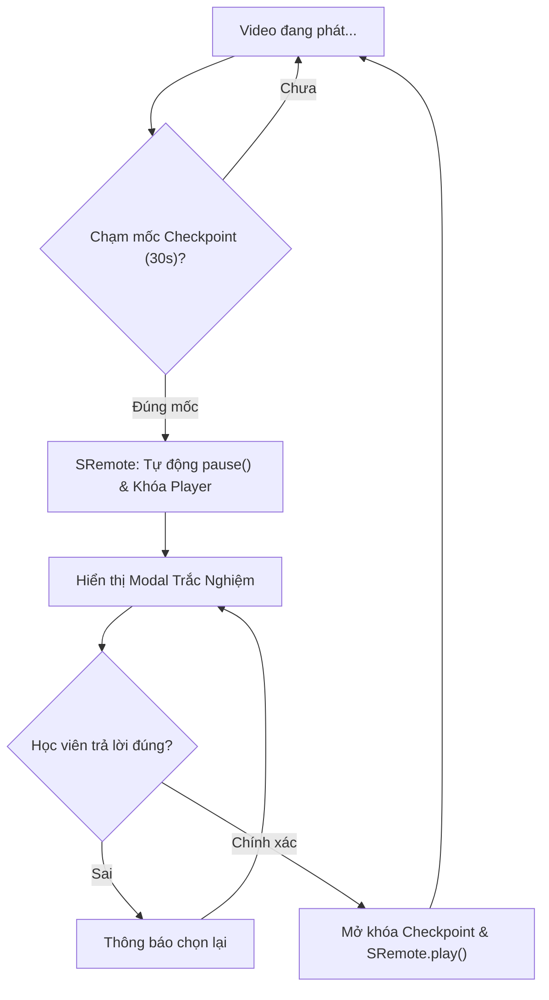

# Tutorial 04: Nền Tảng Học Trực Tuyến EdTech Tự Động Khóa Video Bắt Làm Bài Tập

Trong các nền tảng học trực tuyến (E-Learning / LMS như Coursera, Udemy hay EdX), một kỹ thuật giữ chân và kiểm tra mức độ hiểu bài của học viên là **Interactive Video Checkpoints**:
- Khi video bài giảng phát tới một mốc thời gian định trước (ví dụ phút thứ 00:30), hệ thống **tự động tạm dừng video và khóa màn hình**.
- Một hộp thoại câu hỏi trắc nghiệm (Quiz Modal) hiện ra đè lên video.
- Học viên **bắt buộc phải trả lời chính xác** mới được mở khóa để xem tiếp nội dung bài giảng.
- Học viên **không thể tua lách qua điểm kiểm tra (Anti-cheat Seek Guard)**.

Trong bài hướng dẫn này, chúng ta sẽ tự tay lập trình tính năng này từng bước bằng **SRemote**.

> [!TIP]
> **Trải nghiệm ngay bản demo hoạt động thực tế**: Mở [🚀 Live Demo: 04-edtech-quiz](../../../../demo/apps/04-edtech-quiz/index.html) để tương tác trực tiếp trên trình duyệt.

---

## 🎯 Mục tiêu Bạn Sẽ Đạt Được

Sau bài học này, bạn sẽ nắm vững:
1. Cách định nghĩa cấu trúc mảng điểm kiểm tra bài học (**Checkpoints Metadata**).
2. Lắng nghe dòng thời gian qua sự kiện `timeupdate` và kích hoạt ngắt tự động (Trigger Interruption).
3. **Kỹ thuật Chống Gian Lận (Anti-cheat Seek Guard)**: Ngăn học viên kéo thanh tua nhảy cóc qua câu hỏi nếu chưa hoàn thành.
4. Cơ chế mở khóa và hoàn nguyên trạng thái phát sau khi nộp bài thành công.



---

## Bước 1: Chuẩn Bị Giao Diện & Bộ Styling (HTML/CSS)

> [!TIP]
> **📥 Tải Nhanh Bộ Giao Diện Mẫu (Starter Kit)**  
> Để bắt đầu ngay mà không cần mất thời gian gõ HTML & CSS, bạn hãy nhấp vào nút **`📥 Tải Starter Files`** ở thanh công cụ phía trên đầu trang tài liệu để tải về máy:
> - `index.html`: Khung sườn bài giảng và Modal trắc nghiệm Flat 2.0.
> - `style.css`: File định dạng layout cho Course Player & Quiz Overlay.
> - `common.css`: Hệ thống biến màu sắc và theme chung.
>
> Đặt các file trên vào cùng thư mục làm việc với file `app.js` của bạn.

### 🔑 Các Phần Tử DOM Trọng Tâm Cần Điều Khiển Trong JS
Trong suốt bài hướng dẫn này, file `app.js` sẽ kết nối và điều khiển trực tiếp các phần tử có `id` sau:

| Phần tử DOM | `id` | Vai trò trong ứng dụng |
| :--- | :--- | :--- |
| `<div>` Slot Video | `#video-slot` | Vùng mount player bài giảng video |
| `<div>` Modal Quiz | `#quiz-overlay` | Lớp phủ làm mờ và khóa tương tác khi dừng kiểm tra |
| `<h3>` Câu hỏi | `#quiz-question` | Thẻ hiển thị nội dung câu hỏi trắc nghiệm |
| `<div>` Danh sách đáp án | `#quiz-options` | Vùng render các nút bấm chọn đáp án A, B, C, D |
| `<div>` Thông báo | `#quiz-feedback` | Hiển thị thông báo khi trả lời đúng / sai |
| `<b>` Trạng thái học | `#learning-status` | Hiển thị trạng thái học tập (Đang học / Bị khóa) |
| `<span>` Đồng hồ giây | `#video-time` | Bộ đếm giây bài giảng hiện tại |

---

---

## Bước 2: Khởi Tạo SRemote & Dữ Liệu Checkpoints Bài Học

Tạo file `app.js`. Chúng ta định nghĩa một mảng các điểm dừng kiểm tra (`checkpoints`). Mỗi checkpoint gồm:
- `time`: Giây kích hoạt ngắt video.
- `question`: Nội dung câu hỏi.
- `options`: Mảng các phương án lựa chọn.
- `correct`: Chỉ số phương án chính xác.
- `passed`: Trạng thái đã vượt qua bài kiểm tra hay chưa (mặc định `false`).

```javascript
import { sremote } from 'https://cdn.jsdelivr.net/npm/@sremote/sdk/+esm';
import { youtube } from 'https://cdn.jsdelivr.net/npm/@sremote/ready2use/+esm';

// 1. Khai báo danh sách bài tập trắc nghiệm gắn với timeline
const checkpoints = [
  {
    time: 15, // Dừng tại giây thứ 15
    question: "Từ khóa nào trong JavaScript được dùng để khai báo hằng số không thể gán lại?",
    options: ["var", "let", "const", "def"],
    correct: 2,
    passed: false
  },
  {
    time: 45, // Dừng tại giây thứ 45
    question: "Kết quả của biểu thức `typeof null` trong JavaScript là gì?",
    options: ["'null'", "'undefined'", "'object'", "'boolean'"],
    correct: 2,
    passed: false
  }
];

let activeCheckpoint = null;
let maxAllowedTime = 0; // Chặn tua vượt checkpoint

const quizOverlay = document.getElementById('quiz-overlay');
const quizQuestion = document.getElementById('quiz-question');
const quizOptions = document.getElementById('quiz-options');
const quizFeedback = document.getElementById('quiz-feedback');
const learningStatus = document.getElementById('learning-status');
const videoTimeEl = document.getElementById('video-time');

// 2. Khởi tạo Player
async function initCourse() {
  await youtube.mount('#video-slot', {
    videoId: 'W6NZfCO5SIk', // JavaScript Tutorial mẫu
    playerVars: { controls: 1, autoplay: 0 }
  });

  console.log('🎓 Bài giảng đã sẵn sàng!');
  setupQuizTriggers();
}
```

---

## Bước 3: Lập Trình Cơ Chế Ngắt Tự Động & Bật Modal

Viết hàm `setupQuizTriggers()` để theo dõi từng giây phát của video:
1. Khi video chạm hoặc vượt qua mốc `cp.time` mà bài tập đó `passed === false`:
2. Lập tức gọi `await sremote.pause()`.
3. Hiển thị modal câu hỏi trắc nghiệm tương ứng.

```javascript
function setupQuizTriggers() {
  sremote.on('timeupdate', async ({ currentTime }) => {
    videoTimeEl.textContent = `${Math.floor(currentTime)}s`;

    // Nếu đang mở modal bài tập thì luôn đảm bảo video giữ trạng thái Pause
    if (activeCheckpoint) {
      return;
    }

    // Cập nhật mốc thời gian lớn nhất học viên đã đạt được hợp lệ
    if (currentTime > maxAllowedTime) {
      maxAllowedTime = currentTime;
    }

    // Tìm xem có checkpoint nào chưa pass mà video đã chạy tới hay không
    const pendingCp = checkpoints.find(cp => !cp.passed && currentTime >= cp.time);

    if (pendingCp) {
      console.log(`🛑 Đạt điểm dừng kiểm tra tại giây ${pendingCp.time}!`);
      // 1. Tạm dừng video ngay lập tức
      await sremote.pause();
      
      // 2. Đưa video về chính xác mốc checkpoint
      await sremote.seekTo(pendingCp.time);

      // 3. Mở modal trắc nghiệm
      showQuizModal(pendingCp);
    }
  });
}
```

---

## Bước 4: Xử Lý Logic Trả Lời & Mở Khóa Tiếp Tục Học

Hàm `showQuizModal` sẽ dựng các nút phương án trắc nghiệm và bắt sự kiện click của học viên:

```javascript
function showQuizModal(cp) {
  activeCheckpoint = cp;
  learningStatus.textContent = 'Đang làm bài tập kiểm tra...';
  learningStatus.style.color = '#38bdf8';

  quizQuestion.textContent = cp.question;
  quizOptions.innerHTML = '';
  quizFeedback.textContent = '';
  quizFeedback.className = 'quiz-feedback';

  // Render các phương án lựa chọn
  cp.options.forEach((optText, index) => {
    const btn = document.createElement('button');
    btn.className = 'option-btn';
    btn.textContent = `${String.fromCharCode(65 + index)}. ${optText}`;

    btn.addEventListener('click', () => handleAnswer(index));
    quizOptions.appendChild(btn);
  });

  // Hiển thị modal
  quizOverlay.classList.remove('hidden');
}

async function handleAnswer(selectedIndex) {
  if (!activeCheckpoint) return;

  if (selectedIndex === activeCheckpoint.correct) {
    // TRẢ LỜI ĐÚNG
    quizFeedback.textContent = '🎉 Chính xác! Bạn tiếp tục theo dõi bài giảng nhé.';
    quizFeedback.style.color = '#10b981';

    // Đánh dấu đã vượt qua checkpoint này
    activeCheckpoint.passed = true;

    // Cho học viên 1.2s nhìn kết quả trước khi tắt modal và tự động play tiếp
    setTimeout(async () => {
      quizOverlay.classList.add('hidden');
      learningStatus.textContent = 'Đang theo dõi bài giảng';
      learningStatus.style.color = '#94a3b8';
      
      const nextStartTime = activeCheckpoint.time + 0.5;
      activeCheckpoint = null;
      
      // Mở khóa và tiếp tục phát
      await sremote.seekTo(nextStartTime);
      await sremote.play();
    }, 1200);

  } else {
    // TRẢ LỜI SAI
    quizFeedback.textContent = '❌ Chưa chính xác. Vui lòng suy nghĩ và thử lại!';
    quizFeedback.className = 'quiz-feedback error';
  }
}
```

---

## Bước 5: Kỹ Thuật Chống Gian Lận Tua Bài (Anti-Cheat Seek Guard)

Nhiều học viên thông minh sẽ thử kéo thanh tua của YouTube để nhảy vọt qua giây 45 nhằm tránh phải làm bài tập.  
Để ngăn chặn điều này, chúng ta lắng nghe sự kiện `seeked`:

```javascript
// Chống tua cóc qua checkpoint chưa hoàn thành
sremote.on('seeked', async ({ currentTime }) => {
  // Tìm checkpoint chưa hoàn thành sớm nhất
  const unpassedCp = checkpoints.find(cp => !cp.passed);

  if (unpassedCp && currentTime > unpassedCp.time) {
    console.warn('⚠️ Phát hiện hành vi tua qua bài tập chưa làm! Đang tua ngược lại...');
    alert(`Bạn cần hoàn thành câu hỏi kiểm tra tại mốc ${unpassedCp.time}s trước khi xem phần tiếp theo!`);
    
    // Ép tua ngược lại đúng mốc checkpoint và pause
    await sremote.seekTo(unpassedCp.time);
    await sremote.pause();
  }
});

// Khởi chạy
initCourse();
```

---

## 💡 Bài Tập Thử Thách Mở Rộng

1. **Gửi kết quả lên Máy chủ (LMS Webhook)**: Khi học viên trả lời đúng checkpoint, hãy dùng `fetch('/api/quiz-progress')` để lưu trạng thái hoàn thành bài học vào cơ sở dữ liệu.
2. **Nút "Xem lại 10s trước"**: Thêm một nút trong modal trắc nghiệm cho phép học viên tua lùi 10 giây để nghe lại đoạn giảng giải trước khi đưa ra câu trả lời.
