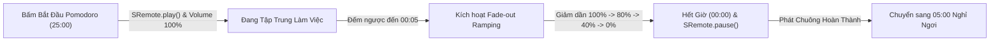

# Tutorial 05: Đồng Hồ Pomodoro Lo-fi với Hiệu Ứng Giảm Âm Lượng Mượt Mà (Fade-out Ducking)

Kỹ thuật **Pomodoro (25 phút tập trung cao độ + 5 phút nghỉ ngơi)** khi kết hợp cùng âm nhạc không lời (Lo-fi Beats) là phương pháp học tập và làm việc được hàng triệu người ưa chuộng.

Tuy nhiên, một điểm trừ của nhiều ứng dụng là: Khi hết 25 phút, âm thanh bất ngờ bị ngắt phụt một cái rất thô bạo (Abrupt cutoff) gây giật mình khó chịu cho người dùng.

Trong tutorial này, chúng ta sẽ xây dựng một ứng dụng Pomodoro Lo-fi cao cấp:
- Đếm ngược 25 phút làm việc đồng bộ với luồng nhạc Lo-fi Girl.
- **Thuật toán Giảm Âm Lượng Mượt Mà (Volume Ramping / Fade-out Ducking)**: Trong 5 giây cuối cùng trước khi hết giờ, âm lượng nhạc sẽ tự động hạ dần đều từ 100% về 0% một cách êm ái trước khi tiếng chuông êm dịu vang lên.

> [!TIP]
> **Trải nghiệm ngay bản demo hoạt động thực tế**: Mở [🚀 Live Demo: 05-pomodoro-lofi](../../../../demo/apps/05-pomodoro-lofi/index.html) để tương tác trực tiếp trên trình duyệt.

---

## 🎯 Mục tiêu Bạn Sẽ Đạt Được

Sau bài học này, bạn sẽ nắm vững:
1. Cách xây dựng vòng lặp đếm ngược thời gian chính xác (`setInterval`) kết hợp đồng bộ Media.
2. **Kỹ thuật Fade-out Âm lượng Tuyến tính (Linear Volume Interpolation)**: Lập trình thuật toán giảm âm lượng mượt mà bằng các bước nhỏ qua `sremote.setVolume()`.
3. Tự động chuyển đổi trạng thái phiên: Tập trung (Work) ➔ Nghỉ ngơi (Break).
4. Khôi phục âm lượng nguyên bản khi bắt đầu phiên làm việc mới.



---

## Bước 1: Chuẩn Bị Giao Diện & Bộ Styling (HTML/CSS)

> [!TIP]
> **🚀 Lối Tắt Tiết Kiệm Thời Gian (Khuyên Dùng)**  
> Để tập trung vào cơ chế chuyển trạng thái đồng hồ và kỹ thuật **Audio Ducking** (tự động hạ âm lượng mượt mà bằng SRemote SDK), bạn hãy lấy sẵn các file giao diện Flat 2.0 từ thư mục `demo/apps/05-pomodoro-lofi`:
> - 📄 **HTML mẫu**: [`index.html`](../../../../demo/apps/05-pomodoro-lofi/index.html)
> - 🎨 **CSS dùng chung (Design System & Variables)**: [`common.css`](../../../../demo/apps/common.css)
> - 🎨 **CSS riêng của bài (Pomodoro Display & Controls)**: [`style.css`](../../../../demo/apps/05-pomodoro-lofi/style.css)
>
> *Cấu trúc thư mục làm việc khuyến nghị:*
> ```text
> my-pomodoro/
> ├── common.css     <-- Tải từ demo/apps/common.css
> ├── style.css      <-- Tải từ demo/apps/05-pomodoro-lofi/style.css
> ├── index.html     <-- Đã link sẵn common.css & style.css
> └── app.js         <-- Nơi bạn sẽ viết toàn bộ code logic trong bài này!
> ```

### 🔑 Các Phần Tử DOM Trọng Tâm Cần Điều Khiển Trong JS
Các `id` quan trọng mà file `app.js` sẽ kết nối và xử lý:

| Phần tử DOM | `id` | Vai trò trong ứng dụng |
| :--- | :--- | :--- |
| `<div>` Huy hiệu chế độ | `#mode-badge` | Hiển thị chế độ: Focus (Tập trung) hoặc Break (Nghỉ ngơi) |
| `<div>` Đồng hồ số | `#timer-display` | Bộ số đếm ngược thời gian lớn (`25:00`) |
| `<button>` Bắt đầu | `#btn-start` | Nút kích hoạt bộ đếm Pomodoro và phát nhạc Lo-fi |
| `<button>` Tạm dừng | `#btn-pause` | Nút dừng đồng hồ đếm ngược |
| `<button>` Đặt lại | `#btn-reset` | Đưa đồng hồ về mốc 25:00 mặc định |
| `<span>` Chỉ số Volume | `#volume-indicator` | Nhãn trực quan hiển thị % âm lượng khi ducking |
| `<div>` Slot Video Lo-fi | `#lofi-player-slot` | Vùng mount player YouTube stream phát nhạc nền |

<details>
<summary><b>👀 Nhấn vào đây nếu bạn muốn xem hoặc tự viết toàn bộ mã HTML & CSS</b></summary>

#### Mã nguồn `index.html`:
```html
<!DOCTYPE html>
<html lang="vi">
<head>
  <meta charset="UTF-8">
  <meta name="viewport" content="width=device-width, initial-scale=1.0">
  <title>App 05: Pomodoro Lo-fi Audio Ducking - SRemote Demo</title>
  <!-- 1. CSS Dùng chung: Biến theme, Typography, Flat buttons -->
  <link rel="stylesheet" href="common.css">
  <!-- 2. CSS Riêng của bài: Khung Pomodoro Card & Timer Display -->
  <link rel="stylesheet" href="style.css">
</head>
<body>

  <main class="demo-main-layout">
    <div class="pomodoro-card">
      <div class="mode-badge" id="mode-badge">🎯 Chế độ Tập trung</div>
      
      <!-- Đồng hồ đếm ngược Flat lớn -->
      <div class="timer-display" id="timer-display">25:00</div>

      <!-- Nút điều khiển Flat 2.0 -->
      <div class="btn-group">
        <button id="btn-start" class="btn-flat btn-flat-primary">Bắt đầu</button>
        <button id="btn-pause" class="btn-flat">Tạm dừng</button>
        <button id="btn-reset" class="btn-flat">Đặt lại</button>
      </div>

      <!-- Khung nhạc Lo-fi nhúng -->
      <div class="lofi-container">
        <div class="lofi-header">
          <span>🎵 Nhạc nền: Lofi Girl Radio</span>
          <span id="volume-indicator" class="volume-tag">Âm lượng: 100%</span>
        </div>
        <div id="lofi-player-slot" class="player-slot"></div>
      </div>
    </div>
  </main>

  <script type="module" src="app.js"></script>
</body>
</html>
```

#### Mã nguồn `style.css`:
```css
.demo-main-layout {
  flex: 1;
  display: flex;
  align-items: center;
  justify-content: center;
  padding: 30px 16px;
}

.pomodoro-card {
  width: 100%;
  max-width: 500px;
  background-color: var(--bg-surface);
  border-radius: var(--radius-lg);
  padding: 32px;
  text-align: center;
  border: 1px solid var(--border-color);
  box-shadow: var(--shadow-lg);
}

.mode-badge {
  display: inline-block;
  padding: 6px 14px;
  border-radius: var(--radius-sm);
  background-color: var(--color-primary-light);
  color: var(--color-primary);
  font-size: 13px;
  font-weight: 700;
  margin-bottom: 20px;
}

.timer-display {
  font-size: 72px;
  font-weight: 800;
  font-variant-numeric: tabular-nums;
  letter-spacing: -2px;
  color: var(--text-main);
  margin-bottom: 24px;
}

.btn-group {
  display: flex;
  justify-content: center;
  gap: 12px;
  margin-bottom: 30px;
}

.lofi-container {
  background-color: var(--bg-surface-elevated);
  border-radius: var(--radius-md);
  padding: 16px;
  border: 1px solid var(--border-color);
}

.lofi-header {
  display: flex;
  justify-content: space-between;
  font-size: 13px;
  color: var(--text-muted);
  margin-bottom: 12px;
}

.volume-tag {
  color: var(--color-primary);
  font-weight: 600;
}

.player-slot {
  width: 100%;
  aspect-ratio: 16 / 9;
  border-radius: var(--radius-sm);
  overflow: hidden;
  background-color: #000000;
  border: 1px solid var(--border-color);
}
```
</details>

---

---

## Bước 2: Nạp Nhạc Lo-fi & Thiết Lập Bộ Đếm Thời Gian

Mở file `app.js`. Chúng ta kết nối luồng stream trực tiếp của **Lofi Girl** qua adapter YouTube của SRemote:

```javascript
import { sremote } from 'https://cdn.jsdelivr.net/npm/@sremote/sdk/+esm';
import { youtube } from 'https://cdn.jsdelivr.net/npm/@sremote/ready2use/+esm';

// Các hằng số thời gian (tính bằng giây)
const WORK_TIME = 25 * 60; // 25 phút
const BREAK_TIME = 5 * 60; // 5 phút

let timeLeft = WORK_TIME;
let timerInterval = null;
let isRunning = false;
let currentMode = 'WORK'; // 'WORK' hoặc 'BREAK'

// DOM Elements
const timerDisplay = document.getElementById('timer-display');
const modeBadge = document.getElementById('mode-badge');
const volumeIndicator = document.getElementById('volume-indicator');
const btnStart = document.getElementById('btn-start');
const btnPause = document.getElementById('btn-pause');
const btnReset = document.getElementById('btn-reset');

function formatSeconds(secs) {
  const m = Math.floor(secs / 60);
  const s = secs % 60;
  return `${String(m).padStart(2, '0')}:${String(s).padStart(2, '0')}`;
}

async function initPomodoro() {
  console.log('🍅 Đang nạp stream Lofi Girl...');
  
  await youtube.mount('#lofi-player-slot', {
    videoId: 'jfKfPfyJRdk', // Lofi Girl Livestream
    playerVars: { controls: 1, autoplay: 0 }
  });

  // Đặt âm lượng khởi điểm 100%
  await sremote.setVolume(1);
  updateDisplay();
}

function updateDisplay() {
  timerDisplay.textContent = formatSeconds(timeLeft);
}
```

---

## Bước 3: Lập Trình Đồng Bộ Nhạc Khi Bắt Đầu & Tạm Dừng

Khi người dùng bấm **Bắt đầu**:
1. Đồng hồ giảm từng giây (`setInterval`).
2. SRemote tự động phát nhạc: `await sremote.play()`.

Khi người dùng bấm **Tạm dừng**:
1. Dừng bộ đếm thời gian (`clearInterval`).
2. SRemote tự động dừng nhạc: `await sremote.pause()`.

```javascript
function startTimer() {
  if (isRunning) return;
  isRunning = true;
  
  // Tự động phát nhạc nền khi bắt đầu phiên làm việc
  sremote.play();

  timerInterval = setInterval(() => {
    timeLeft--;
    updateDisplay();

    // KIỂM TRA MỐC FADE-OUT ÂM LƯỢNG
    if (timeLeft === 5) {
      console.log('🔉 Bắt đầu hiệu ứng Fade-out âm lượng mượt mà...');
      triggerVolumeFadeOut(5000); // Giảm dần trong 5 giây
    }

    // Khi hết giờ
    if (timeLeft <= 0) {
      clearInterval(timerInterval);
      isRunning = false;
      handleSessionCompleted();
    }
  }, 1000);
}

function pauseTimer() {
  if (!isRunning) return;
  isRunning = false;
  clearInterval(timerInterval);
  sremote.pause();
}

function resetTimer() {
  pauseTimer();
  timeLeft = currentMode === 'WORK' ? WORK_TIME : BREAK_TIME;
  sremote.setVolume(1);
  volumeIndicator.textContent = 'Âm lượng: 100%';
  updateDisplay();
}

btnStart.addEventListener('click', startTimer);
btnPause.addEventListener('click', pauseTimer);
btnReset.addEventListener('click', resetTimer);
```

---

## Bước 4: Lập Trình Thuật Toán Fade-Out Âm Lượng Mượt Mà

Đây là trọng tâm kỹ thuật của bài học:
- Chúng ta không thể giảm từ 100% xuống 0% ngay lập tức.
- Thay vào đó, ta chia nhỏ thời lượng 5000ms thành các bước nhảy (steps) mỗi 100ms:
  - Tổng số bước: $5000 / 100 = 50$ bước.
  - Mỗi bước giảm: $1 / 50 = 0.02$ (tức 2% âm lượng).

```javascript
function triggerVolumeFadeOut(durationMs = 5000) {
  const stepTime = 100; // Mỗi 100ms cập nhật 1 lần
  const totalSteps = durationMs / stepTime;
  let currentStep = 0;

  const fadeInterval = setInterval(async () => {
    currentStep++;
    // Tính tỉ lệ giảm tuyến tính từ 1.0 về 0.0
    const currentVol = Math.max(0, 1 - (currentStep / totalSteps));
    
    await sremote.setVolume(currentVol);
    volumeIndicator.textContent = `Âm lượng: ${Math.round(currentVol * 100)}%`;

    if (currentStep >= totalSteps) {
      clearInterval(fadeInterval);
      console.log('🔇 Fade-out hoàn tất. Nhạc đã êm ái về 0%!');
    }
  }, stepTime);
}
```

---

## Bước 5: Hoàn Thành Phiên Làm Việc & Đổi Sang Chế Độ Nghỉ Ngơi

Khi hết giờ:
1. Dừng hẳn nhạc bằng `sremote.pause()`.
2. Bật thông báo hoàn thành phiên tập trung.
3. Chuyển sang chế độ **Nghỉ ngơi 5 phút** và hoàn nguyên âm lượng về 100% để sẵn sàng cho phiên tiếp theo.

```javascript
async function handleSessionCompleted() {
  await sremote.pause();

  if (currentMode === 'WORK') {
    alert('🎉 Chúc mừng bạn đã hoàn thành 25 phút tập trung! Hãy nghỉ ngơi 5 phút nhé.');
    currentMode = 'BREAK';
    modeBadge.textContent = '☕ Chế độ Nghỉ ngơi (Break)';
    modeBadge.style.color = '#10b981';
    timeLeft = BREAK_TIME;
  } else {
    alert('⏰ Hết giờ nghỉ! Sẵn sàng cho phiên làm việc mới nào.');
    currentMode = 'WORK';
    modeBadge.textContent = '🎯 Chế độ Tập trung (Focus)';
    modeBadge.style.color = '#38bdf8';
    timeLeft = WORK_TIME;
  }

  // Khôi phục lại âm lượng 100% cho phiên kế tiếp
  await sremote.setVolume(1);
  volumeIndicator.textContent = 'Âm lượng: 100%';
  updateDisplay();
}

// Khởi chạy ứng dụng
initPomodoro();
```

---

## 💡 Bài Tập Thử Thách Mở Rộng

1. **Hiệu ứng Fade-In (Tăng âm lượng êm dịu khi bắt đầu)**: Hãy viết hàm `triggerVolumeFadeIn(3000)` để khi vừa bấm Bắt đầu, nhạc sẽ tăng từ từ từ 0% lên 100% trong 3 giây đầu tiên thay vì vang lên đột ngột.
2. **Âm thanh Chuông Thông Báo (Chime Audio)**: Tích hợp `new Audio('bell.mp3').play()` ngay khi kết thúc hiệu ứng fade-out để báo hiệu đổi phiên.
