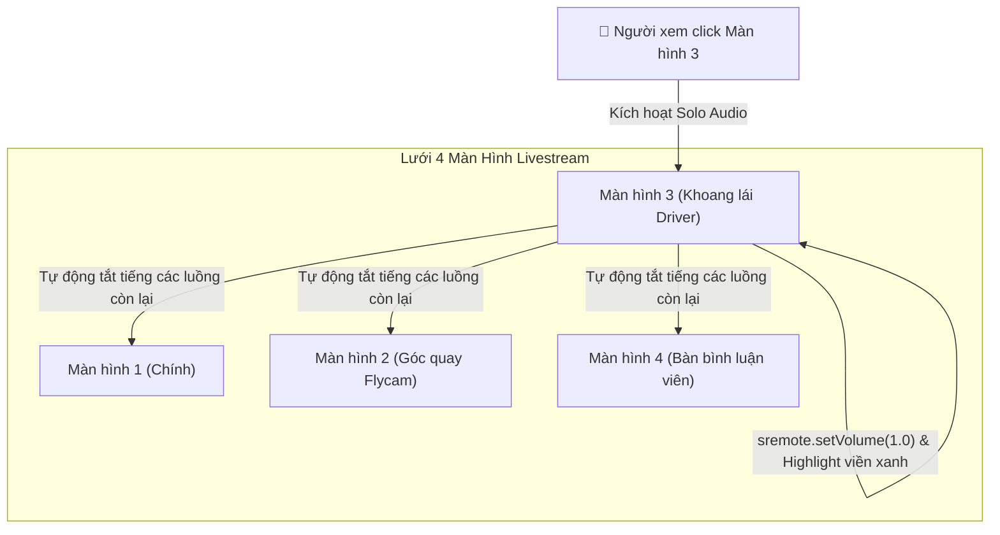

# Tutorial 06: Bàn Điều Khiển 4 Màn Hình Livestream Song Song (Multi-Stream Dashboard)

Trong các sự kiện thể thao lớn (World Cup, F1), giải đấu Esports (League of Legends, CS:GO) hoặc hệ thống giám sát an ninh (CCTV), người dùng thường có nhu cầu **theo dõi cùng lúc 4 góc máy quay (Multiple Camera Angles)** trên một màn hình duy nhất.

Tuy nhiên, nếu bật cả 4 luồng video cùng phát âm thanh thì người nghe sẽ bị "loạn cào cào" vì tiếng ồn chồng chéo.

Trong tutorial này, chúng ta sẽ xây dựng một **Multi-Stream Command Center**:
- Hiển thị lưới Grid 2x2 chứa 4 màn hình livestream độc lập.
- Tính năng **"Solo Audio (Nghe Độc Quyền)"**: Nhấp vào bất kỳ màn hình nào, màn hình đó sẽ mở âm thanh 100%, đồng thời 3 màn hình còn lại sẽ **tự động tắt tiếng (Mute)** mà hình ảnh vẫn tiếp tục chạy mượt mà.
- Nút tổng chỉ huy: **"Mute All"** và **"Pause All"**.

> [!TIP]
> **Trải nghiệm ngay bản demo hoạt động thực tế**: Mở [🚀 Live Demo: 06-multi-stream](../../../../demo/apps/06-multi-stream/index.html) để tương tác trực tiếp trên trình duyệt.

---

## 🎯 Mục tiêu Bạn Sẽ Đạt Được

Sau bài học này, bạn sẽ nắm vững:
1. Cách quản lý đồng thời một mảng gồm nhiều đối tượng `SRemoteClient` độc lập trên cùng 1 trang.
2. **Kỹ thuật Solo Audio Pattern (Master/Solo Channel)**: Điều khiển trạng thái âm thanh có điều kiện giữa nhiều player.
3. Kỹ thuật điều khiển hàng loạt (Batch Operations) bằng `Promise.all()`.
4. Thiết kế giao diện phản hồi trực quan với viền phát sáng (Glow Border) cho màn hình đang được Solo Audio.



---

## Bước 1: Chuẩn Bị Giao Diện & Bộ Styling (HTML/CSS)

> [!TIP]
> **📥 Tải Nhanh Bộ Giao Diện Mẫu (Starter Kit)**  
> Để bắt đầu ngay mà không cần mất thời gian gõ HTML & CSS, bạn hãy nhấp vào nút **`📥 Tải Starter Files`** ở thanh công cụ phía trên đầu trang tài liệu để tải về máy:
> - `index.html`: Khung sườn lưới 4 màn hình Grid 2x2 Flat 2.0.
> - `style.css`: File định dạng layout cho Multi-Stream Grid & Viền Solo Active.
> - `common.css`: Hệ thống biến màu sắc và theme chung.
>
> Đặt các file trên vào cùng thư mục làm việc với file `app.js` của bạn.

### 🔑 Các Phần Tử DOM Trọng Tâm Cần Điều Khiển Trong JS
Trong suốt bài hướng dẫn này, file `app.js` sẽ kết nối và điều khiển trực tiếp các phần tử có `id` sau:

| Phần tử DOM | `id` | Vai trò trong ứng dụng |
| :--- | :--- | :--- |
| `<button>` Mute All | `#btn-mute-all` | Nút tắt tiếng đồng loạt cả 4 luồng video |
| `<button>` Play/Pause All | `#btn-toggle-all` | Nút đồng loạt phát hoặc tạm dừng cả 4 màn hình |
| `<div>` Lưới Grid | `#stream-grid` | Khung lưới 2x2 render 4 ô camera đa luồng |

---

---

## Bước 2: Định Nghĩa Danh Sách 4 Camera & Render DOM Động

Mở file `app.js`. Chúng ta định nghĩa mảng 4 camera gồm tên góc quay và `videoId` tương ứng:

```javascript
import { SRemoteClient } from 'https://cdn.jsdelivr.net/npm/@sremote/sdk/+esm';
import { youtube } from 'https://cdn.jsdelivr.net/npm/@sremote/ready2use/+esm';

// Cấu hình 4 luồng video độc lập
const streamsData = [
  { id: 'cam-1', name: 'Camera 1: Toàn Cảnh Sân Vận Động', videoId: 'jfKfPfyJRdk' },
  { id: 'cam-2', name: 'Camera 2: Góc Quay Flycam Trên Cao', videoId: 'dQw4w9WgXcQ' },
  { id: 'cam-3', name: 'Camera 3: Khoang Lái Tuyển Thủ', videoId: '4xDzrJKXOOY' },
  { id: 'cam-4', name: 'Camera 4: Bàn Bình Luận Viên', videoId: 'M7lc1UVf-VE' }
];

// Mảng lưu trữ các instance SRemoteClient
const activeStreams = [];

const streamGrid = document.getElementById('stream-grid');
const btnMuteAll = document.getElementById('btn-mute-all');
const btnToggleAll = document.getElementById('btn-toggle-all');

// Render 4 card ra giao diện
streamsData.forEach((stream, index) => {
  const card = document.createElement('div');
  card.className = `stream-card ${index === 0 ? 'solo-active' : ''}`;
  card.id = `card-${stream.id}`;
  card.innerHTML = `
    <div id="slot-${stream.id}" class="stream-video-slot"></div>
    <div class="stream-footer">
      <span class="camera-label">🎥 ${stream.name}</span>
      <button class="solo-btn" id="btn-solo-${stream.id}">🔊 Solo Audio</button>
    </div>
  `;
  streamGrid.appendChild(card);
});
```

---

## Bước 3: Khởi Tạo Độc Lập 4 SRemote Client

Mỗi thẻ iframe cần có một đối tượng `SRemoteClient` riêng để điều khiển. Chúng ta duyệt qua từng camera và khởi tạo song song:

```javascript
async function initMultiStreams() {
  console.log('⚡ Đang khởi tạo 4 luồng video song song...');

  for (let i = 0; i < streamsData.length; i++) {
    const data = streamsData[i];
    
    // Mount YouTube vào slot tương ứng
    const handle = await youtube.mount(`#slot-${data.id}`, {
      videoId: data.videoId,
      playerVars: { controls: 0, autoplay: 1 }
    });

    // Tạo SRemoteClient riêng gắn với iframe này
    const client = new SRemoteClient({ target: handle.iframe });

    activeStreams.push({
      id: data.id,
      client: client,
      card: document.getElementById(`card-${data.id}`)
    });

    // Gắn sự kiện click vào nút Solo Audio hoặc click vào cả khung hình
    document.getElementById(`btn-solo-${data.id}`).addEventListener('click', () => {
      setSoloAudio(data.id);
    });
  }

  // Mặc định ban đầu: Chỉ mở tiếng Camera 1, tắt tiếng 3 camera còn lại
  await setSoloAudio('cam-1');
  console.log('✅ Cả 4 camera đã sẵn sàng!');
}
```

---

## Bước 4: Lập Trình Tính Năng Solo Audio (Nghe Độc Quyền)

Khi người dùng kích hoạt Solo Audio cho một Camera (ví dụ `cam-3`):
1. Tìm client của `cam-3` và đặt `setVolume(1)`.
2. Duyệt qua tất cả các client còn lại và đặt `setVolume(0)`.
3. Cập nhật class CSS `.solo-active` để viền của camera đó phát sáng.

```javascript
async function setSoloAudio(targetCamId) {
  console.log(`🎧 Đang kích hoạt Solo Audio cho: ${targetCamId}`);

  // Thực hiện song song để đảm bảo tốc độ phản hồi tức thì
  await Promise.all(activeStreams.map(async (stream) => {
    if (stream.id === targetCamId) {
      // Bật tiếng 100% cho camera được chọn
      await stream.client.setVolume(1);
      stream.card.classList.add('solo-active');
      stream.card.querySelector('.solo-btn').textContent = '🔊 Đang Nghe';
    } else {
      // Tắt tiếng tất cả các camera khác
      await stream.client.setVolume(0);
      stream.card.classList.remove('solo-active');
      stream.card.querySelector('.solo-btn').textContent = '🔇 Solo Audio';
    }
  }));
}
```

---

## Bước 5: Lập Trình Lệnh Tổng Chỉ Huy (Batch Controls)

Thực hiện đồng loạt lệnh lên toàn bộ 4 màn hình bằng `Promise.all`:

```javascript
// 1. Tắt tiếng toàn bộ 4 màn hình
btnMuteAll.addEventListener('click', async () => {
  console.log('🔇 Đang mute toàn bộ các luồng...');
  await Promise.all(activeStreams.map(async (s) => {
    await s.client.setVolume(0);
    s.card.classList.remove('solo-active');
    s.card.querySelector('.solo-btn').textContent = '🔇 Bật Tiếng';
  }));
});

// 2. Play / Pause đồng loạt cả 4 màn hình
let areAllPlaying = true;
btnToggleAll.addEventListener('click', async () => {
  areAllPlaying = !areAllPlaying;
  console.log(`⏯ Đang chuyển trạng thái toàn bộ sang: ${areAllPlaying ? 'Play' : 'Pause'}`);
  
  await Promise.all(activeStreams.map(async (s) => {
    if (areAllPlaying) {
      await s.client.play();
    } else {
      await s.client.pause();
    }
  }));
});

// Khởi chạy hệ thống
initMultiStreams();
```

---

## 💡 Bài Tập Thử Thách Mở Rộng

1. **Phóng to Toàn màn hình (Full Grid / Maximize)**: Thêm nút ⛶ Phóng to ở mỗi camera để mở rộng camera đó chiếm 100% diện tích dashboard, tạm ẩn 3 camera còn lại.
2. **Kéo Thả Đổi Vị Trí (Drag & Drop Cameras)**: Sử dụng HTML5 Drag and Drop API để người xem tự do tráo đổi vị trí của các góc quay theo ý muốn.
