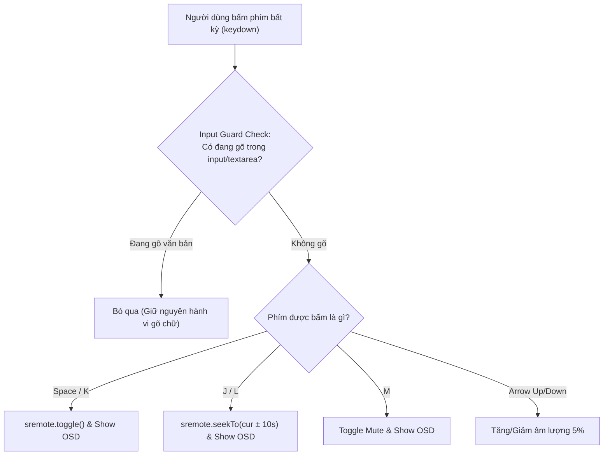

# Tutorial 07: Hệ Thống Phím Tắt Toàn Cục (Accessibility & Global Keyboard Shortcuts)

Khi nhúng video từ YouTube, Vimeo hoặc Spotify vào trang web qua thẻ `<iframe>`, một vấn đề gây ức chế hàng đầu cho người dùng là:
- Khi người dùng đang duyệt web hoặc đọc bình luận ở trang cha, việc bấm phím **Space**, **K**, **J**, **L** hay **M** hoàn toàn **không có tác dụng** vì con trỏ bàn phím (Focus) không nằm bên trong thẻ iframe!
- Muốn bấm phím tắt, người dùng bắt buộc phải rê chuột nhấp đúng vào khung hình video để trao focus cho iframe.

Trong bài hướng dẫn này, chúng ta sẽ xây dựng một **Hệ thống Phím Tắt Toàn Cục chuẩn Desktop / VLC**:
- Điều khiển video mọi lúc mọi nơi trên trang cha mà không cần focus vào iframe.
- Bắt trọn bộ phím quen thuộc: `Space/K` (Play/Pause), `J/L` (Tua lùi/tới 10s), `M` (Mute), `ArrowUp/Down` (Tăng giảm volume).
- **Kỹ thuật Input Guard (Bộ Lọc Chống Nuốt Phím)**: Đảm bảo khi người dùng đang gõ văn bản trong `<input>` hay `<textarea>` tìm kiếm, phím Space sẽ gõ ra dấu cách chứ không làm dừng video!
- Hiển thị thông báo OSD (On-Screen Display Toast) phản hồi trực quan khi bấm phím.

> [!TIP]
> **Trải nghiệm ngay bản demo hoạt động thực tế**: Mở [🚀 Live Demo: 07-global-shortcuts](../../../../demo/apps/07-global-shortcuts/index.html) để tương tác trực tiếp trên trình duyệt.

---

## 🎯 Mục tiêu Bạn Sẽ Đạt Được

Sau bài học này, bạn sẽ nắm vững:
1. Cơ chế bắt sự kiện bàn phím toàn cục trên đối tượng `window` với `keydown`.
2. **Kỹ thuật Input Guard với `document.activeElement`**: Phân biệt ngữ cảnh người dùng đang gõ phím hay đang điều khiển media.
3. Kỹ thuật tua thời gian tương đối (`relative seek`: $currentTime \pm 10s$) kết hợp đọc thời gian thực từ SRemote.
4. Xây dựng thông báo OSD mờ ảo xuất hiện giữa màn hình tương tự như YouTube Player chính chủ.



---

## Bước 1: Chuẩn Bị Giao Diện & Bộ Styling (HTML/CSS)

> [!TIP]
> **📥 Tải Nhanh Bộ Giao Diện Mẫu (Starter Kit)**  
> Để bắt đầu ngay mà không cần mất thời gian gõ HTML & CSS, bạn hãy nhấp vào nút **`📥 Tải Starter Files`** ở thanh công cụ phía trên đầu trang tài liệu để tải về máy:
> - `index.html`: Khung sườn giao diện kèm OSD Toast và ô gõ thử Input Guard.
> - `style.css`: File định dạng layout cho Video Stage & Toast OSD.
> - `common.css`: Hệ thống biến màu sắc và theme chung.
>
> Đặt các file trên vào cùng thư mục làm việc với file `app.js` của bạn.

### 🔑 Các Phần Tử DOM Trọng Tâm Cần Điều Khiển Trong JS
Trong suốt bài hướng dẫn này, file `app.js` sẽ kết nối và điều khiển trực tiếp các phần tử có `id` sau:

| Phần tử DOM | `id` | Vai trò trong ứng dụng |
| :--- | :--- | :--- |
| `<div>` Slot Video | `#video-container` | Khung hiển thị mount player video |
| `<div>` OSD Toast | `#osd-toast` | Thông báo nổi giữa màn hình khi bấm phím tắt (`▶ Play`, `🔇 Mute`...) |
| `<textarea>` Bình luận | `#comment-box` | Ô gõ text dùng để kiểm thử thuật toán Input Guard chống ngắt phím |

---

---

## Bước 2: Nạp Video & Xây Dựng Hàm Hiển Thị OSD Toast

Mở file `app.js`. Đầu tiên, kết nối player và viết hàm tiện ích `showOSD(text)` để hiển thị nhãn nổi giữa màn hình và tự động biến mất sau 1 giây:

```javascript
import { sremote } from 'https://cdn.jsdelivr.net/npm/@sremote/sdk/+esm';
import { youtube } from 'https://cdn.jsdelivr.net/npm/@sremote/ready2use/+esm';

const osdToast = document.getElementById('osd-toast');
let osdTimeout = null;

// Hàm hiển thị OSD Toast nổi giữa màn hình
function showOSD(text) {
  osdToast.textContent = text;
  osdToast.classList.remove('hidden');

  if (osdTimeout) {
    clearTimeout(osdTimeout);
  }

  osdTimeout = setTimeout(() => {
    osdToast.classList.add('hidden');
  }, 1000);
}

// Khởi tạo Player
async function initPlayer() {
  await youtube.mount('#video-container', {
    videoId: 'M7lc1UVf-VE',
    playerVars: { controls: 1, autoplay: 0 }
  });
  console.log('✅ Player sẵn sàng nhận phím tắt toàn cục!');
  setupGlobalShortcuts();
}
```

---

## Bước 3: Lập Trình Input Guard (Bộ Lọc Chống Nuốt Phím)

> [!IMPORTANT]
> Đây là lỗi cực kỳ phổ biến: Nếu bạn chỉ viết `window.addEventListener('keydown', e => { if (e.code === 'Space') sremote.toggle(); })`, mỗi khi người dùng gõ phím cách trong ô bình luận, video sẽ bị dừng lại liên tục!

Chúng ta kiểm tra xem con trỏ bàn phím có đang nằm trong bất kỳ ô nhập liệu nào hay không:

```javascript
function isUserTyping() {
  const activeEl = document.activeElement;
  if (!activeEl) return false;

  const tag = activeEl.tagName.toLowerCase();
  const isInputOrTextarea = tag === 'input' || tag === 'textarea';
  const isContentEditable = activeEl.isContentEditable;

  return isInputOrTextarea || isContentEditable;
}
```

---

## Bước 4: Lập Trình Bộ Phím Tắt Chuẩn VLC / YouTube

Bây giờ ta bắt sự kiện trên `window`:
- Nếu `isUserTyping()` trả về `true` ➔ Không làm gì cả.
- Ngược lại ➔ Xử lý từng phím bấm tương ứng:

```javascript
function setupGlobalShortcuts() {
  window.addEventListener('keydown', async (e) => {
    // 1. Kiểm tra Input Guard
    if (isUserTyping()) {
      return; // Người dùng đang gõ chữ, bỏ qua phím tắt media!
    }

    const key = e.key.toLowerCase();

    // 2. Phím Space hoặc K: Play / Pause
    if (e.code === 'Space' || key === 'k') {
      e.preventDefault(); // Ngăn trình duyệt cuộn trang xuống dưới khi bấm Space
      await sremote.toggle();
      const state = await sremote.getState();
      showOSD(state === 'playing' ? '▶ Play' : '⏸ Pause');
    }

    // 3. Phím J: Tua lùi 10 giây
    else if (key === 'j') {
      e.preventDefault();
      const cur = await sremote.getCurrentTime();
      const target = Math.max(0, cur - 10);
      await sremote.seekTo(target);
      showOSD(`⏪ -10s (${Math.floor(target)}s)`);
    }

    // 4. Phím L: Tua tới 10 giây
    else if (key === 'l') {
      e.preventDefault();
      const cur = await sremote.getCurrentTime();
      const dur = await sremote.getDuration();
      const target = Math.min(dur || 9999, cur + 10);
      await sremote.seekTo(target);
      showOSD(`⏩ +10s (${Math.floor(target)}s)`);
    }

    // 5. Phím M: Bật / Tắt tiếng (Mute)
    else if (key === 'm') {
      e.preventDefault();
      const curVol = await sremote.getVolume();
      if (curVol > 0) {
        window._lastVol = curVol;
        await sremote.setVolume(0);
        showOSD('🔇 Mute');
      } else {
        const restore = window._lastVol || 0.8;
        await sremote.setVolume(restore);
        showOSD(`🔊 Âm lượng: ${Math.round(restore * 100)}%`);
      }
    }

    // 6. Phím Mũi tên Lên / Xuống: Tăng giảm 10% âm lượng
    else if (e.key === 'ArrowUp') {
      e.preventDefault();
      const curVol = await sremote.getVolume();
      const nextVol = Math.min(1, curVol + 0.1);
      await sremote.setVolume(nextVol);
      showOSD(`🔊 Âm lượng: ${Math.round(nextVol * 100)}%`);
    }
    else if (e.key === 'ArrowDown') {
      e.preventDefault();
      const curVol = await sremote.getVolume();
      const nextVol = Math.max(0, curVol - 0.1);
      await sremote.setVolume(nextVol);
      showOSD(`🔉 Âm lượng: ${Math.round(nextVol * 100)}%`);
    }
  });
}

// Khởi chạy
initPlayer();
```

---

## 💡 Bài Tập Thử Thách Mở Rộng

1. **Phím tắt Tốc độ phát (`<` và `>` / `Shift + ,` và `Shift + .`)**: Bổ sung phím tắt tăng giảm tốc độ phát từ 0.5x, 1x, 1.5x đến 2x bằng lệnh `sremote.setPlaybackRate()`.
2. **Phím số `0` đến `9`**: Bấm số `1` tua đến 10% thời lượng video, phím `5` tua đến 50%, phím `0` tua về đầu video (chuẩn YouTube).
