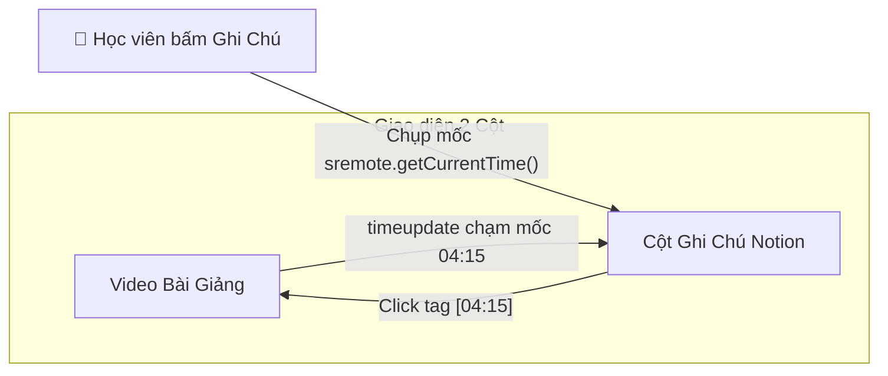

# Tutorial 08: Trình Ghi Chú Bài Giảng Đính Kèm Mốc Thời Gian (Lecture Timestamped Notes)

Khi xem các video bài giảng kỹ thuật dài 2 - 3 tiếng trên YouTube, sinh viên và lập trình viên thường có thói quen vừa xem vừa ghi chép. Các công cụ ghi chú thông minh hiện đại (như Notion, Roam Research hay Otter.ai) đều có tính năng **Timestamped Notes**:
- Khi học viên bấm nút "Tạo ghi chú" (hoặc phím tắt), hệ thống **tự động chụp lại chính xác mốc thời gian đang phát** (ví dụ `04:15`).
- Khi bấm vào tag `[04:15]`, video lập tức tự động tua đến đúng giây đó để học viên ôn lại kiến thức.
- Khi video phát lướt qua mốc `04:15`, ghi chú tương ứng sẽ **tự động đổi màu highlight** trên màn hình để thu hút sự chú ý.

Trong bài hướng dẫn này, chúng ta sẽ xây dựng ứng dụng ghi chú bài giảng thông minh này từ A đến Z với **SRemote**.

> [!TIP]
> **Trải nghiệm ngay bản demo hoạt động thực tế**: Mở [🚀 Live Demo: 08-timestamp-notes](../../../../demo/apps/08-timestamp-notes/index.html) để tương tác trực tiếp trên trình duyệt.

---

## 🎯 Mục tiêu Bạn Sẽ Đạt Được

Sau bài học này, bạn sẽ nắm vững:
1. Cách lấy thời gian hiện tại chính xác `await sremote.getCurrentTime()` theo thời gian thực.
2. Thiết kế cấu trúc dữ liệu ghi chú có gắn mốc `timestamp` và lưu bền vững vào `localStorage`.
3. **Cơ chế Tương Tác 2 Chiều**:
   - Nhấp vào ghi chú ➔ Tua video (`sremote.seekTo()`).
   - Video đang phát ➔ Tự động highlight ghi chú đang khớp thời gian (`sremote.on('timeupdate')`).
4. Phím tắt tiện lợi `Ctrl + Enter` (hoặc `Cmd + Enter`) để lưu ghi chú nhanh mà không cần rời tay khỏi bàn phím.



---

## Bước 1: Chuẩn Bị Giao Diện & Bộ Styling (HTML/CSS)

> [!TIP]
> **📥 Tải Nhanh Bộ Giao Diện Mẫu (Starter Kit)**  
> Để bắt đầu ngay mà không cần mất thời gian gõ HTML & CSS, bạn hãy nhấp vào nút **`📥 Tải Starter Files`** ở thanh công cụ phía trên đầu trang tài liệu để tải về máy:
> - `index.html`: Khung sườn layout 2 cột (Video bên trái, sổ ghi chú bên phải) Flat 2.0.
> - `style.css`: File định dạng layout cho Notes Column & Time Tags.
> - `common.css`: Hệ thống biến màu sắc và theme chung.
>
> Đặt các file trên vào cùng thư mục làm việc với file `app.js` của bạn.

### 🔑 Các Phần Tử DOM Trọng Tâm Cần Điều Khiển Trong JS
Trong suốt bài hướng dẫn này, file `app.js` sẽ kết nối và điều khiển trực tiếp các phần tử có `id` sau:

| Phần tử DOM | `id` | Vai trò trong ứng dụng |
| :--- | :--- | :--- |
| `<div>` Slot Video | `#video-embed-slot` | Khung hiển thị mount player bài giảng video |
| `<span>` Đồng hồ hiện tại | `#current-clock` | Hiển thị giây hiện tại theo thời gian thực |
| `<textarea>` Ghi chú | `#note-input` | Ô nhập nội dung bài học |
| `<button>` Lưu mốc | `#btn-add-note` | Nút bấm chụp `getCurrentTime()` và lưu thẻ ghi chú |
| `<ul>` Danh sách ghi chú | `#notes-list` | Vùng hiển thị các thẻ ghi chú gắn timestamp |

---

---

## Bước 2: Nạp Video & Quản Lý State Danh Sách Ghi Chú

Mở file `app.js`. Chúng ta định dạng thời gian giây sang `mm:ss`, tải các ghi chú đã lưu từ `localStorage` và nạp video qua SRemote:

```javascript
import { sremote } from 'https://cdn.jsdelivr.net/npm/@sremote/sdk/+esm';
import { youtube } from 'https://cdn.jsdelivr.net/npm/@sremote/ready2use/+esm';

// Lấy danh sách ghi chú từ localStorage hoặc mảng rỗng
let notes = JSON.parse(localStorage.getItem('lecture_notes_v1') || '[]');

const currentClockEl = document.getElementById('current-clock');
const noteInput = document.getElementById('note-input');
const btnAddNote = document.getElementById('btn-add-note');
const notesListEl = document.getElementById('notes-list');

function formatTime(seconds) {
  const m = Math.floor(seconds / 60);
  const s = Math.floor(seconds % 60);
  return `${String(m).padStart(2, '0')}:${String(s).padStart(2, '0')}`;
}

async function initLecture() {
  await youtube.mount('#video-embed-slot', {
    videoId: '8hly31xKli0', // CS50 Algorithms Lecture
    playerVars: { controls: 1, autoplay: 0 }
  });

  console.log('✅ Bài giảng đã kết nối SRemote!');
  renderNotes();
  setupEventListeners();
}
```

---

## Bước 3: Chụp Mốc Thời Gian Thực & Lưu Ghi Chú

Khi người dùng bấm "Ghi mốc này" hoặc bấm `Ctrl + Enter`:
1. Đọc thời gian chính xác: `const time = await sremote.getCurrentTime()`.
2. Tạo một object ghi chú mới gồm: `id`, `time`, `text`.
3. Đẩy vào mảng và lưu vào `localStorage`.

```javascript
async function saveCurrentNote() {
  const text = noteInput.value.trim();
  if (!text) return;

  // Chụp chính xác giây hiện tại của video qua SRemote
  const currentTime = await sremote.getCurrentTime();

  const newNote = {
    id: Date.now(),
    time: Math.floor(currentTime),
    text: text
  };

  // Sắp xếp các ghi chú theo thứ tự thời gian tăng dần
  notes.push(newNote);
  notes.sort((a, b) => a.time - b.time);

  // Lưu vào localStorage
  localStorage.setItem('lecture_notes_v1', JSON.stringify(notes));

  noteInput.value = '';
  renderNotes();
}
```

---

## Bước 4: Render Ghi Chú & Kỹ Thuật Tương Tác 2 Chiều

### 1. Click vào ghi chú ➔ Tua video:
Khi người dùng bấm vào card ghi chú, ta gọi `await sremote.seekTo(note.time)` và `await sremote.play()`.

### 2. Video phát ➔ Highlight ghi chú đang hoạt động:
Lắng nghe `sremote.on('timeupdate')`, so sánh thời gian hiện tại với mốc của các ghi chú để gắn class `.active-note`.

```javascript
function renderNotes() {
  notesListEl.innerHTML = '';

  if (notes.length === 0) {
    notesListEl.innerHTML = '<li style="color: #64748b; font-size: 13px;">Chưa có ghi chú nào. Hãy vừa xem vừa ghi chép nhé!</li>';
    return;
  }

  notes.forEach((note) => {
    const li = document.createElement('li');
    li.className = 'note-card';
    li.id = `note-${note.id}`;
    li.innerHTML = `
      <div class="note-top-bar">
        <span class="time-tag">⏱ ${formatTime(note.time)}</span>
        <button class="btn-del" title="Xóa ghi chú">✕</button>
      </div>
      <div class="note-body">${note.text}</div>
    `;

    // Click vào cả card -> Tua video tới mốc đó ngay lập tức
    li.addEventListener('click', async (e) => {
      if (e.target.classList.contains('btn-del')) return;
      console.log(`⏩ Đang tua video tới mốc ${note.time}s...`);
      await sremote.seekTo(note.time);
      await sremote.play();
    });

    // Nút xóa ghi chú
    li.querySelector('.btn-del').addEventListener('click', () => {
      notes = notes.filter(n => n.id !== note.id);
      localStorage.setItem('lecture_notes_v1', JSON.stringify(notes));
      renderNotes();
    });

    notesListEl.appendChild(li);
  });
}

function setupEventListeners() {
  // Bấm nút lưu ghi chú
  btnAddNote.addEventListener('click', saveCurrentNote);

  // Phím tắt Ctrl + Enter trong ô nhập liệu
  noteInput.addEventListener('keydown', (e) => {
    if (e.key === 'Enter' && (e.ctrlKey || e.metaKey)) {
      e.preventDefault();
      saveCurrentNote();
    }
  });

  // Lắng nghe timeline video để cập nhật đồng hồ và highlight ghi chú
  sremote.on('timeupdate', ({ currentTime }) => {
    currentClockEl.textContent = `Mốc hiện tại: ${formatTime(currentTime)}`;

    // Tìm ghi chú gần nhất trước hoặc bằng currentTime
    const active = [...notes].reverse().find(n => currentTime >= n.time && currentTime < n.time + 15);

    document.querySelectorAll('.note-card').forEach(el => el.classList.remove('active-note'));
    if (active) {
      const el = document.getElementById(`note-${active.id}`);
      if (el) el.classList.add('active-note');
    }
  });
}

// Khởi chạy
initLecture();
```

---

## 💡 Bài Tập Thử Thách Mở Rộng

1. **Xuất file Markdown (Export to .md)**: Thêm nút "Xuất file ghi chú" để tải về file `.md` chứa toàn bộ các mốc `[04:15](https://youtube.com/watch?v=...&t=255s)` để lưu trữ vào Obsidian hoặc Notion.
2. **Ảnh chụp khung hình (Thumbnail Snapshot)**: Khi tạo ghi chú, lưu thêm ảnh thumbnail của video tại thời điểm đó để xem trước trực quan.
