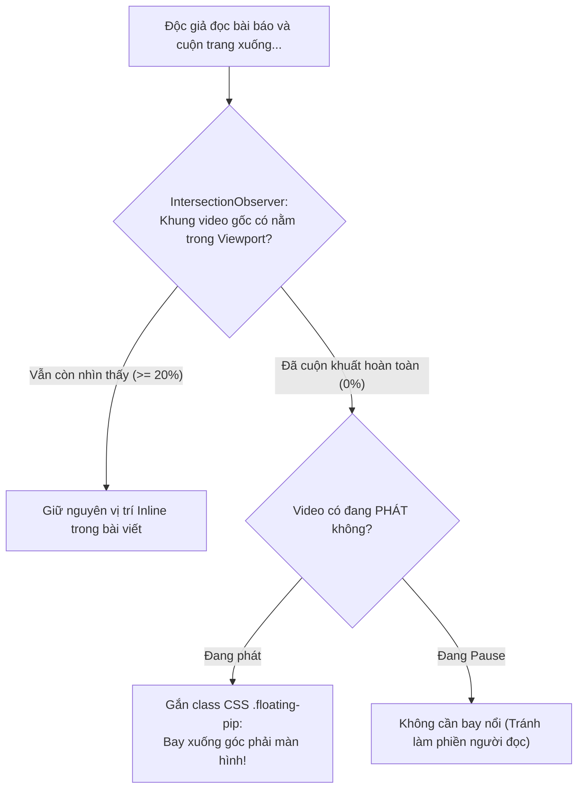

# Tutorial 09: Video Mini Nổi Góc Màn Hình Khi Cuộn Trang (Sticky Floating Picture-in-Picture)

Khi đọc các bài báo công nghệ dài hoặc diễn đàn tin tức (như The Verge, TechCrunch hay VnExpress), độc giả thường vừa muốn đọc nội dung văn bản bên dưới, vừa muốn tiếp tục theo dõi video thuyết minh đang phát.

Trải nghiệm chuẩn mực trong thiết kế web hiện đại là **Sticky Floating Video (Mini-Player)**:
- Khi người dùng ở đầu trang, video nằm đúng vị trí tự nhiên giữa bài viết.
- Khi người dùng **cuộn chuột xuống dưới làm video lọt ra khỏi tầm nhìn**, video sẽ tự động thu nhỏ lại và **nổi cố định ở góc dưới bên phải màn hình** (Floating PiP Widget).
- Khi người dùng cuộn chuột ngược lại đầu trang, video sẽ tự động bay về vị trí cũ một cách mượt mà.
- **Quan trọng**: Video **không bao giờ bị gián đoạn hay tải lại** trong suốt quá trình chuyển đổi vị trí.

Trong tutorial này, chúng ta sẽ xây dựng tính năng này bằng **IntersectionObserver API** và **SRemote**.

> [!TIP]
> **Trải nghiệm ngay bản demo hoạt động thực tế**: Mở [🚀 Live Demo: 09-floating-player](../../../../demo/apps/09-floating-player/index.html) để tương tác trực tiếp trên trình duyệt.

---

## 🎯 Mục tiêu Bạn Sẽ Đạt Được

Sau bài học này, bạn sẽ nắm vững:
1. Cách sử dụng **`IntersectionObserver API`** hiệu quả cao (Zero Scroll Lag) để phát hiện khi nào video rời khỏi màn hình.
2. **Kỹ thuật Giữ Nguyên Vị Trí DOM (DOM Node Preservation)**: Tuyệt đối không tháo gỡ thẻ `<iframe>` ra khỏi DOM (vì tháo ra gắn lại sẽ làm iframe bị reload và mất trạng thái). Thay vào đó, ta sử dụng CSS `position: fixed` kết hợp chuyển đổi kích thước mượt mà.
3. Thêm các nút điều khiển nhanh trên widget nổi: Nút Đóng (Tạm dừng & tắt nổi) và Nút Play/Pause.



---

## Bước 1: Chuẩn Bị Giao Diện & Bộ Styling (HTML/CSS)

> [!TIP]
> **📥 Tải Nhanh Bộ Giao Diện Mẫu (Starter Kit)**  
> Để bắt đầu ngay mà không cần mất thời gian gõ HTML & CSS, bạn hãy nhấp vào nút **`📥 Tải Starter Files`** ở thanh công cụ phía trên đầu trang tài liệu để tải về máy:
> - `index.html`: Khung sườn trang bài báo dài kèm khung neo giữ chỗ (Sentinel Anchor) và Mini-Controls Flat 2.0.
> - `style.css`: File định dạng hiệu ứng chuyển đổi mượt mà khi video bay nổi (Floating PiP) xuống góc màn hình.
> - `common.css`: Hệ thống biến màu sắc và theme chung.
>
> Đặt các file trên vào cùng thư mục làm việc với file `app.js` của bạn.

### 🔑 Các Phần Tử DOM Trọng Tâm Cần Điều Khiển Trong JS
Trong suốt bài hướng dẫn này, file `app.js` sẽ kết nối và điều khiển trực tiếp các phần tử có `id` sau:

| Phần tử DOM | `id` | Vai trò trong ứng dụng |
| :--- | :--- | :--- |
| `<div>` Khung neo | `#video-anchor` | Vị trí neo giữ chỗ cố định trên trang bài viết để `IntersectionObserver` theo dõi |
| `<div>` Hộp chứa Player | `#pip-player-box` | Hộp chứa video thực tế sẽ được thêm class `.floating-pip` để bay xuống góc màn hình |
| `<div>` Slot Video | `#media-embed-slot` | Vùng mount player YouTube video |
| `<button>` Mini Toggle | `#btn-mini-toggle` | Nút Play / Pause nhanh trên thanh điều khiển thu nhỏ khi đang ở chế độ nổi |
| `<button>` Mini Close | `#btn-mini-close` | Nút đóng chế độ nổi PiP và tự động tạm dừng phát video |

---

---

## Bước 2: Nạp Video & Kết Nối SRemote

Tạo file `app.js`:

```javascript
import { sremote } from 'https://cdn.jsdelivr.net/npm/@sremote/sdk/+esm';
import { youtube } from 'https://cdn.jsdelivr.net/npm/@sremote/ready2use/+esm';

const videoAnchor = document.getElementById('video-anchor');
const pipPlayerBox = document.getElementById('pip-player-box');
const btnMiniToggle = document.getElementById('btn-mini-toggle');
const btnMiniClose = document.getElementById('btn-mini-close');

let isFloatingManuallyDismissed = false;
let isCurrentlyPlaying = false;

async function init() {
  await youtube.mount('#media-embed-slot', {
    videoId: 'dQw4w9WgXcQ',
    playerVars: { controls: 1, autoplay: 0 }
  });

  console.log('✅ Player sẵn sàng kết nối!');

  // Theo dõi trạng thái phát của video
  sremote.on('play', () => {
    isCurrentlyPlaying = true;
    btnMiniToggle.textContent = '⏸';
  });

  sremote.on('pause', () => {
    isCurrentlyPlaying = false;
    btnMiniToggle.textContent = '▶';
  });

  setupIntersectionObserver();
  setupMiniControls();
}
```

---

## Bước 3: Giám Sát Tầm Nhìn Bằng `IntersectionObserver`

Thay vì lắng nghe `window.addEventListener('scroll')` làm tụt FPS của trình duyệt, chúng ta dùng `IntersectionObserver` gắn vào `#video-anchor`:

```javascript
function setupIntersectionObserver() {
  const observer = new IntersectionObserver((entries) => {
    entries.forEach((entry) => {
      // entry.isIntersecting = true tức là khung neo vẫn đang nằm trong màn hình
      if (entry.isIntersecting) {
        // Độc giả đã cuộn về lại vị trí ban đầu -> Tắt chế độ nổi
        pipPlayerBox.classList.remove('floating-pip');
        isFloatingManuallyDismissed = false;
      } else {
        // Khung neo đã bị cuộn khuất khỏi màn hình!
        // Chỉ bật Floating nếu video ĐANG PHÁT và người dùng CHƯA bấm nút tắt
        if (isCurrentlyPlaying && !isFloatingManuallyDismissed) {
          pipPlayerBox.classList.add('floating-pip');
        }
      }
    });
  }, {
    threshold: 0.1 // Kích hoạt khi ít hơn 10% khung hình video còn nhìn thấy
  });

  // Bắt đầu theo dõi khung neo
  observer.observe(videoAnchor);
}
```

---

## Bước 4: Lập Trình Các Nút Điều Khiển Nổi (Mini Controls)

```javascript
function setupMiniControls() {
  // Nút Play / Pause trên widget nổi
  btnMiniToggle.addEventListener('click', async () => {
    await sremote.toggle();
  });

  // Nút Đóng (Tạm dừng video và gập widget nổi lại)
  btnMiniClose.addEventListener('click', async () => {
    await sremote.pause();
    pipPlayerBox.classList.remove('floating-pip');
    isFloatingManuallyDismissed = true; // Đánh dấu người dùng đã chủ động tắt
  });
}

// Khởi chạy
init();
```

---

## 💡 Bài Tập Thử Thách Mở Rộng

1. **Kéo thả Widget nổi (Draggable Widget)**: Cho phép người dùng bấm giữ chuột vào thanh `.mini-controls` để kéo widget nổi đến bất kỳ góc nào trên màn hình.
2. **Kích đúp để cuộn nhanh về vị trí gốc**: Khi người dùng nhấp đúp vào video nổi, tự động cuộn màn hình trang web ngược về vị trí `#video-anchor` bằng `videoAnchor.scrollIntoView({ behavior: 'smooth' })`.
