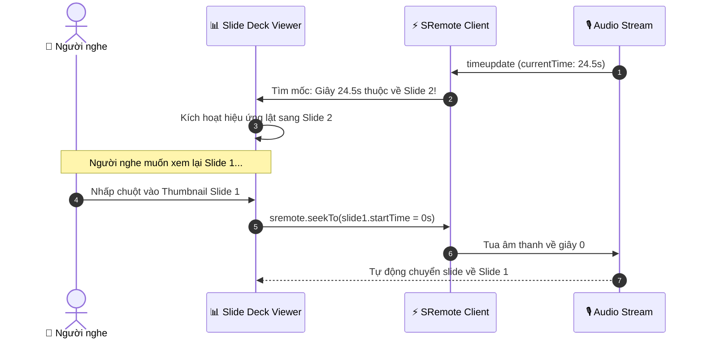

# Tutorial 10: Bộ Trình Chiếu Slide Thuyết Trình Tự Động Lật Theo Giọng Nói (Audio-Driven Slide Deck)

Trong các buổi đào tạo nội bộ của doanh nghiệp hoặc khóa học trực tuyến bán tự động, việc kết hợp giữa **file âm thanh thuyết minh (Voiceover / Audio)** và **bộ Slide trình chiếu** là giải pháp cực kỳ tiết kiệm băng thông so với việc render một file video MP4 cồng kềnh.

Để có trải nghiệm mượt mà, bài toán đặt ra là:
- Khi diễn giả nói đến phần nội dung nào trong file âm thanh, **Slide tương ứng phải tự động lật trang (Auto-Flip)**.
- Người nghe có thể bấm vào mục lục slide bất kỳ để **tua ngược âm thanh** đến đúng thời điểm diễn giả bắt đầu giải thích slide đó (2-way Navigation).

Trong bài hướng dẫn này, chúng ta sẽ xây dựng một **Audio-Driven Slide Deck** hoàn chỉnh bằng **SRemote**.

> [!TIP]
> **Trải nghiệm ngay bản demo hoạt động thực tế**: Mở [🚀 Live Demo: 10-audio-slide](../../../../demo/apps/10-audio-slide/index.html) để tương tác trực tiếp trên trình duyệt.

---

## 🎯 Mục tiêu Bạn Sẽ Đạt Được

Sau bài học này, bạn sẽ nắm vững:
1. Cách định nghĩa siêu dữ liệu dòng thời gian (**Timeline Cue Points / Slide Metadata**).
2. Thuật toán tìm kiếm nhị phân hoặc `findLast()` để xác định slide đang kích hoạt theo `currentTime`.
3. Cơ chế đồng bộ 2 chiều:
   - Âm thanh chạy ➔ Tự động kích hoạt hiệu ứng chuyển slide.
   - Bấm vào thumbnail của slide ➔ Tua âm thanh đến đúng mốc giây bắt đầu của slide đó.
4. Xây dựng thanh tiến độ (Progress Indicator) riêng cho từng slide.



---

## Bước 1: Chuẩn Bị Giao Diện & Bộ Styling (HTML/CSS)

> [!TIP]
> **📥 Tải Nhanh Bộ Giao Diện Mẫu (Starter Kit)**  
> Để bắt đầu ngay mà không cần mất thời gian gõ HTML & CSS, bạn hãy nhấp vào nút **`📥 Tải Starter Files`** ở thanh công cụ phía trên đầu trang tài liệu để tải về máy:
> - `index.html`: Khung sườn màn hình Slide Stage & thanh Thumbnail Deck Flat 2.0.
> - `style.css`: File định dạng layout cho Slide Card, Audio Panel & hiệu ứng chuyển slide.
> - `common.css`: Hệ thống biến màu sắc và theme chung.
>
> Đặt các file trên vào cùng thư mục làm việc với file `app.js` của bạn.

### 🔑 Các Phần Tử DOM Trọng Tâm Cần Điều Khiển Trong JS
Trong suốt bài hướng dẫn này, file `app.js` sẽ kết nối và điều khiển trực tiếp các phần tử có `id` sau:

| Phần tử DOM | `id` | Vai trò trong ứng dụng |
| :--- | :--- | :--- |
| `<div>` Đếm số slide | `#slide-counter` | Nhãn hiển thị số thứ tự slide hiện tại (`Slide 1 / 4`) |
| `<div>` Khung thẻ slide | `#active-slide-card` | Thẻ slide chính đang hiển thị nội dung |
| `<h1>` Tiêu đề slide | `#slide-title` | Tiêu đề của slide đang kích hoạt |
| `<p>` Mô tả slide | `#slide-desc` | Đoạn văn bản thuyết trình chi tiết của slide |
| `<div>` Biểu đồ/Icon | `#slide-graphic` | Biểu tượng trực quan minh họa cho slide |
| `<div>` Slot Audio | `#audio-slot` | Vùng mount player YouTube/SoundCloud phát giọng đọc thuyết minh |
| `<div>` Thanh thumbnails | `#thumbnails-bar` | Lưới 4 thumbnail các slide bên dưới (nhấp để tua âm thanh và lật slide) |

---

## Bước 2: Định Nghĩa Siêu Dữ Liệu Timeline Cues Của Slide

Tạo file `app.js`. Chúng ta định nghĩa mảng `slides` chứa thời điểm bắt đầu (`startTime`) của từng slide trong bài thuyết trình:

```javascript
import { sremote } from 'https://cdn.jsdelivr.net/npm/@sremote/sdk/+esm';
import { youtube } from 'https://cdn.jsdelivr.net/npm/@sremote/ready2use/+esm';

// Danh sách các Slide kèm mốc thời gian (Cue points)
const slidesData = [
  {
    id: 1,
    startTime: 0,
    title: "1. Tổng Quan Về Kiến Trúc Phân Tán",
    desc: "Tại sao các hệ thống monolithic truyền thống gặp khó khăn khi mở rộng và cách thức microservices giải quyết bài toán này.",
    icon: "🌐"
  },
  {
    id: 2,
    startTime: 20, // Bắt đầu tại giây 20
    title: "2. Giao Thức Event-Driven Messaging",
    desc: "Sử dụng Message Broker (Kafka / RabbitMQ) để tách rời sự phụ thuộc trực tiếp giữa các dịch vụ độc lập.",
    icon: "⚡"
  },
  {
    id: 3,
    startTime: 50, // Bắt đầu tại giây 50
    title: "3. Database Per Service Pattern",
    desc: "Mỗi dịch vụ sở hữu cơ sở dữ liệu riêng biệt để đảm bảo tính độc lập và khả năng triển khai linh hoạt.",
    icon: "🗄️"
  },
  {
    id: 4,
    startTime: 85, // Bắt đầu tại giây 85
    title: "4. Tổng Kết & Q&A Thảo Luận",
    desc: "Tóm lược các nguyên lý cốt lõi và bắt đầu phần giải đáp câu hỏi của người tham dự.",
    icon: "💡"
  }
];

let currentSlideIndex = 0;

const slideTitleEl = document.getElementById('slide-title');
const slideDescEl = document.getElementById('slide-desc');
const slideGraphicEl = document.getElementById('slide-graphic');
const slideCounterEl = document.getElementById('slide-counter');
const thumbnailsBarEl = document.getElementById('thumbnails-bar');
```

---

## Bước 3: Nạp Âm Thanh & Render Thumbnails Slide

```javascript
async function initSlideDeck() {
  renderThumbnails();
  displaySlide(0);

  // Gắn audio stream thuyết minh vào slot
  await youtube.mount('#audio-slot', {
    videoId: 'jfKfPfyJRdk', // Audio stream mẫu
    playerVars: { controls: 1, autoplay: 0 }
  });

  console.log('✅ Bộ trình chiếu đã sẵn sàng!');
  setupTimeTracking();
}

function renderThumbnails() {
  thumbnailsBarEl.innerHTML = '';
  slidesData.forEach((slide, index) => {
    const div = document.createElement('div');
    div.className = `thumb-item ${index === 0 ? 'active' : ''}`;
    div.id = `thumb-${slide.id}`;
    div.innerHTML = `
      <div class="thumb-num">SLIDE ${slide.id}</div>
      <div class="thumb-title">${slide.title}</div>
      <div class="thumb-time">⏱ Bắt đầu: ${slide.startTime}s</div>
    `;

    // Nhấp vào Thumbnail -> Tua âm thanh tới đúng mốc slide đó!
    div.addEventListener('click', async () => {
      console.log(`⏩ Người dùng nhấp vào Slide ${slide.id} -> Tua về ${slide.startTime}s`);
      await sremote.seekTo(slide.startTime);
      await sremote.play();
    });

    thumbnailsBarEl.appendChild(div);
  });
}

function displaySlide(index) {
  currentSlideIndex = index;
  const slide = slidesData[index];

  slideTitleEl.textContent = slide.title;
  slideDescEl.textContent = slide.desc;
  slideGraphicEl.textContent = slide.icon;
  slideCounterEl.textContent = `Slide ${slide.id} / ${slidesData.length}`;

  // Highlight thumbnail tương ứng
  document.querySelectorAll('.thumb-item').forEach(el => el.classList.remove('active'));
  const activeThumb = document.getElementById(`thumb-${slide.id}`);
  if (activeThumb) activeThumb.classList.add('active');
}
```

---

## Bước 4: Lập Trình Thuật Toán Tự Động Lật Slide Theo `timeupdate`

Khi SRemote bắn sự kiện `timeupdate`, chúng ta duyệt từ cuối mảng `slidesData` về đầu (hoặc dùng `findLast`) để tìm slide có `startTime <= currentTime`:

```javascript
function setupTimeTracking() {
  sremote.on('timeupdate', ({ currentTime }) => {
    // Tìm slide phù hợp nhất với thời gian hiện tại
    let targetIndex = 0;
    for (let i = slidesData.length - 1; i >= 0; i--) {
      if (currentTime >= slidesData[i].startTime) {
        targetIndex = i;
        break;
      }
    }

    // Nếu phát hiện chuyển sang slide mới -> Cập nhật hiển thị
    if (targetIndex !== currentSlideIndex) {
      console.log(`🔄 Tự động lật sang Slide ${slidesData[targetIndex].id} tại giây ${currentTime.toFixed(1)}s`);
      displaySlide(targetIndex);
    }
  });
}

// Khởi chạy
initSlideDeck();
```

---

## 💡 Bài Tập Thử Thách Mở Rộng

1. **Hiệu ứng chuyển trang 3D (Page Flip Effect)**: Bổ sung thư viện CSS 3D Transform để khi lật slide có hiệu ứng trang sách mở ra chân thực.
2. **Xuất bản PDF Handout**: Tích hợp nút in tài liệu bài giảng ra file PDF với đầy đủ nội dung của 4 slide.
